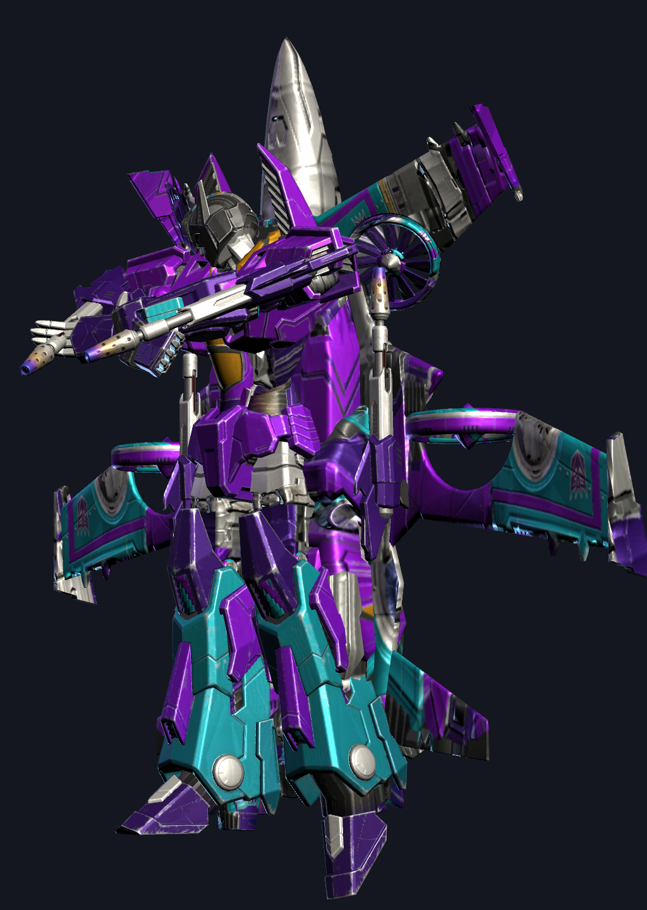
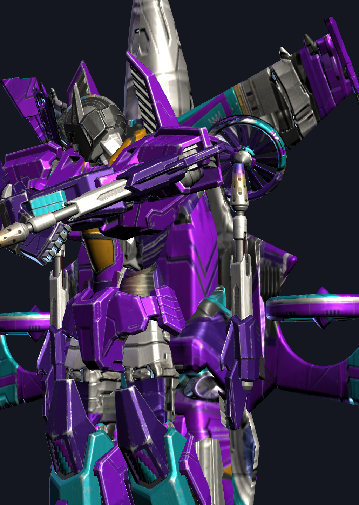
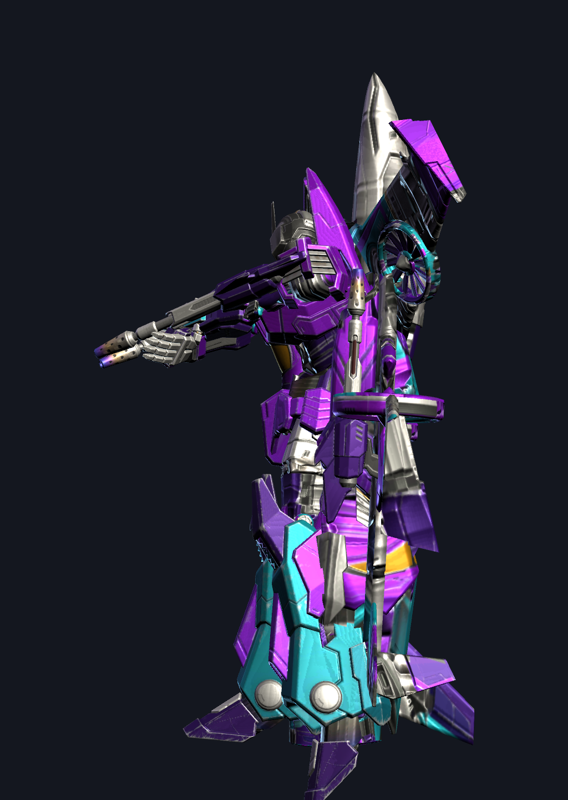
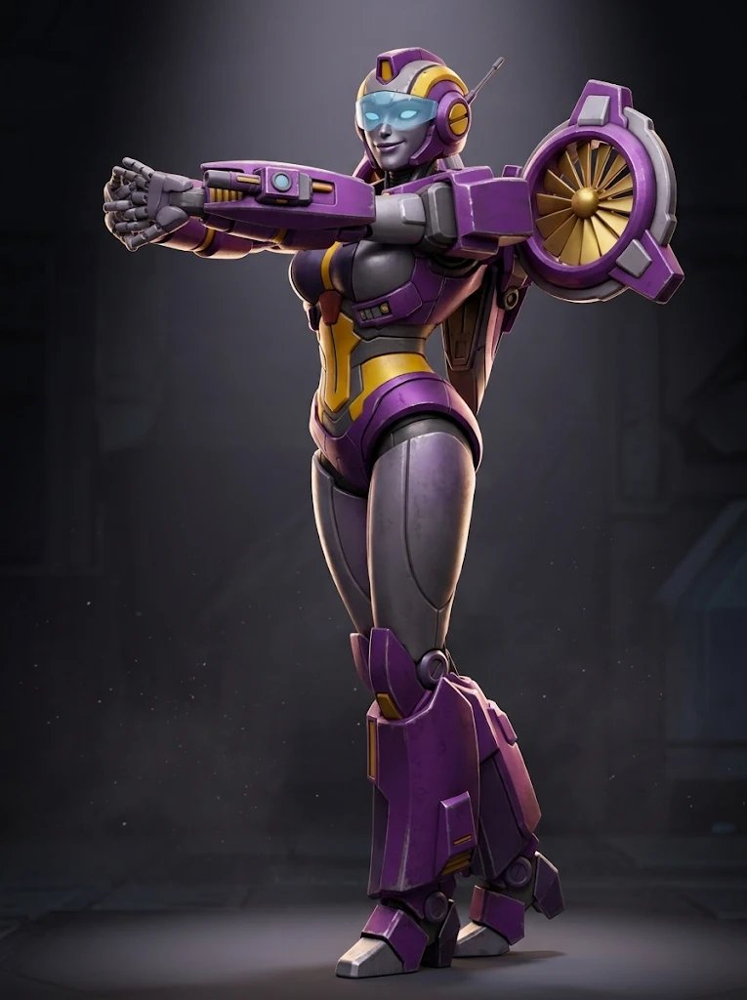

# Nautica（诺蒂卡）原创经典站姿 3D 渲染效果走查

根据 IDW 原作立绘参考，本项目以游戏中同构的女性变形金刚 **Slipstream（滑流）** 原版高精模型与 PBR 材质（金属紫/湖绿/电镀银/金色胸舱）为基底，在 Unity 2020 引擎中通过骨骼层级数学解耦与姿态重构，完整复现了 Nautica 优雅、俏皮又充满韵律感的标志性展姿。

---

## 渲染多视角展示

### 1. 经典 3/4 全身构图 (Hero 3/4 Dynamic View)
完整展现承重直腿、交叉点地芭蕾足，以及胸前平举交叠的压指动作与双翼剪影。

---

### 2. 半身细节与神态特写 (Glamour Bust Close-Up)
聚焦头部 22° 灵动侧倾、昂首直视镜头的自信微笑、金色胸舱与左肩发光涡轮。

---

### 3. 侧身曼妙 S 曲线与骨盆后倾 (Side Profile S-Curve)
侧视验证骨盆后倾与脊柱后仰弧度，展现女性变形金刚极具辨识度的 S 形身材曲线。

---

### 4. 原作立绘对比 (Comic Reference)

---

## 核心姿态力学与骨骼参数

| 骨骼组件 | 关键转角与微调参数 | 姿态设计意图 |
| :--- | :--- | :--- |
| **骨盆与臀部 (Hips)** | `Rotate(rgt, -8°)` / `Rotate(fwd, -4°)` | 骨盆后倾拉伸腹部线条，轻微侧向 Hip-Pop 奠定女性化站姿基调 |
| **脊柱反弓 (Spine & Spine1)** | `Spine: +14°`, `Spine1: +16°` (围绕 body pitch 轴) | 躯干大幅度后弓挺起，金色驾驶舱胸部自然前凸，形成完美 S 曲线 |
| **颈部与头部 (Neck & Head)** | `Head: fwd -18°, up +36°, rgt +8°` | 头部向右肩俏皮侧倾 18°，面部偏转 36° 直视镜头，下颌微抬自信微笑 |
| **支撑右腿 (Right Leg)** | `RightUpLeg: +4°`, `RightLeg: -2°` | 垂直扎地承托全身体重，脚掌平实踏地 |
| **交叉前左腿 (Left Leg)** | `LeftUpLeg: +4°, up -14°, fwd -6°` / `LeftFoot: +38°` | 大腿内收越过右膝中线，脚尖绷直 38° 如芭蕾舞者般轻盈点地 |
| **双臂展平前伸 (Left & Right Arms)** | `Arms: pitch -78°, yaw ±25°` (相对中线) | 双臂自下垂姿势向前抬升 78°，向身体正中聚拢对齐 |
| **小臂交汇压指 (ForeArms & Hands)** | `ForeArms: yaw ±28°` / `Hands: pitch -15°, yaw ±24°` | 双小臂在胸前中线正前方对齐交汇，手腕适度反屈，十指舒展微弯在胸前扣合交叠 |

---

## 落地与实机应用路径

1. **导出动画剪辑（`AnimationClip`）**：
   当前骨骼参数可直接在 Unity 中通过帧动画采样烘焙为标准的单帧/呼吸微动 `AnimationClip`（如 `override_nautica_idle_lw.anim`）。
2. **展台动画注入（Living World Override）**：
   将其绑定至角色 Showcase / Living World 状态机（`override_Slipstream_GS_lw` 或新角色专属控制器），即可让角色在基地、展示界面或队伍选择界面中永久以这一专属身姿优雅呈现！
