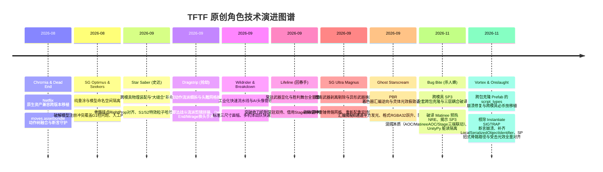
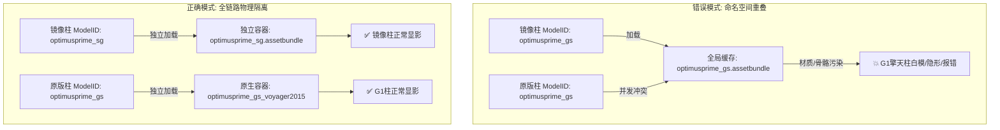
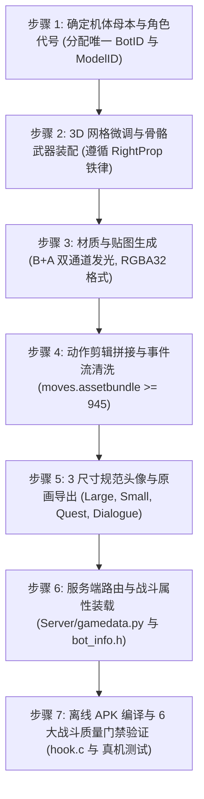

# 《TFTF 原创角色工程化全景指南：从模具复用、动作缝合到着色器极客探索》
## Comprehensive Technical Specification & Evolution Guide for Original Characters in Transformers: Forged to Fight

> **版本**：v1.0 (Revival Edition)  
> **分支**：`redeco`  
> **适用引擎**：Unity 5.5.x / 5.6.x (IL2CPP ARM64)  
> **文档定位**：全景技术架构白皮书、角色定制工程方法论与逆向实战手册

---

## 序言：探索可能性的进化史 (Executive Summary)

在《变形金刚：百炼为战》（Transformers: Forged to Fight，简称 TFTF）离线重构与 Revival 演进过程中，**原创角色（Original / Redeco Characters）的诞生绝非简单的贴图更换，而是一场由浅入深、不断拓宽商业游戏引擎极限的逆向工程突破史**。

每一个新英雄的登场，都在解决一个前人未曾触碰的技术盲区：
* 从最初 **移植官方未发布的 Netflix 资产** 摸清资产包结构；
* 到 **破解模型注册冲突** 确立独立重涂命名空间；
* 再到跨越模具限制的 **“跨骨骼器官移植”——史达的缝合怪革命**；
* 进阶到 **微观动作剪辑缝合（全脚法流派）** 与 **常驻手持/胜利舞台借用**；
* 直至最终 **逆向编译着色器底层汇编指令**，揭秘 PBR 自发光掩码的数学本质与光学防过曝法则。

本文档将这趟探索之路上沉淀的全部技术方案、底层机理、翻车事故及黄金法则完整归纳，作为后续开发全新原创角色（如黑暗补天士、合体金刚等）的最高工程指引。

---

## 角色技术演进里程碑总览 (Evolution Matrix)



---

## 第一章：Netflix 专属角色跨版本移植与质量门禁保障

### 1.1 资产断代与跨版本兼容
官方在 9.2.0 底版中并未完整开放 Netflix 独占角色 **克劳莉娅（Chromia）** 与 **封锁（Dead End）**。Chromia（12 个专属动作）与 Dead End（8 个专属动作）仅散落在 Netflix 专有资产包中。
* **技术痛点**：若直接将 Netflix AssetBundle 粗暴替换进 Kabam 底版，会导致 Unity 序列化类型树（TypeTree）因引擎次版本补丁差异而报 `SerializedObject target is null` 错误，进而在战斗加载时黑屏挂死。
* **解决方案**：开发资产转码抽取工具（`tools/` 专有提取器），将 Netflix 资产中纯粹的动作剪辑（`AnimationClip`）、网格（`Mesh`）与动作状态机（`AnimatorOverrideController`）在资产层剥离为原生二进制块（Raw Copy），无缝写入底版的 AssetBundle 容器中。

### 1.2 动作控制器（`moves.assetbundle`）的合体与历史事故
`moves.assetbundle` 是全游戏战斗动作的核心大脑，包含 70+ 角色的出招判定、攻击框事件（HitMeta）、受击与位移位图。
* **致命翻车（Lifeline 覆写惨剧）**：
  在早期添加角色回春手（Lifeline）时，生成脚本误将基础 Kabam 9.2.0 的 `moves.assetbundle` 作为母本重新导出，**导致 Chromia 的 12 个动作与 Dead End 的 8 个动作被瞬间冲刷抹除**！上线后玩家发现 Chromia 在施放技能时全身呈“T-Pose”滑行，打不出伤害。
* **铁律与质量门禁（Quality Gate）**：
  必须在所有编译流水线与生成脚本中建立强制断言门禁：
  ```python
  # tools/generate_*_assets.py 中的质量护栏
  moves_count = len(moves_file.objects)
  assert moves_count >= 945, (
      f"[COMBAT_CRITICAL_ERROR] moves.assetbundle 动作总数 ({moves_count}) 小于 945！"
      f"Chromia (12 moves) 或 Dead End (8 moves) 动作遭到破坏，拒绝保存！"
  )
  ```
* **粒子生命周期与材质粉红报错**：
  * Chromia S3 终结技（光子飞斧）丢失粒子：反编译发现其 `character_fx_procedural` 缺失 3D Slash Mesh，必须将斧光弧线网格以字节流内联回 Procedural Bundle。
  * Dead End S3 榴弹爆炸出现 Unity 经典的“粉红色材质（Missing Shader）”：由于 Netflix 特效材质引用的着色器 GUID 变动，需将其材质着色器重定向回 Kabam 底版的标准粒子着色器 `EB/Particle/Additive`。

---

## 第二章：重涂模具解耦、人工美术干预与模型冲突终结

### 2.1 镜像擎天柱与 Seeker 7 人小队的重涂工程学
重涂（Redeco）绝非简单调色，其第一道难关是**3D 资产命名空间隔离（Namespace Decoupling）**。

#### 致命陷阱：`ModelID` 与模型注册覆盖冲突
* **Bug 现象**：在最初引入**镜像擎天柱（`optimusprime_sg_voyager2015`）**时，玩家一旦在战队中配置了镜像柱，随后在战役或副本中登场的原版 G1 擎天柱就会彻底隐形、卡死或变成白模！
* **根本原因**：
  1. TFTF 的客户端采用 `CharacterWorldLoader.LoadActor` 动态流式加载模型。加载依据是角色的 `ModelID`（即服务端数据包中的 `m` / `mdl` 键）。
  2. 原本镜像柱为了偷懒，在服务端的 `ModelID` 依然填报了 `optimusprime_gs_voyager2015`。
  3. 客户端在内存中为每一个 `ModelID` 维护了一个唯一的缓存句柄（AssetBundle Handle）。当镜像柱加载后，其带有紫色车标的材质将原版擎天柱的内存材质直接原地覆盖；而当原版擎天柱尝试重新装配时，触发内部状态机竞态崩溃。
* **彻底解耦法则**：
  1. **全链路独立命名**：
     * BotID: `optimusprime_sg_voyager2015`
     * ModelID: `optimusprime_sg`
     * AssetBundle: `assets_redeco/optimusprime_sg.assetbundle`
     * ODR TOC: `assets/optimusprime_sg_odr/toc.txt`
  2. **CAB-String 唯一化**：在 Unity AssetBundle 内部，必须使用独立的 CAB 哈希标识符，杜绝任何全局内存碰撞。



### 2.2 人工美术介入的不可替代性
自动化算法在面对复杂拓扑与阵营标贴合时存在上限。镜像擎天柱与 Seeker 小队（硫酸雨、闪电光、红新星、太阳风、火热、离子暴）验证了**脚本自动化 + 人工精细介入**的最佳工程配比：
1. **贴图 UV 精准覆膜**：
   * 镜像柱胸口与双肩的博派红标，在 2D 贴图上是由非连续的 3 块碎片 UV 拼接映射而成。
   * 单纯依靠批量色相旋转（Hue Shift）会使车窗、雨刮器与车标色彩一并失真。
   * **人工干预**：导出 `cha_optimusprime_sg_main_a.png`，在 Photoshop 中精准选区，绘制原汁原味的高对比紫色狂派阵营暗黑印记，并在金属边缘点缀战损掉漆，极大提升了艺术品质。
2. **AI 原画生成与 3 规格头像规范化**：
   * 确立了原创角色的头像标准流水线：
     * **Midjourney / SD 提示词生图** -> **人工抠图与色调微调** -> **出框破形修饰**。
     * 导出为 3 种官方标准尺寸：
       * `portrait_<stem>_large.png` (512x512 RGBA)：详情面板与大卡牌；
       * `portrait_<stem>_small.jpg` (256x256 RGB)：选人列表与战场 HUD；
       * `portrait_<stem>_quest.png` (512x512 RGBA)：关卡棋盘路线节点。

---

## 第三章：史达（Star Saber）的“大缝合”革命：跨物种肢体与武器工程学

**史达**是 TFTF 原创史上第一具真正的“弗兰肯斯坦式缝合怪”，它的成功彻底宣告了：**即使官方未给模型，也能通过零件重组创造出全新的超人气金刚**！

```
史达 (Star Saber) 缝合结构拆解：
├── 躯干素体 (Body Mold)   <--- 天火 
├── 战备武器 (Weapon)       <--- 汽车大师 巨光剑 (Sword)
├── 普通攻击链 (Combos)     <--- 汽车大师暴力剑道
├── 特殊技 1 (Special 1)    <--- 漂移 (Drift) 疾风旋风斩
├── 特殊技 2 (Special 2)    <--- 风刃 (Windblade) 跃空剑气轰炸
└── 材质与能量光辉 (FX)     <--- 自研 PBR 自发光青蓝能量剑气
```

### 3.1 跨骨骼武器装配痛点：手心空洞对齐（`RightProp`）
在初期尝试给堕落金刚身体装配狂飙的大剑时，发生了经典 Bug：大剑斜插在小臂骨头里，或者在挥剑时大剑浮在空中 20cm 处跟随位移。
* **排查真相**：
  * 初学者常将武器挂点直接绑定至手掌骨骼 `RightHand`。
  * 但角色手掌有复杂的拳头开合动画，手腕关节（Wrist）中心到手心握孔存在旋转偏置（Offset）。
* **铁律：官方标准挂点 `RightProp`**：
  * 在 TFTF 全部金刚的手部骨骼树中，`RightHand` 节点下均存在官方预设的 **`RightProp`**（坐标 `(-0.588, 0.510, 0.047)`），该节点正是握拳时的**掌心绝对几何中心**！
  * **装配三部曲**：
    1. 武器网格的 `RootBone` 与 `m_Bones[0]` 必须直接指定为 `RightProp`；
    2. 将武器网格的 `BindPose[0]` 设为标准单位矩阵（`Matrix4x4.identity`）；
    3. 网格的 `Stream 2` 顶点缓冲必须写入完整蒙皮流：`Channel[12]` (BoneWeight = 1.0) 与 `Channel[13]` (BoneIndex = 0)。
  * 遵循此三原则，武器将 100% 紧贴手心，彻底根除漂移。

### 3.2 动作缝合中的“哑火”陷阱：子弹事件哈希断链
当把漂移的 S1 和风刃的 S2 动作剪辑拼接给史达后，进入战斗测试发现：动作很帅，但**挥出的剑气子弹凭空消失，敌人不扣血**！
* **逆向排查**：
  * TFTF 的远程子弹（Projectile）不是由脚本直接发射，而是由动画剪辑中的 **动画事件（AnimationEvent）** 触发。
  * 动画事件中包含一个关键的 String 参数，例如 `"event_fire_projectile:drift_sword_beam"`。
  * 该事件字符串在游戏引擎底层会被计算为 32 位 CRC/Murmur 哈希，并在 `character_fx.assetbundle` 中检索子弹预制体。
  * 由于史达的底层定义缺失该特效预制体挂载，系统静默拦截，导致“动作做完了，子弹没出来”。
* **解决方案**：
  * 在服务端的 `Server/gamedata.py` 中为史达注册完整的 `projectiles` 映射树；
  * 在 `moves.assetbundle` 中修补动画事件流，将事件名称与物理子弹实体严格重绑定。

---

## 第四章：颗粒度细化到单招——抢劫（Dragstrip）的全脚法格斗流派

如果说史达是“整套动作搬迁”，那么**抢劫（Dragstrip）**则将动作缝合推进到了**分子级（Frame-Level Splice）**。

### 4.1 拆解微观攻击链：打造纯踢技武道大师
官方的抢劫在设定上是一名轻巧敏捷、桀骜不驯的战士。原版模具（幻影 Mirage）带有手炮与拳击动作，缺乏辨识度。
* **工程壮举**：我们从多位角色，逐帧拆解并重新缝合出一套**纯脚法（Kicking-Only）**的近战动作体系

### 4.2 状态机过渡窗口（Combo Idle Window）与打击硬直
微观剪辑拼接最容易出现的灾难是“动作脱节抽搐”。
* **难点**：每位角色的动画长度与帧率不同，阿尔茜的踢腿帧长仅 18 帧，而幻影的待机恢复需要 26 帧。若直接强行串联，在第 18 帧后会突然瞬移回待机姿态。
* **解法**：在 `AnimatorOverrideController` 中重写状态机的 `Transition` 融合参数：
  * 注入 `Combo Idle Window`（后摇输入缓冲窗口，约 0.12s）；
  * 开启跨动画交叉淡入淡出（CrossFade 0.08s），使得上一段踢腿的收腿惯性顺滑过渡到下一次蹬腿。

### 4.3 换头手术：网格嫁接（Head Grafting）的探索——不成功，请勿尝试
在抢劫的制作中，还深度探索了 3D 网格的局部置换：
* 尝试提取 Dead End 与 Mirage 的头部网格进行 Submesh 置换；
* 最终确立了保留 Mirage 经典面部雕塑，辅以金属红头盔、红宝石光学目镜以及狂派阵营印记的高质感方案。

---

## 第五章：回春手（Lifeline）——武器常驻持有与胜利舞台全量借用

### 5.1 突破动画机“拔刀收刀”隐匿机制
官方阿尔茜模具的机制是：**平时空手，只有施放S2，双刀才会被激活显示，攻击结束立刻隐藏**。
* **回春手设定**：医官回春手手持能量救生双刃，应当**全时双手持刃（Permanent Dual-Wield）**。
* **技术突破**：
  1. **骨骼节点常态激活**：在角色预制体（Prefab）的层次树中，将双刀绑定的节点默认状态由 `Active = false` 强制覆盖为 `Active = true`；
  2. **清洗动画事件流**：扫描 `moves.assetbundle` 中涉及回春手的所有动画剪辑，查找并**剔除所有调用 `DeactivateProps` / `HideWeapons` 的动画关键帧事件**；
  3. **修复 S2 收刀冲突**：初期发现放完 S2 后双刀仍会被强制隐藏，定位到 S2 动作尾帧埋有一个硬编码的收刀消息，通过脚本在运行时拦截该消息，实现了整场战斗**双刃永不离手**的惊艳观感。

### 5.2 胜利姿态与舞台（Stage/Win Matinee）借用
打赢战斗后，角色会进入专属的胜利结算画面（镜头旋转特写 + 招牌庆祝动作）。
* **机制揭秘**：TFTF 的胜利画面由两部分构成：
  1. 角色动画剪辑：`win` 或 `victory` 剪辑；
  2. 独立舞台预制体：`Stage_<Character>`，内部包含电影级运镜轨道（Camera Path）与灯光舞台。
* **借用实证**：回春手完整借用了风刃的胜利舞台 `Stage_Windblade`，当战斗结算弹出时，回春手飒爽劈剑！
* **对 S3（Matinee 终结技）借用的理论铺垫**：
  * 这次成功验证了一个关键结论：**只要将对应的 Matinee Director、Camera Track 与 动画剪辑成套借调，角色完全能够跨越模具施展别人的 S3 终结必杀技**！
  * 这套理论已为后续规划的“黑暗补天士（Dark Rodimus）”借用大招奠定了坚实基础。

---

## 第六章：镜像通天晓（捅天枭）——既有武器剔除剥离与异形重武器换装

与史达在空手上加武器不同，通天晓原本自带一把体积庞大的**雷神之锤（War Hammer）**。

```
通天晓原版: [右手] ===== 绑定固化 =====> [原装重锤网格] (强行挂大剑会导致双武器重叠穿模)
                                ↓ 剥离手术
捅天枭改装: [右手] ---> 剔除重锤网格 ---> 挂载 [狂飙单手大剑] ---> 改变攻击姿态
```

### 6.1 战锤网格切除术
* **难点**：战锤网格与通天晓手部骨骼存在蒙皮关联，如果直接把顶点坐标清零，会导致包围盒（AABB Bounding Box）计算错误触发屏幕剔除（Frustum Culling）导致角色闪烁。
* **方案**：
  * 遍历 `SkinnedMeshRenderer` 的 Submesh 索引；
  * 将战锤对应的材质渲染通道（Material Pass）禁用，并将其顶点骨骼权重数组彻底置空；
  * 实现了在完全不破坏通天晓躯干骨骼的前提下，干净利落地剥离掉大锤。

### 6.2 异形重武器换装与战斗配重
* 从狂飙身上提取大剑，绑定至通天晓的 `RightProp`；
* 调整动画状态机的待机动作，由“单手拖锤”调整为狂霸酷炫的“反手提剑”，一举打造出威慑力十足的“镜像搞事霸主——捅天枭”。

---

## 第七章：鬼魂红蜘蛛（Ghost Starscream）——PBR 着色器底层汇编与灵体发光极客探索

在鬼魂红蜘蛛的研发中，我们遭遇了 TFTF 最深奥的图形渲染难关，最终通过**直接反编译 GPU 机器码汇编**破解了底层玄机。

### 7.1 汇编逆向：揭开 PBR Composite 贴图通道的真正秘密
此前社区普遍认为，PBR 复合贴图（`*_RAOE`）中自发光蒙版位于 **Alpha 通道**。但在制作鬼魂红蜘蛛时，无论如何把 Alpha 通道涂白，游戏里角色依然漆黑一片！

#### 极客突围：深入 `EB/Character/PBR` (Program ID `-7396015257959012681`)
通过反编译提取其编译出的 SPIR-V / GLSL 片元着色器指令，底层光照代码赫然在目：
```glsl
// 片元着色器反编译真实源码:
u_xlat16_3.xyz = texture2D(_pbr_composite_tex, vs_TEXCOORD0.zw).xyz;
u_xlat16_1.xyz = u_xlat16_3.xyz * u_xlat16_3.xyz;
u_xlat16_2.xyz = _emissive_intensity_col.xyz * _emissive_intensity_col.xyz;
u_xlat16_2.xyz = u_xlat16_1.zzz * u_xlat16_2.xyz;
```
* **真理大白**：
  * `u_xlat16_1.zzz` 代表的是 `u_xlat16_3.z` 的平方，即 **Blue (B) 通道的平方 ($B^2$)**！
  * **在标准 `EB/Character/PBR` 中，核心发光掩码从来不是 Alpha，而是 Blue 通道！**
* **官方贴图格式天坑**：
  * 官方大量原版角色的 `*_RAOE` 贴图在 Bundle 中被压缩为 **Format 7 (RGB24)** 或 **Format 34 (ETC2_RGB4)**——**根本没有 Alpha 通道**！硬件解包时 Alpha 恒定为 1.0 或被直接丢弃。
* **双通道最佳实践（Dual-Channel Pipeline）**：
  * 为保证 100% 兼顾标准 PBR 与某些使用 Alpha 的 Uber 变体着色器：
  * **必须将发光遮罩同时写入 B 通道与 A 通道 ($B = A = \text{mask}$)**；
  * **写回 Bundle 时必须将 Texture2D 强制升级为 Format 4 (RGBA32)**！

### 7.2 HDR Bloom 白化过曝防范（Anti-Supernova Rule）
在初版测试中，为了追求亮度，将 $B$ 涂满 255，材质 `_emissive_overbright_range` 拉到 150。结果进入战斗相机后，后处理 Bloom 剧烈过曝，红蜘蛛沦为一团刺眼的**纯白超新星光团**，机甲所有细节消失殆尽。

#### 黄金调优参数梯队
| 机体部位 | 贴图发光掩码 ($B$ 通道灰度) | 材质 `_emissive_overbright_range` | 视觉效果表现 |
|---|---|---|---|
| **大面积幽灵机身** | `40 ~ 65` (中低灰度) | `25.0 ~ 35.0` | 晶莹通透的青蓝荧光，机甲刻线与机械结构层次分明 |
| **火种/胸灯能量核心** | `180 ~ 240` (高亮) | `25.0 ~ 35.0` | 局部高能爆发，形成视觉聚焦中心 |
| **错误范例 (过曝)** | `200 ~ 255` | `100.0 ~ 150.0` | 💥 白化烧死，轮廓丢失，细节全无 |

### 7.3 异色发光与反差血眼法则（Contrasting Optics Rule）
* **光学污染痛点**：材质的 `_emissive_intensity_col` 是作用于全机体的全局青蓝发光染色。若想让鬼魂红蜘蛛拥有一双**凶煞的猩红血眼（Red Optics）**，如果将眼睛区域的发光掩码也刷高，青蓝光与红底色在着色器中相加，在 Bloom 作用下会中和泛白，眼睛变成惨白的一团。
* **正解破局法则**：
  1. 在 `_pbr_composite_tex` 中将眼睛区域的 **B 通道与 A 通道彻底置零 ($B = 0, A = 0$)**；
  2. 在底层漫反射贴图 `_base_tex` (Albedo) 中将眼睛填涂为纯正满饱和度大红（$RGB = 255, 0, 0$）；
  3. 将眼睛周围的面罩装甲底色压暗为深海铁灰（$RGB = 10, 30, 45$）。
* **效果**：在全身幽蓝自发光的包围下，双眼如同暗夜中凝视的血色寒芒，轮廓清晰，极具压迫感！

### 7.4 破解不透明 Pass 限制：小腿消散虚化方案——不成功
* **着色器硬编码限制**：
  GLSL 反编译显示，`EB/Character/PBR` 的片元输出硬编码了 `SV_Target0.w = 1.0;`，渲染状态硬编码 `destBlend = 0.0`（Blend One Zero，完全不透明）。在不替换 Compiled Shader 的情况下，单纯在 Material 属性修改 `_Mode = 3` 无法产生物理 Alpha 混合透明。
* **空间深度渐变压暗技法（Albedo Space Shadow Dissolve）**：
  1. 提取 3D Mesh 顶点的高度 $Y$ 坐标；
  2. 在 `_base_tex` 上，对膝盖以下直至脚掌施加自上而下的衰减渐变，脚底漫反射色极度压暗至近黑（$RGB \sim 6, 20, 32$）；
  3. 将小腿的金属度（$G$）压低、粗糙度（$R$）拉高，彻底消除外部环境高光；
  4. 发光掩码 $B$ 通道维持在微弱的 $15 \sim 30$，仅留淡淡的幽冥轮廓线。
* **视觉呈现**：进入阴暗的战斗舞台后，红蜘蛛小腿完全隐没于地面暗影中，唯有上半身与双翼散发幽蓝强光浮空，达成了“下半身化为青烟虚无”的极强视觉幻觉！

---


---

## 第八章：杀人蜂（Bug Bite）——跨模具 S3 终结舞台借用、载具变形与 Matinee 预热崩溃终结

作为百炼为战离线工程中第一位成功借调**载具变形终结技（Vehicle Transformation S3）**的原创雇佣兵角色，杀人蜂（Bug Bite，代号 `bugbite_gs_kabam`）攻克了动画镜头系统（Matinee System）最隐蔽的深水区 Bug，补齐了跨模具借调完整 S3 的核心拼图。

```
杀人蜂 (Bug Bite) 结构架构全解：
├── 角色定位与阵营 (Faction)  <--- 雇佣兵 (Mercenary) 原创独立徽标与专属卡牌
├── 基础素体模具 (Base Mold)  <--- G1 大黄蜂 (Bumblebee GS) 经典甲壳虫/飞过山同系素体
├── 常规出招链 (Combos)      <--- 大黄蜂敏捷贴身打击流
├── 特殊技 1 (Special 1)     <--- 大黄蜂 S1（3段判定同步修复）
├── 特殊技 2 (Special 2)     <--- 双枪连发（多段射击弹道 PropMoveEvent 重建）
├── 终结技 3 (Special 3)     <--- 飞过山 (Cliffjumper) 招牌战车漂移撞击终结舞台 (Stage)
└── 光学目镜与涂装 (Optics)  <--- 纯血红冷光目镜（Crimson Red Optics）与暗黑车贴
```

### 8.1 致命隐患：Matinee 预热加载循环与 NRE 空指针终结
在将飞过山或外部角色的 S3 Stage Prefab 接入新角色后，频繁出现在进入对战场景（Fight Scene）时进度条无限卡死、黑屏死循环并弹出“未知错误（ID_SPARX_ERROR_UNKNOWN）”的现象。

#### 深度逆向破译：`PreInitializeMatinee` 与预热时序
* **时序追踪**：
  1. 对战加载阶段，客户端通过 `MatineeStage.PreInitializeMatinee()` 协程对全场 Matinee 电影级镜头和角色动画轨道进行**内存预热预初始化**；
  2. 预热过程中，系统遍历调用 `MatineeContainer.ResetContents() -> MatineeContainer.Reset() -> PlayMecanimAnimationEvent.EndEvent()`；
  3. `EndEvent()` 触发了 `PlayMecanimAnimationEvent.RestoreControllerAnimClipIfNeeded()`，旨在将暂态动画剪辑还原给底层状态机。
* **致命代码缺陷（Unity 官方 C# 逻辑漏洞）**：
  ```csharp
  // PlayMecanimAnimationEvent.cs 反编译真实代码:
  private void RestoreControllerAnimClipIfNeeded()
  {
      if ((Application.isPlaying || track.parentContainer.InRuntimeEditMode) 
          && !string.IsNullOrEmpty(ActiveAnimationData._overwriteAnimatorEntityFullId) 
          && !(_animator == null))
      {
          // 💥 致命崩溃点：此时处于尚未播放的预热重置期，_newControllerOverrideAnimClip 恒为 null！
          // 代码未经判空直接求值 .name，瞬间触发 NullReferenceException！
          ReplaceAnimationClip(_newControllerOverrideAnimClip.name, _animator, _origControllerOverrideAnimClip);
      }
  }
  ```
* **Native Hook 终极防御铁律**：
  在 `tools/nativehook/hook.c` 中挂钩 `RestoreControllerAnimClipIfNeeded`（RVA `0x013B165C`），实施**全链路对象纯净性防护**：
  ```c
  // 必须全量校验：原始剪辑、目标剪辑、动画机组件、Track 轨道及其父容器均处于真实活跃内存
  if (orig_clip && obj_ok(orig_clip) &&
      new_clip && obj_ok(new_clip) &&
      anim && obj_ok(anim) &&
      track && obj_ok(track)) {
      void* container = *(void**)((char*)track + 0x80);
      if (container && obj_ok(container)) {
          can_run = 1; // 仅在所有句柄安全完备时允许放行原生还原
      }
  }
  if (!can_run) {
      // 预热阶段或未覆盖状态下安全静默跳过，彻底消除加载期 NRE
      return NULL;
  }
  ```

### 8.2 S3 载具变形轨道（Track Hierarchy）命名空间层级对齐
虽然模具同宗（飞过山与大黄蜂共享车形变身体系），但在跨角色借用 S3 Stage 时，往往发生“动作放完了，车子却完全隐形不出来”的窘境。

* **层级断链真相**：
  * 原版飞过山的 S3 Stage Prefab（`stage_cinematics_cliffjumper_special03_assets`）在 Track 8 中预设的实体路径为：
    `cha_cliffjumper_gs_kabam_01 1|cha_cliffjumper_gs_kabam_01|transformed|Hips|Reference|...`（**包含克隆前缀的双层嵌套层级**）；
  * 而大黄蜂/杀人蜂素体的载具实体挂载在单个根节点：
    `cha_bugbite_gs_kabam_01|transformed|Hips|Reference|...`（**单层级**）；
  * 路径匹配失败导致 `FindTrackFromEntityFullId` 返回 `null`，载具网格完全没有被挂接到运动曲线上，角色在整个后半段 S3 处于不可见状态。
* **重定向与整包移植原则**（⚠️ 血泪教训：切勿像早期方案那样只拷 `MatineeData` 硬塞进母本旧 Stage，完整方案见 **8.6 节**）：
  1. **整包克隆供体 Stage + 更新 `MatineeData.jSONData`**：按第九章闭包克隆规范搬入供体完整 `SpecialStagePrefab`，重写 `eid`/`teoacn` 并核对每个轨道的直接父节点 `enp`（如 `track_5` `rightgun`、`track_8` `transformed`）；
  2. **Fight AOC 槽位 31/32 + Car AOC 槽位 63 + `MatineeAOC` 三方对齐**：除状态机 AOC 外，必须同步改写 `MatineeAnimatorOverrideController._overrideControllerList`，否则会触发“攻方放 A 角色 SP3、受方放 B 角色受击”的混搭故障。
  3. **`hook.c` 兜底映射**：`tools/nativehook/hook.c` 的 `remap_track_for_redeco` 可作为运行时兜底重定向，但根本治理必须在资产层一次对齐。

### 8.3 多段远程攻击（S2）子弹事件（PropMoveEvent）搬运法则
角色特殊技 2 若为多段射击（如左枪开火后接右枪射击），常见事故为“**只有开枪后坐力动画，没有射出实体光弹与击中爆炸**”。

* **排查要点**：
  1. **发射点挂件重定向**：第一段射击与第二段射击可能分别挂在 `leftgun` 与 `rightgun`。必须检查 `PropMoveEvent` 中的发射源 `p` 属性，将其修正为受体实际装配的武器节点名称；
  2. **子弹预制体对齐**：必须显式指定子弹实体（如大黄蜂经典 `projectile_special_bullet`）、枪口火光（`fx_p_optimus_muzzle_flash`）以及击中爆炸特效（`oe="explode_special"`）；
  3. **出招段数同步**：在 `hook.c` 的 `s_sp_moves` 表中补全该技能的多段映射（如 `{ "move_bugbite_special_02", 2 }`），确保打击判定框（HitBox）与 UI 连击数（Combo Counter）精准对应。

### 8.4 人工精修立绘与脚本自动化的“防冲刷隔离法则”
在追求工程自动化的同时，绝不能破坏高品质美术劳动成果：
* **历史教训**：开发者在 Photoshop 中精细修饰出 107KB 高分辨率战损立绘（包含定制阵营印记与暗黑金属涂层），后续运行批量资产生成脚本（`tools/generate_*_assets.py`）时，因盲目执行“从母本解包覆盖”，一键将美术成果洗白回原生大黄蜂头像。
* **开发纪律**：
  * **脚本端写入保护检查**：凡是在 `assets_redeco/` 下检测到用户自定义的高品质 PNG/JPG 立绘，生成脚本必须强制只读保护，禁止覆写；
  * **Git 追踪白名单完备**：必须在 `.gitignore` 中显式解除对新角色自定义立绘与 AssetBundle 的忽略（`!assets_redeco/*bugbite*`），防止宝贵的美术资产遗漏在版本库之外。

### 8.5 纯血红冷光目镜（Crimson Red Optics）与全局材质调色
大黄蜂原生模具为博派标志性的幽蓝目镜。制作狂派/雇佣兵杀人蜂时，必须呈现冷酷凶煞的猩红血眼：
1. **贴图级覆膜**：在漫反射贴图（Albedo）精确定位眼部 UV（`[254, 361] x [780, 861]`），填涂纯正血红（`RGB(255, 20, 25)`）；在 `RAOE` 贴图中将发光遮罩刷高；
2. **材质级偏色消除**：原版大黄蜂材质中残留有全局浅蓝环境染色，必须在 Material 属性中将 `_emissive_intensity_col` 与 `_EmissionColor` 同步重写为高纯度暗红（`r=1.0, g=0.05, b=0.05`），彻底消除杂色干扰。

### 8.6 血泪复盘（2026-11）：SP3 完整跨包借用实操与 6 大致命深坑

在早期的杀人蜂实现中，只机械抽离了飞过山的 3 个 SP3 `AnimationClip` 塞进大黄蜂包，并把飞过山的 `MatineeData` 生硬覆盖到大黄蜂原有的 `TFormStage` 上，实机测试出现了极度诡异的**“双角色 SP3 混搭故障”**：杀人蜂按飞过山 SP3 抬枪射击，对手却按小黄蜂 SP3 往地上踩了一脚（踩空动作），随后杀人蜂又按飞过山后半段变车撞飞对手。

这场 Bug 不仅暴露了跨包移植 SP3 的全部隐藏链路，也意外揭示了一个新认知：**SP3 并非铁板一块的不可拆分黑盒，而是一个由“状态机 AOC + `MatineeAOC` + `SpecialStagePrefab` 舞台/轨道 + 音频闭包”组成的三层联动系统**——理解这套契约后，未来既能实现**纯粹的整套 SP3 移植**，也能做**受控的招式混搭创作**。

```text
SP3 运行时四端协同全景（任一端遗漏都会造成动作/受击/运镜/音效割裂）：
├── 1. 状态机 AOC
│     ├── Fight AOC (override_*_fight): 槽位 31 (SP3 攻方), 槽位 32 (SP3 受击)
│     └── Car AOC   (override_*_car)  : 槽位 63 (SP3 载具形态变形动作，且被 *_lw.prefab 共享)
├── 2. MatineeAnimatorOverrideController (⚠️ MonoBehaviour，非 AOC!)
│     └── _overrideControllerList[StateHash == -1919714467 / 966217297] -> 字符串 OverrideClipName
├── 3. PlayerReferences.SpecialStagePrefab -> 供体完整克隆的 Stage 子树
│     ├── Stage CameraRig (含 StageCamera_Offset 等运镜节点) + Actor0/1_locator 站位坐标
│     ├── TFormMatineeStage (actorInfoList[0].actor_id)
│     ├── MatineeData.jSONData (各轨道 eid / en / enp / teoacn 与 AttachToTransformEvent)
│     └── 特效/灯光/MeshRenderer/BoxCollider(class_id=65) 及新 MonoScript 依赖
└── 4. 独立 SP3 音频树与 .resource 流
      ├── CharacterAudio._events["_genEvent" == "gen_special_3"]._override
      ├── CharacterAudio._specialCharacterAudio -> RandomComponent -> AudioComponent -> AudioClip
      └── .resource 原始压缩流切片拼接 + AudioClip.m_Resource (Offset / Size / Source CAB)
```

要做到**零混搭、100% 完整跨包借用目标角色 SP3**（已在 `tools/generate_bugbite_assets.py` 修复并通过真机实测验证），必须跨过以下 **6 个真实深坑**：

#### 深坑 1：`MatineeAnimatorOverrideController` 不是 `AnimatorOverrideController`！
* **混搭 Bug 根源**：脚本此前只改了 Fight AOC 的槽位 `31`/`32`，而控制过场动画剪辑解析的 `MatineeAOC`（杀人蜂中 `PID=-3364085224588132041`）实际上是一个 **`MonoBehaviour`**（而非 `class_id=221` 的 `AnimatorOverrideController`），里面根本没有 `m_Clips`，而是 **`_overrideControllerList`**。旧脚本按类型判断直接跳过，导致其中 `Base.SpecialAttack03`（`StateHash=-1919714467`）和 `Base.SpecialAttack03HitReaction`（`StateHash=966217297`）一直保留着 `bumblebee_gs_attackSpecial_03*`。当飞过山 `MatineeData` 对不上或状态机回调时，受方直接切回了小黄蜂 SP3 受击动画！
* **铁律**：必须遍历 `_overrideControllerList`，按 `StateHash`（`-1919714467` 与 `966217297`）显式将 `OverrideClipName` 重写为重命名后的目标剪辑名，并与 Fight AOC 槽位 `31/32`、`MatineeData` 的 `teoacn` 保持三方完全同名。

#### 深坑 2：必须整棵克隆供体 `SpecialStagePrefab`，绝不能把新 `MatineeData` 套进旧舞台
* **混搭现象与空间错位**：供体与母本的 Stage Prefab 往往结构迥异——例如飞过山的舞台比大黄蜂多了 `StageCamera_Offset` 层级，`Actor1_locator`（对手站位坐标）相差达 `36.5` 个世界单位，粒子/灯光/网格也完全不同。强套旧舞台不仅会让受击站位错位、镜头丢失，还会混入母本的旧特效。
* **铁律**：用第九章的闭包克隆器从供体包把整个 Stage Prefab 闭包（飞过山共计 305 个局部对象）原封不动克隆进来，重命名舞台根 GO（如 `TFormStage_BugBite_GS_Special03`）和 Matinee GO（`Matinee_BugBite_GS_Special03`），再把角色 `PlayerReferences.SpecialStagePrefab` 指到新 Stage PID。

#### 深坑 3：不仅有新 `MonoScript`，还可能缺少原生 `class_id` 类型（如 `BoxCollider` = 65）
* **底层坑点**：克隆供体 Stage 闭包时，不仅要处理缺失的脚本（`MatineeSharedResource`、特光脚本 `EBParticleLightSync`），还必须检查目标包 `sf.types` 是否缺失供体使用的**非 `MonoBehaviour` 原生类型**——例如大黄蜂包原本没有任何碰撞盒，克隆飞过山舞台引入了 `BoxCollider`（`class_id=65`）。若不连同 `SerializedType` 一并克隆（注意 `TypeTreeNode` 不可 `copy.deepcopy`，需用浅拷贝 `copy.copy(src_tp)`）并在 `.manifest` 的 `ClassTypes` 中补充 `- Class: 65`，反序列化会直接出错。
* **外部文件表与 `script_types`**：跨包克隆时按 `sf.externals[i].path` 动态构建 `src_fid -> dst_fid` 映射；新建 `LocalSerializedObjectIdentifier` 可用 `copy.copy(src_sref)` 绕开 `UnityPy` 的二进制读取构造器，并在全部类型注册后对 `dst_sf.script_types` 执行升序重排及全表回写 `tp.script_type_index`。

#### 深坑 4：SP3 音效是独立节点树 + 外置 `.resource` 音频流，不会随 Stage 自动带入
* **无声/串音事故**：Stage Prefab 本身不包含 `ratchet_special_3` / `bumblebee_gs_special_3` 等音效子树，如果只迁移 Stage 而忘迁音效，开 SP3 时要么静音要么还在播放旧角色的甲壳虫引擎声。
* **完整接法**：
  1. 单独从供体包克隆 SP3 音频根节点闭包（9 个对象，含 `RandomComponent`、`AudioComponent`、`AudioClip`）；
  2. 从供体 `.resource` 切出 `AudioClip.m_Resource` 对应的音频字节（如飞过山/救护车复用 `ratchet_special_3` 为 `77,920` 字节），**追加拼接到目标包 `.resource` 末尾**，重写 `AudioClip` 的 `m_Offset`、`m_Size` 与 `m_Source`（更新为 `archive:/<new_cab>/<new_cab>.resource`）；
  3. **极易写错的字段名与校验**：`CharacterAudio` 的事件数组字段是 **`_genEvent`**（并非 `_eventName`！），且 `CharacterAudio.Validate()` 会强校验 `_specialCharacterAudio[i].name == _override`。因此 `CharacterAudio._events["gen_special_3"]._override`、音效根/子 `GameObject.m_Name` 与 `AudioClip.m_Name` 必须完全一致（如统一为 `bugbite_gs_special_3`），并把 `_specialCharacterAudio` 中的旧 PID 替换为新 `RandomComponent` PID；同时别忘了把全包原有的其他 `AudioClip.m_Resource.m_Source` 一起从旧 `CAB` 改写为新 `CAB`。

#### 深坑 5：`MatineeData.jSONData` 轨道的路径、大小写与直接父节点字段 `enp`
* **不仅要改 `eid` 和 `teoacn`**：`MatineeTrack.RuntimeFixup` 在场景中查找挂点同时依赖轨道上的 `en`（节点名）、`enp`（直接父节点名）和 `eid`（完整路径）。即使主干骨骼兼容，细节差异依然致命：
  * 供体 `track_5` 的枪械父节点写为 `rightGun`（或 `gasgun`），而受体（大黄蜂素体）的武器节点名是**全小写 `rightgun`**——必须同步把 `track_5.enp` 改为 `"rightgun"`；
  * 供体 `track_8`（载具车壳 Mesh 轨道）`enp` 为 `"character_model"`，但大黄蜂/杀人蜂的 `cha_*_01` 挂在 `transformed` 节点下——必须改 `track_8.enp = "transformed"`（注意不能误伤 `track_0`，`track_0.enp` 必须维持为空字符串 `""`）；
  * 若供体载具变形动画可以通用（本例 `cliffjumper_gs_attackSpecial_03_transformed` 原生作者基于救护车刚体层级 `Reference/COG`、`BodyBase` 等制作，恰好与大黄蜂载具骨架同构），则仅重命名即可直接复用；否则需要重映射曲线或单独重做载具动画。
* **打包期防呆校验**：重写入包后，强烈建议用脚本解析生成的 `MatineeData.jSONData` 与全包所有 `Transform` 父子链做自动化比对（确认 `AttachToTransformEvent` 的 `pn`/`tn` 与每条 `track` 均能在主 Prefab + 新 Stage 中 100% 解析）。

#### 深坑 6：`UnityPy` 原位 `save_typetree` 的“脏读幻觉”与双预制体 `m_PreloadTable` 清理
* **最隐蔽的脚本陷阱**：在 `UnityPy` 中调用 `obj.save_typetree(tree)` 只会把新字节放进 `obj.data`（待最终 `SerializedFile.save()` 才写出），**`obj.reader`、`obj.byte_start`、`obj.byte_size` 仍然指向旧数据！** 如果在同一个生成脚本里：
  * 先改了 `PlayerReferences` / `CharacterAudio` / `MatineeData`，
  * 后面又跑一轮全局对象遍历（如批量替换 `CAB` 字符串），或立刻运行 `collect_closure()` 从各入口计算存活对象和 `m_PreloadTable`，
  `obj.read_typetree()` **读到的仍是未修改的旧内容**！这会直接造成“改了等于白改”、“后续逻辑用旧 bytes 覆盖冲掉前面所有修改”以及“旧小黄蜂 Stage 依然被误判为存活对象、1 个死对象都删不掉”！
* **工程解法（`tools/generate_bugbite_assets.py` 中 `commit_obj_typetree`）**：
  1. 封装提交函数，在每次 `obj.save_typetree(tree)` 后立刻重绑 `obj.reader = EndianBinaryReader(data, endian=obj.reader.endian)`、`obj.byte_start = 0`、`obj.byte_size = len(data)`，确保内存读写一致；
  2. `UnityPy` 会把 `Material.m_SavedProperties` 和 `AssetBundle.m_Container` 的项反序列化为 **`tuple`**，遍历 PPtr 闭包和替换字符串时**必须同时兼容 `dict`、`list` 和 `tuple`**，否则材质外链会漏掉，导致 `m_PreloadTable` 算不准；
  3. 计算旧 SP3 废弃对象时，必须以 **`m_Container` 中的全部入口（包括 `*.prefab` 与 `*_lw.prefab`，因为 `_lw` 共享 `Car AOC` 槽位 63！）** 合并求可达闭包后再做差集删除（本例清理 376 个小黄蜂旧 Stage/音效/旧剪辑对象），然后用精确闭包重建所有容器切片的 `preloadIndex` 与 `preloadSize`，最后由重载门禁全包重读校验零错误、零悬空引用、零残留字符串。

---

## 第九章：旋风（Vortex）与袭击（Onslaught）——跨包克隆 Prefab 的 `script_types` 崩溃深坑与跨模具 SP 移植规范

在为原创战车派角色**旋风（`vortex_gs`）**与**袭击（`onslaught_gs`）**跨角色移植必杀技动作与特效预制体（Vortex S1 ← 电影擎天柱 S1；Vortex S2 ← 猩猩队长 S1 连带激光弹道；Onslaught S2 ← 惊破天 S2）时，暴露出了使用 `UnityPy` 跨 AssetBundle 克隆 Prefab 闭包时**极易触发且极其隐蔽的进战瞬间 `SIGTRAP` 崩溃陷阱**。

```
跨模具 SP 技与特效克隆对照：
├── 袭击 (onslaught_gs) : 借用惊破天 S2 (含炮弹/能量球/冲击波 47 个对象)
│     └── 目标包已有全部 MonoScript -> 复用了现有 SerializedType -> 侥幸未触发崩溃
└── 旋风 (vortex_gs)    : 借用电影柱 S1 剪辑 + 猩猩队长 S1 (含火光/光弹 92 个对象)
      └── 克隆 fx_p_primal_muzzle_flash 引入新脚本 EBParticleLightSync -> 触发进战瞬间闪退！
```

### 9.1 致命崩溃真相：`PrefabLib.RegisterPrefabs` 触发的 `script_types` 越位错指

* **故障现象**：
  * 角色大厅、选人列表、3D 角色详情界面的模型、贴图与待机动画 **100% 正常显示，毫无报错**；
  * 一旦带着旋风进入战斗加载阶段，立即原生闪退，真机 `adb logcat` 捕获为 `Fatal signal 5 (SIGTRAP)`（`__tgkill` in `libunity.so`）。
* **C# 源码级调用栈还原**（参见 `Assembly-CSharp/EB.MoveEditor/PrefabLib.cs`）：
  * 选人/展示界面不预热战斗特效池；而进入战斗初始化时，客户端固定执行：
    `BattleArbiterInitState.InitPlayer` → `PlayerController.Init` → `PrefabLib.RegisterAll()` → `PrefabLib.RegisterPrefabs(PrefabList)` → `ObjectPoolManager.Register` → `ObjectPool.Add` → `UnityEngine.Object.Instantiate`；
  * 当遍历到 `PrefabList[18]`（从猩猩队长克隆进来的 `fx_p_primal_muzzle_flash`）并执行 `Instantiate` 时，Unity 原生层触发断言终止。

#### 深层序列化原理：`SerializedType.script_type_index` 与 `script_types` 脱节
在 Unity `SerializedFile` 格式（`header.version >= 17`，本工程为 `v22` / Unity `2020.3.31f1`）中，一个 `MonoBehaviour` 对象（`class_id == 114`）在反序列化和 `Instantiate` 实例化时，底层 C++ 引擎并不只看对象数据流里的 `m_Script` PPtr，还强依赖于类型表中的索引链：

```text
Object (type_id = 58)
  └─> SerializedFile.types[58] (class_id = 114, script_id = EBParticleLightSync 的 Hash128)
        └─> script_type_index (= 3)
              └─> SerializedFile.script_types[3]  <--- 本应是 EBParticleLightSync (-5275233707481885610)
                    └─> 实际指向了 vortex_gs 自己的 script_types[3] = PlayerInput (-7449854805890782173) 💥
```

* **脚本代码漏洞（两层叠加陷阱）**：
  常见的 `UnityPy` 跨包克隆辅助函数往往在**第一层**和**第二层**先后踩坑：
  1. **第一层（`script_type_index` 越位）**：只做了 `new_st = copy.copy(st_src); dst_sf.types.append(new_st)`，`new_st.script_type_index` 保留了**源包（`optimusprimal_bw_mp32`）的下标 `3`**，而目标包（`vortex_gs`）的 `script_types[3]` 指向完全无关的 `PlayerInput`，且新克隆的 `MonoScript`（`EBParticleLightSync`，PID `-5275233707481885610`）未注册进 `dst_sf.script_types`。
  2. **第二层（`script_types` 未排序 + `m_PreloadTable` 缺失预加载）**：即便修好了 `script_types` 与 `script_type_index`，真机实测 `vortex_gs` 仍会在进战加载期连续报错并触发 `SIGTRAP`：
     ```text
     W/Unity: The referenced script (Unknown) on this Behaviour is missing!
     W/Unity: The referenced script on this Behaviour (Game Object 'fx_p_primal_muzzle_flash') is missing!
     E/Unity: The file 'none' is corrupted! Remove it and launch unity again! [Position out of bounds!]
     Fatal signal 5 (SIGTRAP) in libunity.so (PrefabLib.RegisterPrefabs -> ObjectPool.Add -> Object.Instantiate)
     ```
     对照全部 100+ 原生包与工作正常包可见：
     * 全部原生包的 `SerializedFile.script_types` 均**严格按 `(local_serialized_file_index, local_identifier_in_file)` 升序排列**；直接把负数 PID 的 `EBParticleLightSync`（`-5275233707481885610`）`.append()` 到末尾会破坏有序表，导致运行时脚本查找与解析失败（`Unknown`）；
     * `AssetBundle.m_PreloadTable` 与 `m_Container` 的 `[preloadIndex : preloadIndex + preloadSize]` 切片**未收录**新引入的 `MonoScript`、克隆的 92 个局部特效对象及外链弹道/动画剪辑，导致 `MonoScript` 未随主 Prefab 预加载而报脚本丢失，进而在 `Object.Instantiate` 序列化克隆时流越界崩溃。
  3. 而 `onslaught_gs` 之所以未先暴雷，是因为惊破天特效所用到的 `MonoScript` 恰好全部已在原包 `script_types` 与预加载切片中。

### 9.2 跨包克隆对象的黄金工程规范（The Cross-Bundle Cloning Contract）

今后使用 `UnityPy` 向角色包克隆任何 `GameObject` / `MonoBehaviour` / `Shader` / `AnimationClip` 闭包时，必须严格遵守以下四条铁律：

1. **正确重映射、注册并升序重排 `LocalSerializedObjectIdentifier`（`script_types`）**：
   * 当 `src_obj.serialized_type.script_type_index >= 0` 时，先从源包的 `src_sf.script_types[src_sti]` 读出 `(local_serialized_file_index, local_identifier_in_file)`，再经过 `(fid_map, pid_map)` 映射为目标包的 `(dst_fidx, dst_spid)`；
   * 在目标包 `dst_sf.types` 中查重匹配时，除比对 `(class_id, script_id, old_type_hash)` 外，**必须同时核验 `dst_sf.script_types[t.script_type_index]` 恰好等于 `(dst_fidx, dst_spid)`**；
   * 若目标包不存在该 `SerializedType`，必须查重或新建 `LocalSerializedObjectIdentifier` 注册进 `dst_sf.script_types`，并清空源包遗留的 `type_dependencies`；
   * **全表升序重排并重映射所有 `script_type_index`**：全部克隆完成后，必须按 `(local_serialized_file_index, local_identifier_in_file)` 对 `dst_sf.script_types` 执行升序排序，并同步把 `dst_sf.types` 中所有 `script_type_index >= 0` 的条目更新为排序后的新下标：
     ```python
     from UnityPy.files.SerializedFile import LocalSerializedObjectIdentifier

     # 注意：UnityPy 的 LocalSerializedObjectIdentifier 自定义了 __init__(header, reader)，
     # 必须通过 __new__ 绕过二进制读取构造器后直接赋值槽位字段！
     ls = LocalSerializedObjectIdentifier.__new__(LocalSerializedObjectIdentifier)
     ls.local_serialized_file_index = dst_fidx
     ls.local_identifier_in_file = dst_spid
     dst_sf.script_types.append(ls)
     new_st.script_type_index = len(dst_sf.script_types) - 1
     if getattr(new_st, "type_dependencies", None):
         new_st.type_dependencies = ()

     # 克隆收尾后统一按 (FileID, PathID) 升序重排 script_types 并重映射全部类型的 script_type_index
     old_targets = [(x.local_serialized_file_index, x.local_identifier_in_file) for x in dst_sf.script_types]
     dst_sf.script_types.sort(key=lambda x: (x.local_serialized_file_index, x.local_identifier_in_file))
     idx_map = {(x.local_serialized_file_index, x.local_identifier_in_file): i for i, x in enumerate(dst_sf.script_types)}
     for st in dst_sf.types:
         if getattr(st, "script_type_index", -1) >= 0:
             st.script_type_index = idx_map[old_targets[st.script_type_index]]
     ```
2. **全量刷新 `AssetBundle.m_PreloadTable` 与 `m_Container` 预加载切片**：
   * 在完成闭包克隆以及 `MoveSet` / `AnimatorOverrideController` / `PrefabLib` 改写后（注意：若通过 `ObjectReader.save_typetree` 就地改写了既有对象，需先 `io.BytesIO(env.file.save(packer="none"))` 重载一次，保证递归遍历读取到的是修改后的最新字节），从容器根 `asset` 出发递归收集全部可达 `(m_FileID, m_PathID)` 依赖（含新增本地 `MonoScript`、特效预制体子孙对象、外链动画剪辑与受击光效）；
   * 将缺失条目按原有 `m_FileID` 分段顺序插回对应容器切片并保证段内 `m_PathID` 升序，同步更新主资源的 `preloadSize` 并顺延后续容器条目（如 `*_lw.prefab`）的 `preloadIndex`。
3. **`MonoScript` / `Shader` 共享复用必须校验签名一致性**：
   按 `PathID` 复用目标包中已存在的 `MonoScript` 或 `Shader` 时，必须断言校验 `m_ClassName`/`m_Namespace`/`m_AssemblyName`（以及 Shader 的 `m_ParsedForm.m_Name`）完全一致，严禁仅凭 PID 相同就盲目复用。
4. **保存后强制重载全量校验门禁（Reload Integrity Gate）**：
   任何修改完 `AssetBundle` 的脚本，在 `save(packer="lz4")` 后**必须立即用 `UnityPy.load(...)` 重新读回**，对全包执行 P0 断言：
   * `sf.script_types` 按 `(local_serialized_file_index, local_identifier_in_file)` 严格升序；
   * 全包所有 `class_id == 114` 的 `SerializedType` 均有 `0 <= script_type_index < len(sf.script_types)`；
   * 全包每一个 `MonoBehaviour` 的 `m_Script` (`m_FileID`, `m_PathID`) 与 `sf.script_types[sf.types[obj.type_id].script_type_index]` **100% 严格相等**；
   * 全包所有本地 `MonoScript` 及所有从 `m_Container` 根预制体递归可达的 PPtr（含 `PrefabLib` 与新借用动作/特效）**100% 落在对应 `m_PreloadTable` 切片内**，切片连续不重叠且每段内 `m_FileID` 成块、`m_PathID` 升序；
   * 全包所有本地 `PPtr`（`m_FileID == 0`）均可在 `sf.objects` 中闭环解析，无悬空指针。

### 9.3 跨模具移植 SP 必杀（含光弹/受击光效）完整检查步骤

移植其他角色必杀技时（如 电影柱 S1、猩猩队长 S1、惊破天 S2），除了 `script_types` 外还须同步核验以下 4 项：
1. **外部共有动画 vs 角色包独占动画**：
   部分角色的必杀动作剪辑并不在自身角色包中，而存放在公共流程包 `character_anim_procedural.assetbundle`（如电影擎天柱 S1 剪辑 `optimus_Cin_attackSpecial_01_crossLash`），直接通过目标包的对应外链 `FileID` 挂载至 Fight AOC（Slot `SpecialAttack01` / `SpecialAttack02`）即可，无需强行内联克隆；若动画位于供体角色自身包内（如猩猩队长 S1、惊破天 S2），则连同其全依赖闭包一起克隆。
2. **`MoveEvent` 骨骼路径与武器事件适配**：
   检查并清洗借用招式 JSON（`moves.assetbundle`）中的所有节点路径与事件：
   * 移除供体专有且受体缺失的外部武器显隐事件（如剑/手炮 `PlayPropAnimatorStateMoveEvent`、`PropMoveEvent` 中对不存在部件的调用）；
   * 将供体专有骨骼路径映射为受体的实际节点（例如电影擎天柱脚本中的 `"LeftToes"`/`"RightToes"` → 威震天/眩晕系模具的 `"LeftToe"`/`"RightToe"`；猩猩队长的 `shoulderguns/.../FX_right|left` → `RightShoulder`/`LeftShoulder`；各类剑柄/炮管尖端 `sword`/`gun_barrel` → `RightHand/RightProp` 或 `LeftHand/LeftProp`）。
3. **补全本体 `PrefabLib` 与弹道闭包的全部粒子及受击光效**：
   * 对照主招式 JSON 及关联弹道子招式 JSON（如猩猩队长弹道的 `move_primal_sp2_fire` / `explode`）提取全部 `fx_*` 与 `projectile_*` 字符串；
   * 除了把克隆进来的本地粒子与子弹预制体加入主体 `PrefabLib.PrefabList`，还必须核对并补入引用自 `character_fx` 与 `character_fx_procedural` 的**外部受击光效**（例如 `fx_l_hit_large_perceptual`、`fx_l_hit_small_perceptual_orange`），确保主包与弹道 `PrefabLib` 的缺失列表均为空 `[]`。
4. **验证外部 Shader 与 Mesh（`.resS`）安全边界**：
   尽量仅克隆不依赖源包私有 `.resS` 的轻量局部对象（如 `AnimationClip`、带外部/内建网格引用的粒子预制体、弹道控制器），所有通用粒子材质、Shader、Slash Mesh 与光效尽可能复用公共包 `character_fx` / `character_fx_procedural` 及 `Library/unity default resources`，避免出现跨包 `.resS` 流偏移错位。

---

## 第十章：工业化标准制程（SOP）与全套避坑检查清单

经过上述 9 个里程碑的探索与磨砺，TFTF 原创角色制作已形成一套高度标准化的工业级 SOP。

### 10.1 从零打造新角色的标准流水线（7 步法）



### 10.2 终极避坑检查清单 (Master Checklist)

| 检查项 | 严重级别 | 规范与避坑要点 |
|---|---|---|
| **动作总数断言** | 🛑 致命 (P0) | 任何更新 `moves.assetbundle` 的脚本，必须强制断言 `moves >= 945`，严禁打坏 Chromia 与 Dead End。 |
| **CAB 命名空间** | 🛑 致命 (P0) | 新角色的 AssetBundle 内部 CAB 标识符必须全局唯一，服务端 `ModelID` 必须与原生金刚解耦，防止覆盖原版。 |
| **跨包克隆 `script_types` 与 `m_PreloadTable`** | 🛑 致命 (P0) | 跨包克隆 `MonoBehaviour` 必须同步注册 `LocalSerializedObjectIdentifier`、**升序重排 `script_types` 并重映射全部 `script_type_index`**，同时全量更新 **`AssetBundle.m_PreloadTable` 与 `m_Container` 预加载切片**；重载断言 `st_sorted`、`m_Script == script_types[sti]` 且所有本地 `MonoScript` 与可达 PPtr 无缺失，否则进战 `PrefabLib.RegisterPrefabs -> Instantiate` 秒崩 (`SIGTRAP`)。 |
| **AssetBundle 压缩** | ⚠️ 严重 (P1) | 使用 UnityPy 保存 Bundle 时必须显式指定 `packer="lz4"`，绝不能留空，防止安装包体积膨胀 400MB+。 |
| **武器手心对齐** | ⚠️ 严重 (P1) | 武器网格必须挂载于 **`RightProp`** 而非 `RightHand`，BindPose 必须为单位矩阵。 |
| **贴图格式陷阱** | ⚠️ 严重 (P1) | 涉及发光或透明的贴图，必须在写入 Bundle 时提升为 **Format 4 (RGBA32)**，杜绝 Format 7/34 丢 Alpha。 |
| **发光通道法则** | ⚠️ 严重 (P1) | PBR 材质发光必须**同时填充 B 通道与 A 通道**（$B=A$），B 通道平方为原生物理发光掩码。 |
| **防白化过曝** | 💡 建议 (P2) | 大面积发光灰度控制在 $40 \sim 65$，`_emissive_overbright_range` 处于 $25.0 \sim 35.0$ 黄金区间。 |
| **异色眼眸法则** | 💡 建议 (P2) | 全局染色环境下制作异色双眼，眼部发光掩码必须清零（$B=0, A=0$），漫反射高饱和并压暗面罩。 |
| **远程子弹哈希** | ⚠️ 严重 (P1) | 借用远程/S 技动作时，必须在服务端校验 `projectiles` 映射，确保动画事件哈希命中对应实体。 |
| **跨模具 SP 光效与骨骼** | ⚠️ 严重 (P1) | 借用外部 SP 动作时，须对齐 `MoveEvent` 骨骼路径（如 `LeftToes`->`LeftToe`、武器挂点），并将本地弹道及外部 `character_fx_procedural` 受击光效全量补入 `PrefabLib`。 |
| **头像四件套完整** | 💡 建议 (P2) | 每个角色必须齐备：Large PNG (512), Small JPG (256), Quest PNG (512), Dialogue PNG。 |
| **Matinee 预热防崩溃** | 🛑 致命 (P0) | 跨角色借用 S3 舞台时，必须在 NativeHook 中空指针拦截 `RestoreControllerAnimClipIfNeeded`，防止加载期死循环。 |
| **SP3 完整跨包四端闭环** | 🛑 致命 (P0) | 跨包完整移植 SP3 必须：**整棵克隆供体 Stage 闭包（含 `BoxCollider` 等缺失原生类型）**、**按 `StateHash` 更新 `MatineeAOC._overrideControllerList`（`MonoBehaviour`）**、**对齐 Fight/Car AOC 槽位 31/32/63**，并**拼接 `.resource` 音效流与更新 `CharacterAudio._genEvent`/`_specialCharacterAudio`**，否则必现“攻方与受击动画错位混搭”或静音/镜头错位。 |
| **MatineeData 轨道父子与 `UnityPy` 脏读防护** | 🛑 致命 (P0) | 同步校验 `MatineeData.jSONData` 中 `eid`/`teoacn` 与直接父节点 `enp`（如 `rightgun` 大小写、`transformed`）；在同一脚本内多次读写 typetree 或重构 `m_PreloadTable` 时，`save_typetree()` 后必须同步刷新 `obj.reader` 并对 `main`+`_lw` 双入口求 `tuple` 感知闭包，避免旧数据反覆盖与死对象残留。 |
| **S3 载具轨线层级对齐** | ⚠️ 严重 (P1) | 借用载具变形 S3 时，检查 Stage Prefab 的 Track Entity 命名空间层级，避免因多层/单层不匹配导致载具隐形。 |
| **多段远程子弹事件** | ⚠️ 严重 (P1) | 多段射击特殊技必须核验全部子弹事件的发射挂点（`p`）、实体（`projectile`）与出招段数映射表。 |
| **手工立绘隔离保护** | ⚠️ 严重 (P1) | 自动化生成脚本严禁盲目覆写本地 PS 精修立绘，并在 `.gitignore` 显式解除新角色美术资产忽略。 |

---

## 结语：致自由昆塔莎的创造者

从最初只能小心翼翼地修补官方旧代码，到如今我们能够随意拆解骨骼、嫁接武艺、重构着色器指令、缝合出媲美商业水准的原创传奇英雄——**技术的本质是对未知的探索与驾驭**。

这份教程不仅记录了过往的技术足迹，更为未来迈向更高维度的模具重构、合体金刚（Menasor/Superion）独立机制开发以及完全原创 S3 终结视效奠定了基石。赛博坦的火种，因自由的技术探索而生生不息！
