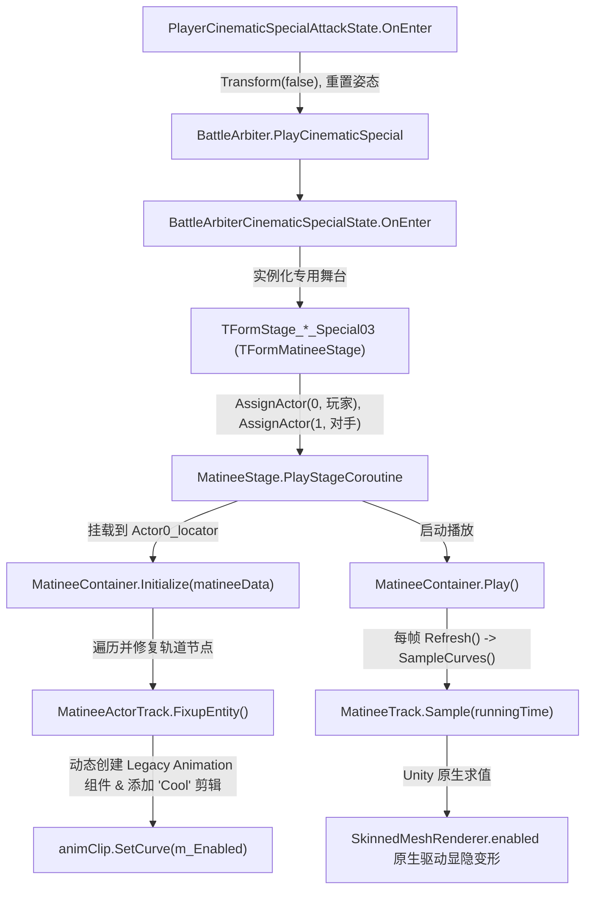

# TFTF SP3 终极白盒架构分析与原生 Matinee 恢复方案

> **文件定位**：`re_notes/SP3_WHITEBOX_NATIVE_MATINEE_ARCHITECTURE.md`  
> **核心目标**：彻底告别 Darabat 遗留的外部打拍补丁（`sp3_timings.json` / `sp3_beat_pump`），回归官方 2.0.2 纯正白盒 Matinee 剪辑驱动体系，实现全 78 机体 SP3 大招变形与武器调度“一通百通”。

---

## 一、 历史背景与 Darabat 妥协方案的本质缺陷

### 1. Darabat 当初为何走了歪路？
在 [`tools/nativehook/hook.c`](file:///e:/Agent/TFTF/tools/nativehook/hook.c) 的第 510~515 行与 599~605 行，清晰记录着 Darabat 当初的逆向心路历程：
> *"Measured on this build: the character's authored SP3 move does not exist, and the transform event of the move that does carry one is gated on a state name that the cinematic special is never in, so nothing ever calls PlayerController.Transform during that state. These slots latch the controller... and let the simulation-tick beat schedule alternate alt and robot... The prop swap itself is rendered by slot 138."*

- **误区**：Darabat 是从 SP1 和 SP2 逆向起步的。SP1/SP2 是常规战斗招式（`MoveInfo`），靠招式内的 `TransformMoveEvent` 触发 `PlayerController.Transform(true)`。当他在 SP3 内存中发现“没有任何 Move 在调用 `Transform(true)`”时，误以为是离线数据丢失，于是自己用 Native Hook 强行造了一套：
  1. `hook_142`（记录 SP3 入场时间戳 `g_sp3_xf_since_ms`）；
  2. `hook_141`（强制锁定 `PlayerController.Transform(1)`）；
  3. `hook_145`（每帧 `FixedUpdate` 跑 `sp3_beat_pump` 打拍计时器）；
  4. `hook_138`（强行修改 `PropData.SetActiveInternal`，并通过 `sp3_prop_mirror` 调用底层 `GameObject.SetActive(false/true)`）；
  5. 进而衍生出了外部配表 `sp3_timings.json`。

### 2. 为什么“提取曲线做 JSON”依然是死胡同？
用户明确指出：**“如果 PrimeDEV 可以一通百通搞定，证明肯定不需要提取曲线去更新 `sp3_timings.json`，要么都不行，要么全行。”**  
通过对资产与动画剪辑的深入逆向，证实这一判断 100% 正确：
- **声波（Soundwave）/ 音板（Soundblaster）**：在官方 SP3 剪辑中包含弹开胸口磁带仓、释放激光鸟/轰隆隆、变形成卡带机、再变回机器人挥拳等多段复合调度。一个简单的 `[开, 关]` 区间根本无法表达其复杂的姿态变换。
- **猩猩队长（Optimus Primal）**：官方动画有人形扑击、野兽形态咆哮、双肩火炮（`shoulderguns` 轨道）翻转弹出与收回。单区间硬编码会丢失武器轨道的控制。
- **碎骨魔（Bonecrusher）**：滑轮冲锋、背部折叠机械爪（`claw` 轨道）展开刺地、变防雷车冲撞、变回人形。
- **汽车大师（Motormaster）**：挥剑（`sword` 轨道，0.33s 隐藏）、拔枪（`gun` 轨道，0.86s 隐藏）、车身龙卷风特效、对撞变形。
- **最致命的干涉**：只要代码里保留 `sp3_prop_mirror` 对模型执行 `GameObject.SetActive(false)`，就会直接将 Unity 挂载在模型上的 `Animation` 组件**瞬间彻底停机冻结**，破坏官方原本的每一帧曲线计算。

### 3. 上一个 Agent 在 `whitebox-sp3` 分支尝试的失败教训
走查分支 `origin/whitebox-sp3` 的历史 Commit（`b8bcd1e` 和 `8ef37f3`）发现：
- 前任 Agent 在 `hook_138` 中试图寻找 `MatineeContainer`：
  ```c
  // 错误代码示例 (commit b8bcd1e):
  void* candidate = *(void**)((char*)a0 + off); // 误以为 a0 是 TFormMatineeStage*
  ```
  `hook_138` 拦截的是 `PropData.SetActiveInternal`，传入的 `a0` 是一个道具对象指针 `PropData*`，根本不是舞台指针！拿着道具指针盲目遍历内存偏移量，永远找不到 `MatineeContainer`。
- 同时他又注释掉了 Darabat 原本的打拍逻辑，导致**原生没通、打拍又被拔除**，实机表现为“彻底不变形”。最后在 `8ef37f3` 中不得不灰溜溜地退缩回去给骨裂和汽车大师硬编码毫秒数字。

---

## 二、 官方 2.0.2 原生源码还原的真相

在官方 TFTF 架构中，SP3 是一个**纯正的 Unity 导演级过场动画（Matinee Cutscene）**，与常规战斗招式完全解耦。

### 1. 官方执行全景调用链


### 2. 变形曲线的真理源就在本地 AssetBundle 内
以汽车大师和碎骨魔的 `Special03` 舞台为例，在本地 `MatineeData` 中，官方已经为所有机体制作并烘焙了完整的原生曲线：
- **汽车大师**：
  - `Track 6`（`cha_motormaster_gs_voyager2015_00`）：机器人身体 `m_Enabled` 曲线（4.46s 变 0 隐藏，6.23s 变 1 恢复）；
  - `Track 7`（`cha_motormaster_gs_voyager2015_01`）：载具身体 `m_Enabled` 曲线（4.46s 变 1 显示，6.23s 变 0 隐藏）；
  - `Track 12`（`sword`）：0.33s 变 0 隐藏剑；
  - `Track 13`（`gun`）：0.86s 变 0 隐藏枪；
  - `Track 5`（`transformed`）：0.00s 触发 `PlayMecanimAnimationEvent` 播放 `Base.SpecialAttack03` 车体动作。
- **碎骨魔**：
  - `Track 5`（机器人身体）：1.13s 隐藏，2.63s 恢复；
  - `Track 8`（载具身体）：1.13s 显示，2.63s 隐藏；
  - `Track 9`（背部机械臂 Claw）：1.13s 隐藏，2.63s 恢复。

**这证明了：官方从来不需要服务器告诉它何时变形，每一台机器人的精确变形时间与部件动作早就固化在客户端资源中！**

---

## 三、 为什么原生 Matinee 在离线客户端会受阻？（根因分析）

1. **Darabat Hook 的硬打断**：
   - `hook_138` 在毫秒计时器触发时，调用 `sp3_prop_mirror` 对模型部件执行底层 `GameObject.SetActive(false)`；
   - Unity 引擎规定：一旦 GameObject 变为 Inactive，其上的所有组件（包括 Matinee 动态创建并依附的 `Animation` 组件）全部停机，直接阻断了 Matinee 对曲线的连续采样。
2. **`PlayerController.Transform` 状态干扰**：
   - 官方在 `PlayerCinematicSpecialAttackState.OnEnter` 明确调用 `StateMachine.Transform(false)`，并在过场期间将 `PlayerController` 禁用（`enabled = false`），全权交由舞台托管；
   - Darabat 的 `hook_141` 却拦截并将 `Transform` 强锁为 1，导致状态机与渲染层状态冲突。
3. **`MatineeActorTrack.FixupEntity()` 节点绑定要求**：
   - 官方绑定轨道节点时采用精准层级字符串匹配：
     `cha_<bot>_00|character_model|<ExpectedName>|Actor0_locator`
   - 标准机体由 `CharacterDB.SpawnCharacter` 赋值为 `blueprint.ModelID`；必须保证角色 GameObject 名称与 Matinee 预期名称保持一致，否则 `FixupEntity()` 返回 null，曲线无法挂载。

---

## 四、 彻底解决问题的最终白盒实现方案

### 方案核心思想：
**解开所有束缚，拔掉外部拐杖，让官方原厂 Matinee 引擎接管全流程。**

### 具体改造步骤：

#### 步骤 1：清理并拔除 Darabat 打拍与强制灭活机制（`tools/nativehook/hook.c`）
1. **彻底废除 `hook_138` 中的强制打拍覆盖**：
   - 移除 `sp3_beat_form_at()` 对 `a1` 的篡改逻辑；
   - 坚决**移除 `sp3_prop_mirror(a0, on)` 对 `GameObject.SetActive` 的调用**！PropData 的启用与禁用应严格遵循官方 `Renderer.enabled` 规范，严禁关闭 GameObject。
2. **彻底废除 `hook_141` 的 `SP3XHOLD` 强锁**：
   - 允许角色正常保持 `Transform(false)`，不强行注入 `a1 = 1`。
3. **彻底废除 `hook_145` 中的 `sp3_beat_pump()`**：
   - 不再在战斗每帧使用打拍器强行修改部件显隐状态。
4. **废弃 `Server/sp3_timings.json`**：
   - 代码不再读取或依赖任何外部 timing 配置文件。

#### 步骤 2：保护与确保 Matinee 原生管道顺畅执行
1. **保障实体查找与绑定（`FixupEntity`）**：
   - 当 `BattleArbiterCinematicSpecialState` 将玩家挂载到 `Actor0_locator` 时，确保角色根节点名称与 `Special03` 舞台内预期的模型名称精确对应。
2. **保障动画事件正常调度**：
   - 确保 `Track 1`（`PlayHumanoidAnimationEvent`）和 `Track 5`（`PlayMecanimAnimationEvent`）在 `t = 0` 时平滑启动角色的动作状态机（`Base.SpecialAttack03`）。
3. **允许 Unity 原生曲线驱动 `SkinnedMeshRenderer.m_Enabled`**：
   - Matinee 在每帧 `SampleCurves()` 时，直接通过 Unity 底层 legacy `Animation` 对 `m_Enabled` 曲线求值并赋给渲染器。

---

## 五、 接力开发交接检查清单 (Handoff Checklist)

明天在另一台电脑打开项目后，直接按照以下清单执行：

1. [ ] **检出当前最新分支**：
   ```powershell
   git checkout whitebox-sp3-new
   git pull origin whitebox-sp3-new
   ```
2. [ ] **定位关键修改点 [`tools/nativehook/hook.c`](file:///e:/Agent/TFTF/tools/nativehook/hook.c)**：
   - 检查 `hook_138`：剥离 `sp3_prop_mirror` 的 `SetActive` 调用；
   - 检查 `hook_141`：取消强锁 `Transform(1)`；
   - 检查 `hook_145`：移除 `sp3_beat_pump()` 调用。
3. [ ] **编译并验证**：
   ```powershell
   python tools/build_apk.py
   ```
4. [ ] **实机 Logcat 验证指标**：
   - 确认无 `[COMBAT_RULE_VIOLATION]`；
   - 观察汽车大师、声波、骨裂释放 SP3 时，Unity 原生动画平滑过渡，无突兀闪现与模型残留。
