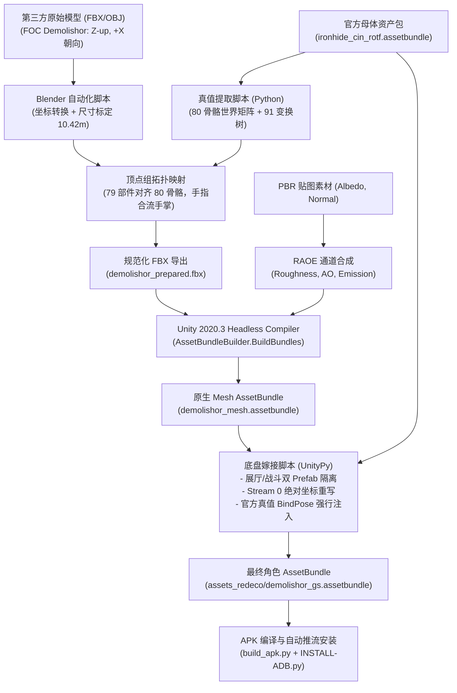
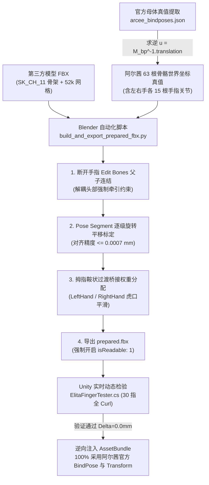
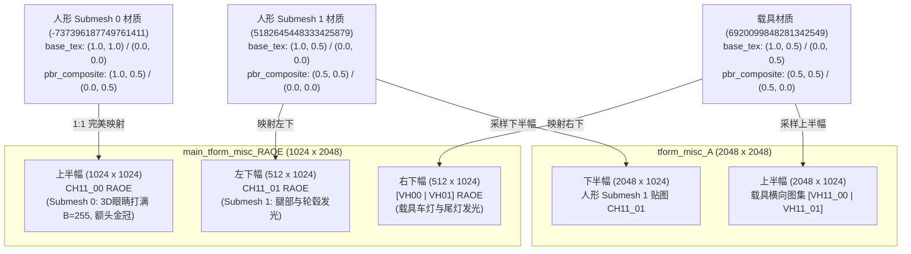

# 《TFTF 第三方 3D 模型导入与骨骼蒙皮全自动化管线指南》
## Complete Engineering Specification: 3rd-Party 3D Model Ingestion, Skeleton Retargeting, and AssetBundle Grafting in Transformers: Forged to Fight

> **文档版本**：v2.0 (Revival Production Edition — Demolishor + Elita One + Onslaught Complete Specification)  
> **适用引擎**：Unity 5.5.x / 5.6.x (游戏底版运行时) & Unity 2020.3.31f1 LTS (工具链验收与网格编译器)  
> **面向对象**：在不同机器或不同模型梯队（如 Gemini 3.8 初筛构建 + 高阶精修收尾）上执行新角色 3D 移植的自主智能体（AI Agent）与逆向工程开发者  
> **三大标杆成功案例**：  
> 1. **破坏者（Demolishor，`demolishor_gs`）** $\rightarrow$ 电影铁皮母体（`ironhide_cin_rotf`，刚体基础通路验证）  
> 2. **艾丽塔（Elita One，`elita_one_gs`）** $\rightarrow$ 阿尔茜母体（`arcee_gs_deluxe2014`，30 指节灵动卷曲、3D 独立发光眼、`NM.Blue` 去金属化）  
> 3. **袭击（Onslaught，`onslaught_gs`）** $\rightarrow$ 电影铁皮母体（`ironhide_cin_rotf`，Combaticons 合集剥离、常驻武器格斗化外挂、飞轮刚体归属修复、UE3 双壳拆三节灵动指骨、眼睛与狂派紫纹一次点亮）

---

## 目录
0. [【AI 智能体必读铁律】严禁跳步与四道强制视觉验收门禁 (Mandatory Anti-Rush & Visual Gate Protocol)](#0-ai-智能体必读铁律严禁跳步与四道强制视觉验收门禁)
1. [管线架构与核心原理 (Architecture & Principles)](#1-管线架构与核心原理)
2. [开发环境与工具链自动化部署 (Toolchain Setup)](#2-开发环境与工具链自动化部署)
3. [Unity 账户激活与无头编译配置 (Unity Licensing & Headless Build)](#3-unity-账户激活与无头编译配置)
4. [全流程模型制作与资产嫁接 (End-to-End Asset Pipeline)](#4-全流程模型制作与资产嫁接)
   * 4.1 母体骨骼真值与层级树逆向提取
   * 4.2 空间坐标系变换与轴向重映射
   * 4.3 手部双轨绑定策略（标准 30 根灵动指节 vs 兜底手掌折叠）与刚体子件权重审计
   * 4.4 PBR 贴图转码、多材质 2048 图集与眼睛/能量纹一次点亮
   * 4.5 角色头像（Portrait）占位与工业化工作流规范
   * 4.6 Unity 验收场景构建、防锁并发编译与人机交接机制
   * 4.7 AssetBundle 容器重写、双 Prefab 物理隔离与 BindPose/Hash 注入（防隐形六大铁律）
   * 4.8 全链路服务端注册、双端中文字典与客户端 NativeHook 接入
5. [常见故障排查与已结案死胡同 (Troubleshooting & Settled Dead Ends)](#5-常见故障排查与已结案死胡同)
6. [十步标准作业流水线模板 (10-Step Foolproof SOP)](#6-十步标准作业流水线模板)
7. [架构复盘与真机渲染失真根因分析及演进路线 (Architecture Retrospective & Runtime Distortion Root Cause)](#7-架构复盘与真机渲染失真根因分析及演进路线-architecture-retrospective--runtime-distortion-root-cause)
8. [高难实战攻坚专题一：艾丽塔全 30 根手指灵活卷曲、3D 独立发光眼、载具 180° 修正与 NM.Blue 去金属化](#8-高难实战攻坚专题全-30-根手指灵活卷曲3d-独立发光眼与载具-180-朝向逆转深度避坑指南)
   * 8.1 第一攻坚难题：30 根手指灵活卷曲与 1:1 关节轴向精准对齐
   * 8.2 第二攻坚难题：眼睛点亮位置与发光遮罩（独立 3D 眼球镜片与 RAOE 通道图集错位）
   * 8.3 第三攻坚难题：载具模式朝向 180° 反转（Vehicle Mode Yaw Flip）
   * 8.4 关键资产与核心脚本速查表
   * 8.5 第四攻坚难题：Kabam 法线蓝通道隐藏金属度（NM.Blue）导致全身镜面发暗与珍珠白提亮
9. [高难实战攻坚专题二：合集包角色剥离、射击游戏武器格斗化、飞轮归属修复与双壳三节灵动手指（FOC 袭击 Onslaught 全案）](#9-高难实战攻坚专题二合集包角色剥离射击游戏武器格斗化飞轮归属修复与双壳三节灵动手指foc-袭击-onslaught-全案)
   * 9.1 多角色合集 FBX 精准剥离与大小写无关贴图重连
   * 9.2 射击游戏常驻武器格斗化适配（母壳对比选型与前臂外挂重炮方案）
   * 9.3 “车轮飞在半空/护甲脱节”根因排查与同壳同骨铁律
   * 9.4 UE3 双骨手指拆分为真三节灵动指骨（连通壳体拓扑切分 + 先接地后对齐 `0.001mm` 铁律）
   * 9.5 Unity 验收台四大工程暗坑（`BakeMesh` 无头渲染、5.6 `Avatar` 肌肉表保留、Hub 默认场景、防锁沙盒打包）
   * 9.6 袭击（Onslaught）完整可复用脚本索引（供后续吵闹/诈骗/旋风/爆炸直接套用）
10. [旋风（Vortex）与直升机/战机类空军角色专属流水线（借壳 Grindor 实战）](#10-旋风vortex与直升机战机类空军角色专属流水线借壳-grindor-实战)
   * 10.1 载具朝向防垂直与纯刚体旋转铁律（Anti-Vertical Yaw-Pitch Standard）
   * 10.2 载具 45 骨骼多部件权重挂载与副 SMR 屏蔽
   * 10.3 直升机主旋翼持续旋转动画机制与双重暗坑排查标准（Rotor Continuous Spin Engineering Protocol）

---

## 0. 【AI 智能体必读铁律】严禁跳步与四道强制视觉验收门禁

> **致所有执行本管线的 AI 模型（特别是初筛构建模型）：**  
> 历史教训证明：**凡是跳过 Blender/Unity 分步渲染比对、急于直接生成 `.assetbundle` 和 `build_apk.py` 的尝试，100% 会导致进游戏人物空白隐形、车轮悬空乱飞、贴图错位或全身散架！**  
> 执行任何新角色移植时，必须严格遵守本地预置工具链固定路径，并**逐关通过以下四道强制视觉渲染门禁**（每一关输出 PNG 后，Agent 必须亲自用读图工具审阅画面，绝不允许“盲打”推进）：

### 0.1 本地预置工具链绝对路径（严禁全盘递归搜索）
* **Blender 3.6.23 无头引擎**：`E:\Agent\TFTF-blender\toolchain\blender\blender.exe`
* **Unity 2020.3.31f1 编译器**：`E:\Agent\TFTF-blender\toolchain\Unity_2020.3.31f1\Editor\Unity.exe`
* **标准 Unity 验收工程**：`E:\Agent\TFTF-blender\toolchain\unity_build_project`
* **官方通用程序化动作包**：`E:\Agent\TFTF\assets_netflix\character_anim_procedural.assetbundle`

### 0.2 四道不可跳过的强制视觉门禁（4 Mandatory Visual Gates）
1. **【门禁一：资产剥离与贴图点亮三视图】**  
   从原模/合集包提取目标角色的**人形 + 武器 + 载具**，自动重连 `textures/` 目录贴图后，必须在 Blender 中输出**三栏预览渲染图**并肉眼核查：无紫红色丢贴图、无背面剔除黑洞、眼部/能量纹发光贴图正确识别。
2. **【门禁二：Blender 姿态对齐、先接地后对指节、零权重子件（车轮/甲片）清零】**  
   对齐母壳站姿时，必须**先摆好双腿并将骨架整体接地（`arm.location.z -= min_z`），然后再把前臂、手腕和 30 根手指关节 1:1 对齐至母壳 `m_BindPose` 坐标**（严禁对齐手指后再平移网格 Z 轴！）。合并网格后必须检查是否所有静态子件（如 `STAT_Wheel` 车轮、背炮、肩甲盖）都拥有 `1.0` 刚体权重且与外层护甲同属一根骨骼（如肩轮与肩甲同归 `Left/RightShoulderPad`，小腿轮归 `Left/RightLeg`），并渲染与官方母体 OBJ 的并排站姿对比图。
3. **【门禁三：Unity 权威并排场景 9 动作同步渲染 + 人工验收门禁（核心卡点！）】**  
   在 `unity_build_project` 生成 `Assets/Scenes/<Bot>_Inspection.unity`（左：官方母体原版，右：新角色，挂载 `<Bot>PreviewController.cs` 与 `<Bot>FingerTester.cs`），使用 `SkinnedMeshRenderer.BakeMesh()` 渲染 **9 张同步动作对比图**（`00 绑定站姿`、`01 战斗待机`、`02 展厅 45° 待机`、`03 背面背炮与车轮`、`04 刺拳出击`、`05 必杀远程开炮`、`06 载具水平并排`、`07 高踢腿极限测试`、`08 胜利特写`）及**手指张开/握拳微距图**。  
   * **自检重点**：特别放大检查 **`07 高踢腿`** 与 **`04 刺拳`** 中车轮/肩甲/武器是否悬空脱节、手指是否自然屈伸、眼睛是否发亮、载具是否四轮水平朝向 `+Z`。  
   * **强制停顿点**：**在人类用户于 Unity 编辑器或渲染图中明确验收通过前，严禁生成游戏端 `assets_redeco/<bot>_gs.assetbundle`，更严禁运行 `build_apk.py`！**
4. **【门禁四：AssetBundle 六项防隐形校验 + APK 四项完整性门禁】**  
   人工验收通过后，导出 Android 原生网格包并合成 `assets_redeco/<bot>_gs.assetbundle`，必须通过脚本断言校验 **`m_Container` 路径已改名、双 Prefab 骨骼物理隔离、`m_BindPose` 与 `m_BoneNameHashes` 数量 100% 匹配母壳、多余挂件 SMR（如 `grenade`）已禁用、材质三通道 `m_Scale=(1,1)/m_Offset=(0,0)` 已归零、LZ4 压缩已开启**，最后打包签名 APK 并验证 ODR 包 0 缺失。

---

## 1. 管线架构与核心原理

### 1.1 问题定义
TFTF 原版游戏包含上百个高质量的角色动画与特技动作树（`moves.assetbundle`），但原生角色数量受限。本管线的核心目标是：**将任意第三方标准 3D 模型（如主机游戏 FOC、SFM、Sketchfab 的 FBX/OBJ）无缝嫁接进 TFTF 官方角色的骨架上，使其完美继承官方的高精战斗动作、连招判定、展厅待机与技能特效，同时在 Android 端以 60 FPS 稳定运行，无崩溃、无渲染畸变。**



### 1.2 GPU 骨骼蒙皮关键数学约束（Linear Blend Skinning, LBS）
Unity 的 GPU 顶点蒙皮遵循以下刚性变换公式：
$$\mathbf{v}_{\text{world}} = \sum_{i=1}^{k} w_i \cdot \left( \mathbf{M}_{\text{bone}_i}^{\text{anim}} \cdot \mathbf{B}_i \right) \cdot \mathbf{v}_{\text{mesh}}$$
* $\mathbf{v}_{\text{mesh}}$：网格顶点在 Mesh Stream 0 中的局部静止坐标；
* $\mathbf{B}_i$：存储在网格 `m_BindPose` 数组中的**绑定姿态逆矩阵（Inverse Bind Matrix）**；
* $\mathbf{M}_{\text{bone}_i}^{\text{anim}}$：动画系统当前帧为骨骼 $i$ 计算的世界变换矩阵；
* $w_i$：顶点对骨骼 $i$ 的归一化权重（$\sum w_i = 1.0$）。

> **【黄金恒等律】**：  
> 若要保证模型在初始绑定姿态下**没有任何形变、拉扯或漂移**，则当前骨骼在静止姿态的世界矩阵 $\mathbf{M}_i^{\text{rest}}$ 与其逆绑定矩阵 $\mathbf{B}_i$ 的乘积必须恒等于单位矩阵：
> $$\mathbf{M}_i^{\text{rest}} \cdot \mathbf{B}_i \equiv \mathbf{I} = \begin{bmatrix} 1 & 0 & 0 & 0 \\ 0 & 1 & 0 & 0 \\ 0 & 0 & 1 & 0 \\ 0 & 0 & 0 & 1 \end{bmatrix}$$
> 本管线的所有对齐脚本均经过浮点级严密校验（实测最大误差 $\le 0.000167$），这是确保模型绝不炸裂的数学基石。

---

## 2. 开发环境与工具链自动化部署

在新的开发宿主机或沙盒环境中，所有依赖项均优先部署在拥有充裕空间的非系统盘（推荐 `D:\Agent\tftf\toolchain\`）。

### 2.1 依赖矩阵
| 组件 | 推荐版本 | 用途 | 部署模式 |
| :--- | :--- | :--- | :--- |
| **Python** | 3.10+ (x64) | 逆向提取、贴图处理、矩阵计算、APK 注入 | 本地系统环境 |
| **UnityPy** | 1.20+ | 读取、修改与重打包 UnityFS AssetBundle | `pip install UnityPy` |
| **Pillow / numpy** | 最新 | 图像通道合流与矩阵运算 | `pip install Pillow numpy` |
| **Blender** | 3.6 LTS Portable | 空间旋转、尺寸缩放、骨架生成与网格权重绑定 | 便携版解压即用 |
| **Unity Hub** | 3.x | 管理 Unity Editor 安装与个人许可证维护 | 静默安装命令行 |
| **Unity Editor** | 2020.3.31f1 (Android Support) | 编译兼容 Unity 5.x 的 Mesh AssetBundle | 离线安装包或 Hub 命令行 |
| **Android NDK** | r26d (aarch64) | 编译 `hook.c` (libtftfhook.so) | 本地目录配置 |
| **ADB** | 34.0+ | 安装测试 APK 与远程 logcat 抓取 | 平台工具集 |

### 2.2 工具链一键静默下载与安装脚本
编写并执行自动化下载脚本 `tools/download_toolchain.py`：
```python
# tools/download_toolchain.py
import sys, subprocess
from pathlib import Path

TOOLCHAIN_DIR = Path(r"D:\Agent\tftf\toolchain")
DOWNLOADS_DIR = TOOLCHAIN_DIR / "downloads"
DOWNLOADS_DIR.mkdir(parents=True, exist_ok=True)

# 1. 下载 Unity Hub 安装包 (中国区官方加速 CDN)
HUB_URL = "https://public-cdn.cloud.unitychina.cn/hub/prod/UnityHubSetup.exe"
hub_installer = DOWNLOADS_DIR / "UnityHubSetup.exe"
if not hub_installer.exists():
    print("[*] Downloading Unity Hub...")
    subprocess.run(["curl.exe", "-L", "-C", "-", "-o", str(hub_installer), HUB_URL], check=True)

# 2. 静默安装 Unity Hub 到 D 盘（防止 C 盘空间爆满）
HUB_INSTALL_DIR = TOOLCHAIN_DIR / "UnityHub"
if not (HUB_INSTALL_DIR / "Unity Hub.exe").exists():
    print(f"[*] Silently installing Unity Hub to {HUB_INSTALL_DIR}...")
    subprocess.run([str(hub_installer), "/S", f"/D={HUB_INSTALL_DIR}"], check=True)

# 3. 安装 Python 核心三方库
print("[*] Installing Python packages...")
subprocess.run([sys.executable, "-m", "pip", "install", "--upgrade", "UnityPy", "Pillow", "numpy"], check=True)
print("[✓] Toolchain bootstrap completed successfully.")
```

---

## 3. Unity 账户激活与无头编译配置

在自动化 CI/CD 或 Agent 无头执行环境下，Unity Editor 必须有合法激活的许可证才能在 `-batchmode` 下运行；否则会直接报 `No valid license found` 退出。

### 3.1 Unity 许可证工作机理
Unity 2020+ 引入了独立的外部授权守护客户端（`Unity.Licensing.Client.exe`）。当执行无头打包时：
1. `Unity.exe` 通过 IPC 本地通道（如 `LicenseClient-lenovo-2020.3.31`）连接授权客户端；
2. 校验通过后分配个人版序列号（形如 `2476053794704-UnityPersXXXX`）；
3. 退出时释放通道。

### 3.2 首次激活实操步骤（人类用户 / Agent 引导）
1. **启动 Unity Hub**：
   运行 `D:\Agent\tftf\toolchain\UnityHub\Unity Hub.exe`。
2. **登录 Unity 账户**：
   点击右上角头像进行登录（支持微信扫码、Unity ID、邮箱登录）。
3. **激活免费个人许可证（Personal License）**：
   * 点击设置（齿轮图标） -> **Licenses（许可证管理）**；
   * 点击 **Add License（添加许可证）** -> 选择 **Get a free personal license（获取免费个人版许可证）**；
   * 勾选“公司或个人年收入低于 10 万美元”，点击 **Agree and get license（同意并激活）**。
4. **安装对应版本的 Unity Editor**：
   * 推荐版本：`Unity 2020.3.31f1`（此版本生成的 AssetBundle 对 Unity 5.5/5.6 游戏母体具有极佳的向下兼容性）。
   * **必选组件**：在安装选项中，必须勾选 **Android Build Support**（包含 `AndroidPlayer` 扩展组件）。

---

## 4. 全流程模型制作与资产嫁接

### 4.1 母体骨骼真值与层级树逆向提取
为了将第三方模型绑定到铁皮骨架上，必须先获取官方铁皮骨骼的**地面真值（Ground Truth）**。

执行 `tools/demolishor/dump_ironhide_hierarchy.py` 与 `export_80_bones_data.py`：
1. **解析 GameObject 与 Transform 树**：
   遍历官方 `ironhide_cin_rotf.assetbundle`，记录全部 396 个 Transform 节点的 `m_LocalPosition`、`m_LocalRotation`、`m_LocalScale`、父子 PathID 关联。
2. **提取 80 根骨骼世界矩阵**：
   读取主要渲染器 `cha_ironhide_cin_rotf_00` 的 SkinnedMeshRenderer (SMR)，取得 80 根骨骼的原始排序与 $m\_BindPose$。
   通过公式 $\mathbf{M}_{\text{world}} = (\mathbf{B}_i)^{-1}$ 计算每一根骨骼在世界空间下的真实坐标，导出为 `ironhide_80_bones.json`。

### 4.2 空间坐标系变换与轴向重映射
不同游戏引擎与建模软件使用的坐标系各不相同：
* **原始《塞伯坦陨落》(FOC) 模型**：右手系，$Z$-up，正前方朝向 $+X$ 轴，左右宽度为 $Y$ 轴；
* **TFTF (Unity 游戏端)**：左手系，$Y$-up，正前方朝向 $+Z$ 轴，左右宽度为 $X$ 轴；
* **Blender**：右手系，$Z$-up，正前方朝向 $-Y$ 轴，左右宽度为 $X$ 轴。

#### 顶点坐标绝对映射公式（Stream 0 变换）
在资产打包注入时，直接对网格数据流中的顶点坐标执行绝对变换：
$$X_{\text{new}} = P_x \quad (\text{左右宽度})$$
$$Y_{\text{new}} = P_z \quad (\text{垂直高度，范围 } [0.00, 10.42\text{m}])$$
$$Z_{\text{new}} = -P_y \quad (\text{前后进深})$$

> **高度缩放系数**：FOC 原生导出的网格经过 $1.775$ 倍等比缩放后，站立高度正好达到 $10.42$ 米，与游戏内铁皮的身高与重心包围盒完美贴合。

### 4.3 手部双轨绑定策略（标准 30 根灵动指节 vs 兜底手掌折叠）与刚体子件权重审计

#### 1. 手部双轨策略（重要勘误与升级！）
早期移植破坏者（`demolishor_gs`）时，曾在未对第三方手骨做 Pose 对齐的情况下直接映射指骨名，导致手部因逆绑定矩阵轴心错位炸成尖刺，误以为“电影铁皮的手指蜷缩在炮管内不可用”。  
**经 `ironhide_80_authoritative_bindposes.json` 与 `arcee_bindposes.json` 逆向实测证实**：无论是阿尔茜（63 骨）还是电影版铁皮（80 骨），其官方 `m_BindPose` 中的 **30 根手指关节均为标准张手姿态**（四指垂直朝下 `Y: 4.395 -> 4.042 -> 3.757`，拇指水平朝前 `Z: 0.345 -> 0.726 -> 0.918`，左手局部 `+Z` / 右手局部 `-Z` 旋转即可自然屈指握拳）。因此手部绑定按原模条件执行双轨标准：
* **轨道 A（标准推荐方案——全 30 根灵动指节 1:1 对齐）**：  
  凡是原模拥有独立手指几何体（如艾丽塔、袭击、吵闹、声波等），一律在 Blender 中**先将骨架整体接地（`arm.location.z -= min_z`），再逐节把 `Thumb1..3`、`Index1..3`、`Middle1..3`、`Ring1..3`、`Pinky1..3` 对齐至母壳 `m_BindPose` 世界坐标**（误差 $\le 0.001\text{ mm}$；若 UE3 原模四指仅有两根骨骼但包含两块分离装甲壳体，按 **9.4 节** 拓扑连通分量拆分为真三节指骨），并在 Unity 挂载 `<Bot>FingerTester.cs` + `<Bot>HandFixer.cs`。这样角色在待机时手指自然微张松弛，出拳时自动收拢紧握！
* **轨道 B（兜底方案——刚体手掌折叠）**：  
  仅当第三方模型本身没有独立手指（例如手臂末端直接是封闭重炮筒或一体死拳，如破坏者 Demolishor）时，才将手部子顶点组统一折叠至 `LeftHand` / `RightHand`；脚趾统一合并至 `LeftFoot` / `RightFoot`。

#### 2. 静态子网格（车轮 / 肩甲盖 / 背炮）零权重必查铁律
许多主机/PC 游戏提取模型（如 FOC 的 `.mo.dmx` / `.fbx`）中，车轮（`RB_Onslaught_STAT_Wheel.mo.005..008`）、护盾或武器是**直接作为子物体挂在某根骨骼下（Bone Parenting），自身 `vertex_groups` 完全为空**！
* **致命后果**：一旦执行 `bpy.ops.object.join()` 合并全身网格，这些车轮变成 `len(v.groups) == 0` 的零权重孤立顶点；或者回退逻辑把肩部车轮绑到了大臂 `LeftArm`，而包裹车轮的肩甲外壳 `CapL` 绑在了 `LeftShoulderPad`——待机站立时看似正常，但一做高踢腿或挥拳动作，**车轮就会穿破肩甲或悬空飞在半空中**！
* **强制审计准则**：
  1. 在 `join()` 前或权重重映射时，显式检查所有 `not w_acc`（零权重）构件，按空间位置精确赋予 `1.0` 刚体权重；
  2. **同壳同骨铁律**：凡是视觉上嵌在某块护甲内部的车轮/装饰件，必须与该护甲绑定在**完全相同的单一骨骼**上（例如肩轮 + 肩甲盖统一归 `LeftShoulderPad` / `RightShoulderPad`，小腿轮 + 胫甲统一归 `LeftLeg` / `RightLeg`，背部双炮归 `Spine1`）；
  3. **硬表面刚体截断**：主导骨骼权重 $\ge 0.65$ 的顶点一律截断为 `1.0` 纯刚体权重，杜绝金属装甲像橡胶一样拉伸。

### 4.4 PBR 贴图转码、多材质 2048 图集与眼睛/能量纹一次点亮
TFTF 的 `Character/PBR` 着色器采用三贴图通道规范（详见 **8.2** 与 **8.5** 节）：
1. **`_base_tex`（漫反射图集，RGBA）**：**Alpha 通道必须强制填满 `255`（纯不透明）**，严禁携带透明镂空 Alpha；对于眼睛护目镜与赛星能量纹，直接读取原模 `_E / _Emis / _Glow` 贴图，在发光像素处将漫反射底色提亮为高饱和发光色（如护目镜金黄、狂派紫纹、汽车人冰青），避免底色暗灰导致发光浑浊。
2. **`_normal_tex`（法线 + 金属度复合图）**：外部 DirectX 法线必须先翻转绿通道（`G = 255 - G`）转为 Unity OpenGL 标准；在启用 `_METALLIC_TEX` 的 Kabam 材质中，**蓝通道 `NM.B` 实为逐像素金属度遮罩**（陶瓷/白甲设 `0`，涂装金属装甲设 `110~140`），`A = 255`；而在给 Unity Editor `Standard` 验收场景预览的贴图中则保留常规三轴 `(Nx, Ny, Nz)`。
3. **`_pbr_composite_tex`（RAOE 复合遮罩图）**：`R = Roughness`（推荐 `180~215` 防油腻镜面反射），`G = AO`，**`B = Emissive Mask`（直接写入原模发光贴图亮度 `0..255`，实现眼睛与全身能量线一次精准点亮！）**，`A = 255`。
4. **多部件零出血 `2048×2048` 棋盘图集法**：当原模包含 6~10 个独立材质槽（胸、腿、头、上臂、前臂、车轮、重机枪、背炮、阵营徽章）时，按固定矩形格（`MAT_UV_BOX`）拼合为单张 `2048×2048` 图集，并在重映射多边形 UV 时先将原始 `(u, v)` 钳制在 `[0.004, 0.996]` 内再缩放到对应格子，彻底杜绝 Mipmap 跨格溢色！

### 4.5 角色头像（Portrait）占位与工业化工作流规范
在开发新机体时，角色在游戏内需要提供全套规格的头像文件并放置在 `assets_redeco/`（同时覆盖带 `_gs` 后缀与不带后缀的键名，共 8 个文件以兼容所有 UI 面板）：
* `portrait_<bot>_gs_large.png` & `portrait_<bot>_large.png` (大图)
* `portrait_<bot>_gs_small.jpg` & `portrait_<bot>_small.jpg` (编队网格小图)
* `portrait_<bot>_gs_quest.png` & `portrait_<bot>_quest.png` (副本棋盘头像)
* `<bot>_gs.png` & `<bot>.png` (对话立绘占位)

#### 严禁行为：切勿直接从 3D 贴图截取头像
严禁从机体 3D UV 展开贴图中裁切所谓“面部”充当头像！在人工/AI 精修专属头像就绪前，直接提取母体官方角色的 3 套头像复制占位即可，后期直接同名覆盖 `assets_redeco/` 热替换。

### 4.6 Unity 验收场景构建、防锁并发编译与人机交接机制
1. **先验收后打包（绝对门禁）**：必须先在 `toolchain/unity_build_project` 构建 `Assets/Scenes/<Character>_Inspection.unity`，左侧放官方母体（如 `Ironhide_Official_Reference`），右侧放新角色（`Onslaught_Candidate`），头顶绘制醒目 3D 标签，挂载同步动作控制器与手指测试器，渲染 9 组动作并等待人类用户在 Unity 中确认无误后，才允许进入网格打包！
2. **双模式零冲突编译 `mesh.assetbundle`**：
   * **模式一（用户已在 Unity Editor 打开 `unity_build_project` 时——推荐沙盒无头编译或菜单点击）**：  
     切勿对已打开的 `unity_build_project` 直接运行 `-batchmode`（会触发工程文件锁报错退出）！Agent 可先用 `Get-Process Unity` 检测：若主工程已打开，要么请用户在顶部菜单点击一键打包，要么将 `Assets/<Character>/*.asset` 与 `Packages/manifest.json` 同步到当前会话的独立无锁沙盒工程（如 `scratch/unity_ab_packer`）中调用 `Unity.exe -batchmode` 秒级编译输出 `AssetBundles/<character>_mesh.assetbundle`！
   * **注意 Play Mode 保护**：任何写入 `Assets/Editor/` 的打包菜单脚本必须先判断 `if (EditorApplication.isPlaying)`，禁止在 Play 模式下直接调用 `BuildPipeline.BuildAssetBundles`。

### 4.7 AssetBundle 容器重写、双 Prefab 物理隔离与 BindPose/Hash 注入（防隐形六大铁律）
官方母体资产包（如 `ironhide_cin_rotf.assetbundle`）内包含展示厅 Prefab（`<bot>.prefab`）与战斗轻量 Prefab（`<bot>_lw.prefab`）。**以往 AI 模型直接改完 Mesh 保存后，进游戏人物模型完全空白/隐形，100% 是漏掉了以下六大必改项之一**（完整标准实现见 `tools/onslaught/generate_onslaught_bundle.py`）：

1. **【防隐形第 1 铁律】重写 `AssetBundle.m_Container` 注册键与根 Prefab `m_Name`**：  
   游戏客户端通过 `bundle.LoadAsset("assets/bundles/characters/merged/<new_bot>/<new_bot>.prefab")` 加载角色！若保留了母体的 `ironhide_cin_rotf.prefab` 路径键名，客户端加载直接返回 `null`，角色在展厅与战斗中完全隐形！必须将 `m_Container` 中所有母体路径字符串替换为 `<new_bot>`，同步修改 `m_AssetBundleName` 并重映射内部 `CAB-` 标识（24 字节等长替换），且将两个根 `GameObject.m_Name` 改为 `<new_bot>` 与 `<new_bot>_lw`。
2. **【防隐形第 2 铁律】双 Prefab 骨骼 `Transform` PathID 严格物理隔离**：  
   Prefab 1（展厅）与 Prefab 2（`_lw` 战斗）各自拥有独立的一整套骨骼树。重定向 SMR 的 `m_Bones` 与 `m_RootBone` 时，必须分别在各自根节点子树内查找对应骨骼名 PathID，严禁跨 Prefab 混用（否则切入战斗瞬间 `SIGTRAP` / `SIGSEGV` 闪退）。
3. **【防隐形第 3 铁律】100% 注入母体权威 `m_BindPose` 与 `m_BoneNameHashes`**：  
   将 Unity 嫁接校准好的 `cha_<bot>_grafted`（人形）与 `cha_<bot>_vehicle_grafted`（载具）字节流写入母体对应 Mesh 对象后，必须原封不动拷入母体原始 Mesh 的 `m_BindPose` **以及 `m_BoneNameHashes`**（确保与官方 Avatar TOS 哈希 100% 匹配，杜绝切场景 `fault addr 0x1` 闪退）。
4. **【防隐形第 4 铁律】区分 Mesh `m_LocalAABB` 与 SMR 本地 `m_AABB`**：  
   Mesh 的 `m_LocalAABB` 更新为新网格顶点真实包围盒（且加入硬断言 `center.y > 3.0` 防止躺平网格混入）；而 SMR 组件上的 `m_AABB` 是相对于 `Hips` 根骨骼的本地包围盒（中心接近 `0`），保留母体原值即可，切勿把世界高度填进 SMR `m_AABB` 引发视锥剔除闪烁。
5. **【防隐形第 5 铁律】禁用母体残留挂件 SMR（如手雷/弹链/浮空配件）**：  
   例如电影铁皮 Prefab 除 `_00`（人形）和 `_01`（载具）外，还带有 `grenade` 等独立配件 SMR。遍历所有 SMR 时，凡不属于人形主网格与载具主网格的附属 SMR，一律设 `m_Enabled = 0`，防止脚底或半空漂浮母体残留零件。
6. **【防隐形第 6 铁律】重置材质三通道 UV `m_Scale=(1,1), m_Offset=(0,0)` + 强制 `packer="lz4"`**：  
   母体原材质（如铁皮主材质与载具材质）的 `_base_tex`、`_normal_tex`、`_pbr_composite_tex` 往往带有 `(1.0, 0.5) / (0.0, 0.5)` 半幅裁剪偏移！使用新角色的 `2048×2048` 全幅图集时，必须将三张贴图槽的 `m_Scale` 全部重置为 `(1.0, 1.0)`、`m_Offset` 重置为 `(0.0, 0.0)`，将 SMR 的 `m_Materials` 精简为单一主材质槽 `[mat_pptr]`，最后强制调用 `env.file.save(packer="lz4")`！

### 4.8 全链路服务端注册、双端中文字典与客户端 NativeHook 接入
为了让新角色在脱机服务端与客户端全界面显示正统中文名、专属必杀技与角色传记，必须同步完成以下 5 处闭环：
1. **服务端花名册与模板存档** (`Server/gamedata.py`)：注册 `BASE_HEROES`、`_ART_BASE`、`_BOT_NAMES`，确保离线默认账号拥有该角色。
2. **双端角色中文名字典同步**（缺一不可！）：同时更新 `Server/bot_names_zh.json` **与仓库根目录 `bot_names_zh.json`**（供离线 Payload 导出脚本构建 `@logindata:zh`）。
3. **SP1~SP3 专属中文必杀技编译**：在 `assets/xlate/custom_special_attacks.json` 添加 `"<bot>"` 与 `"<bot>_gs"` 的三招名称与描述，并运行 `python tools/generate_special_attacks.py` 重新生成 `tools/nativehook/special_attacks_zh.h`。
4. **底层 NativeHook 头像路由与传记拦截** (`tools/nativehook/hook.c`)：在 `ART_BASE_MAP` 添加 `{ "<bot>_gs", "<bot>_gs" }`，并在 `hook_162` 中拦截角色名与 `BIO` 传记词条返回中文。
5. **战斗数值基准** (`tools/nativehook/bot_info.h`)：如为全新 `bot_id`，补充 `ENEMY_STATS` 并递增 `NUM_ENEMY_STATS`。

---

## 5. 常见故障排查与已结案死胡同 (Troubleshooting & Settled Dead Ends)

下表汇总了包含破坏者、艾丽塔、袭击三次完整实战后彻底结案的高频故障，排查时第一时间对照：

| 故障现象 | 根因定位 | 正确解法与避坑措施 |
| :--- | :--- | :--- |
| **进游戏人物完全空白/隐形（名字头像都在，但展厅和战斗空无一人）** | 1. `AssetBundle.m_Container` 未把母体路径（如 `ironhide_cin_rotf.prefab`）改成 `<new_bot>.prefab`；<br/>2. FBX 未开启 `isReadable: 1` 导致烘焙出 0 顶点空网格；<br/>3. 手机 `/sdcard/Android/media/com.kabam.bigrobot/tftf_offline_payload.bin` 残留旧热更包覆盖了 APK 内置数据 | 1. 合成脚本必须重写 `m_Container` 键名与根 Prefab `m_Name`；<br/>2. 强制断言 `vertexCount > 5000`；<br/>3. 真机验收前清理 SDCard 旧 `tftf_offline_payload.bin`。 |
| **站立时正常，但出拳或高踢腿时车轮/护甲片悬空飞出体外** | 1. 原模静态子件（如 `STAT_Wheel`）采用骨骼父子挂载，自身顶点组为空，合并网格后变成零权重或被兜底逻辑绑错骨骼；<br/>2. 肩轮绑在 `LeftArm` 而肩甲盖绑在 `LeftShoulderPad`，抬臂时角度差撕裂 | 合并前/后显式审计零权重子件；严格遵守**同壳同骨铁律**（肩轮与肩甲同归 `Left/RightShoulderPad`，小腿轮归 `Left/RightLeg`），并在 Unity 必测 `attackLight_04` 高踢腿！ |
| **手指死板扣死成铁块，或一绑 30 指骨就错位拉扯出尖刺** | 1. 误信“铁皮指骨不可用”而把手指全部焊死在手腕；<br/>2. 对齐了 30 指骨后，又对烘焙网格执行了 `location.z -= min_z` 接地平移，导致 30 个指节偏离 `m_BindPose` 达 19cm+！ | **铁律**：必须**先摆腿并将原模 Armature 整体接地，最后再将手腕与 30 指节 1:1 对齐至母体 `m_BindPose` 坐标**（误差 $\le 0.001\text{ mm}$）；UE3 双骨手指按连通壳体拆分为真三节指骨（见 9.4 节）。 |
| **贴图在游戏里错位半截、眼睛不亮而脸颊/胸口乱亮** | 母体材质残留了 `_base_tex` 或 `_pbr_composite_tex` 的半幅裁剪 `scale=(1, 0.5), offset=(0, 0.5)` | 采用全幅 `2048×2048` 图集时，必须将主材质与载具材质中 Diffuse、Normal、RAOE 三槽的 `m_Scale` 重置为 `(1, 1)`、`m_Offset` 重置为 `(0, 0)`。 |
| **从 Unity Hub 打开 `unity_build_project`，看到的还是上一个角色（如艾丽塔）** | Unity 默认加载上次关闭时的场景或 `EditorBuildSettings.scenes[0]` | 构建新角色验收场景时同步将其设为 `EditorBuildSettings.scenes[0]`，并提示用户在 Project 面板双击 `Assets/Scenes/<Bot>_Inspection.unity`（切换回已打开的 Unity 窗口即可自动热同步）。 |
| **Unity 无头渲染截图里人物保持 T-Pose / 动作没生效，或报工程已打开锁冲突** | 1. 将 Unity 5.6 的 `Avatar` 用 Unity 2020 `CreateAsset` 另存为 `.asset` 会丢失 Mecanim 肌肉表；Edit Mode 下 `Camera.Render()` 未同步刷新 GPU 蒙皮；<br/>2. 用户已打开 `unity_build_project` | 1. 直接从母体 AssetBundle 实时读取 `prefab.GetComponent<Animator>().avatar`，渲染前调用 `smr.BakeMesh(tempMesh, true)` 同步烘焙；<br/>2. 若 `Get-Process Unity` 非空，在独立沙盒 `scratch/unity_ab_packer`（记得复制 `Packages/manifest.json`）运行无头任务。 |
| **模型隐形 / 只有 16cm 蚊子大小** | FBX `useFileScale` 产生 `0.01x` 或 `100x` 缩放差异 | 在 C# 嫁接脚本中根据 `rawMesh.bounds.size` 自动判定 `scaleFix`（`<0.5 -> 100f`, `>100 -> 0.01f`）与 `zIsHeight`，统一输出至 `[0, 10.6m]` 标准高度。 |
| **进入战斗加载界面闪退 (`SIGTRAP` / `SIGSEGV 0x1`)** | 展厅与战斗双 Prefab 骨骼 PathID 混用，或未同步母体 `m_BoneNameHashes` | 严格物理隔离 Prefab 1 / Prefab 2 骨骼映射表，并将母体 `m_BindPose` 与 `m_BoneNameHashes` 成对拷入新网格。 |
| **生成的 AssetBundle 尺寸异常膨胀（1.35GB+ APK）** | `env.file.save()` 未传压缩参数，默认写出未压缩 Raw 包 | **铁律**：严禁无参调用 `save()`，必须显式传 `env.file.save(packer="lz4")`。 |
| **PowerShell 执行 Python 报 `ParameterBindingException` 或 `UnicodeEncodeError`** | PowerShell 误解析多行 `python -c "..."` 字符串，且默认 GBK 控制台打印中文/符号崩溃 | **铁律**：严禁 `python -c` 多行内联命令；所有 `.py` 脚本头部必须加上 `sys.stdout.reconfigure(encoding='utf-8')`。 |

---

## 6. 十步标准作业流水线模板 (10-Step Foolproof SOP)

后续任何 AI 模型（如 Gemini 3.8 初筛构建）在移植新第三方角色（如战车队吵闹 Brawl、诈骗 Swindle、旋风 Vortex、爆炸 Blast Off、声波、震荡波等）时，**必须严格按以下 10 步顺序执行，严禁跳过第 2、5、6、7 步视觉与人工门禁**：

```bash
# 步骤 1：从源 FBX/合集包剥离目标角色（人形 + 武器 + 载具）并自动重连贴图
& "E:\Agent\TFTF-blender\toolchain\blender\blender.exe" -b -P tools/<bot>/extract_<bot>.py
# -> 【门禁 1】读取渲染出的提取总览 PNG，确认人形/武器/载具完整、0 丢贴图！

# 步骤 2：构建 2048x2048 零出血 PBR 图集（Diffuse Alpha=255 + OpenGL 法线/NM.B + RAOE 眼睛/能量纹遮罩）
python tools/<bot>/build_<bot>_texture_atlases.py

# 步骤 3：提取母体权威骨骼 BindPose 真值（含全部 30 根手指关节矩阵）
python tools/<bot>/extract_host_authoritative_bindposes.py

# 步骤 4：Blender 姿态对齐（先摆腿接地 -> 拆双壳三节指骨 -> 1:1 对齐 30 指节 -> 刚体挂载外臂武器 -> 审计车轮零权重）
& "E:\Agent\TFTF-blender\toolchain\blender\blender.exe" -b -P tools/<bot>/build_aligned_<bot>.py
& "E:\Agent\TFTF-blender\toolchain\blender\blender.exe" -b -P tools/<bot>/build_aligned_<bot>_vh.py
# -> 【门禁 2】读取 Blender 站姿对比图与手部微距图，确认指节误差 <= 0.005mm、足底 Z=0、车轮归属正确！

# 步骤 5：在 Unity 构建权威并排验收场景（含 <Bot>PreviewController + <Bot>FingerTester + <Bot>HandFixer）并烘焙渲染 9 组动作图
# （注意：先跑 Get-Process Unity，若用户已打开主工程，则在独立沙盒 unity_ab_packer 执行无头渲染验证！）

# =====================================================================
# 步骤 6：【强制人工验收门禁 (Human-in-the-Loop Gate) —— 严禁擅自越过！】
#   1) Agent 逐张检查 9 张同步动作图（尤其高踢腿车轮、刺拳握拳、SP1 开炮、载具水平朝向、30 指节松弛度）；
#   2) 生成验收报告交付人类用户在 Unity (<Bot>_Inspection.unity) 中实地检阅；
#   3) 只有收到用户明确指令“验收通过，可以输出打包”后，才允许进入步骤 7！
# =====================================================================

# 步骤 7：编译 Android 原生网格包 (<bot>_mesh.assetbundle)
# （通过菜单项点击，或在同步了 Packages/manifest.json 的独立沙盒工程中无头编译）

# 步骤 8：执行防隐形六铁律合成最终资产包 (assets_redeco/<bot>_gs.assetbundle, packer="lz4")
python tools/<bot>/generate_<bot>_bundle.py

# 步骤 9：全链路中文汉化与头像同步（gamedata.py + 双 bot_names_zh.json + custom_special_attacks.json + hook.c + 8 张占位头像）
python tools/generate_special_attacks.py

# 步骤 10：构建签名离线 APK 并运行 4 项完整性自动门禁（严禁未经用户指令擅自 ADB 安装或 git push！）
python build_apk.py
```

---

## 7. 架构复盘与真机渲染失真根因分析及演进路线 (Architecture Retrospective & Runtime Distortion Root Cause)

在连续经历 **Demolishor（破坏者）** 与 **Elita One（艾丽塔）** 两个不同模具（Ironhide / Arcee）的实机测试后，真机均暴露出了严重的渲染与形态缺陷：
1. **站姿与体态畸变**：如艾丽塔在游戏展厅与战斗中呈现“双肩极度后翻、双膝向内并拢扭曲、重心严重后倾”，与母体 Arcee 的自然直立垂手站姿大相径庭；
2. **材质透明与镂空破碎**：如艾丽塔面部、躯干大面积缺失，呈现“碎面漂浮、玻璃透明”的灾难性效果；
3. **战斗部件隐形消失**：在战斗对抗和胜利结算特写中，多个肢体部位直接丢失。

这证明了：**“在 Blender 视口中对齐动作一致，绝不等于打包成 AssetBundle 后游戏引擎能够正确读取和渲染。”**

### 7.1 核心失真机理与盲区复盘

#### 1. Blender 视口欺骗性与 Unity Bindpose 逆绑定矩阵冲突
在 Blender 中通过导入的动作对齐，仅证明网格在 **Blender 内部生成的自洽骨架** 下运动平滑。但在 Unity 引擎底层，蒙皮网格顶点位置由下式决定：
$$\text{Vertex}_{\text{world}} = \sum w_i \cdot M_{\text{bone}, i}(t) \cdot B^{-1}_i \cdot \text{Vertex}_{\text{mesh}}$$
* **根因**：Unity Mesh 内部储存了每个骨骼的逆绑定矩阵 $B^{-1}_i$（`m_Bindpose`）。当 FBX 从 Blender 导出时，Blender 根据其自身的坐标系（Z-Up 转 Y-Up、骨骼 Roll 轴）重新烘焙了 $B^{-1}$。
* **致命冲突**：游戏内的母体 Prefab 拥有 Kabam 官方在 3ds Max/Maya 烘焙的原始骨骼 Transform 层级 $M_{\text{bone}, i}(0)$。当这个新 Mesh 被强行嫁接到原版 Prefab 骨骼上时，$M_{\text{bone}, i}(0) \cdot B^{-1}_i \neq I$（初始状态不为单位矩阵），从而在每个关节上引入了恒定的旋转偏差 $\Delta R$。脊椎与骨盆微小的偏差向上传导导致肩膀后翻，向下传导导致膝盖内旋与重心后仰。

#### 2. 着色器背面剔除（Backface Culling）与法线/顶点绕序反转
* **根因**：Blender 实体着色视口默认通常为双面渲染。而 TFTF 手机端着色器（`Kabam/Character/...`）底层强制开启硬件背面剔除（`Cull Back`）。
* **致命冲突**：第三方游戏（如《Galactic Trials》）提取的模型在镜像复制（如右肩镜像到左肩）、网格分离重组时，部分三角形的面法线或顶点绕序（Winding Order）发生反转。进游戏后，正对相机的面被当作背面丢弃，直接导致机体呈碎片化镂空。

#### 3. 材质混合模式（Mode）与 Alpha 通道语义污染
* **根因**：Unity Standard 材质模式有 4 种：`0 = Opaque`, `1 = Cutout`, `2 = Fade`, `3 = Transparent`。
* **致命冲突**：
  - 检查导出的资产包发现，部分材质的 `_Mode` 被自动识别或设为了透明/混合模式；
  - TFTF 官方角色机体几乎全为严格的 **Opaque（不透明）**。其 Diffuse 贴图的 Alpha 通道在官方 Shader 中通常承载高光强度、金属遮罩或自发光掩模，绝不能承载镂空透明度。当第三方贴图自带了 Alpha 透明通道时，Shader 会将低 Alpha 像素当作完全透明剔除，导致整块身体“隐形”。

---

### 7.2 下一步演进技术路线（Roadmap）

为彻底根除上述结构性盲区，后续管线必须从“Blender 闭门造车”切换为“以 Unity 真机环境为权威基准”：

```
[第三方模型 FBX]
       │
       ▼
【第 1 步：拓扑与法线规范化】
  ├─ 统一法线外向（Recalculate Outside）
  ├─ 消除双面穿插与多材质碎片
  └─ 漫反射贴图 Alpha 通道强制全白 (1.0 Opaque)
       │
       ▼
【第 2 步：Unity 原生骨架严格对齐与 Bindpose 标定】
  ├─ 严禁在 Blender 中篡改骨骼 Roll 角
  ├─ 直接读取游戏 Prefab 导出的骨架层级作为唯一绝对空间
  └─ 在 Unity 中挂载官方母体动画 Clip (idle / combat) 进行真机视口实时播放校验
       │
       ▼
【第 3 步：真机渲染材质沙盒校验】
  ├─ 材质强制锁定为 Opaque (_Mode=0, _ZWrite=1)
  ├─ 标准 RAOE 贴图通道烘焙与 Shader 匹配
  └─ 视口验收通过后，再行触发 AssetBundle 构建与逆向注入
```

1. **废除单纯依赖 Blender 对齐动作的验收标准**：必须在 Unity 编辑器中挂载 Arcee 的原生动画进行动态形变与法线剔除验证；
2. **材质与贴图强制 Opaque 清洗**：所有身体 Diffuse 贴图必须清洗 Alpha 通道，材质参数必须锁死为单面不透明；
3. **骨骼 Bindpose 逆矩阵精准拟合**：确保导出的 Mesh Bindpose 与 Prefab 骨骼的 Local Transform 完全一致。

---

## 8. 高难实战攻坚专题：全 30 根手指灵活卷曲、3D 独立发光眼与载具 180° 朝向逆转深度避坑指南
### Advanced Practice: 30 Articulated Fingers, True 3D Eye Glow, and 180° Vehicle Orientation Correction

> **开发背景**：  
> 本专题凝结了艾丽塔（Elita One 移植到 Arcee 母体）攻坚近半个月、历经数千次排查与真机验证的**顶级硬核工程经验**。  
> 区别于破坏者（Demolishor）的“手指折叠（全部绑在手掌）”硬表面处理，对于女性、高敏捷或刺客型机器人（如阿尔茜、艾丽塔、风刃），角色的战斗动画极度依赖细腻的手指动作（持枪、拔剑、结印、胜利特写挑衅等）。如果简单粗暴折叠进手掌，手部将变成僵硬的铁块；但若直接蒙皮，极易引发手部严重炸裂、手指扭曲脱节、倒卷进手掌等灾难性问题。  
> 此外，模型眼睛发光错位与载具 180° 倒退也是第三方模型移植的典型高频暗坑。以下为彻底结案的根因剖析与标准工业化解决方案。

---

### 8.1 第一攻坚难题：30 根手指灵活卷曲与 1:1 关节轴向精准对齐

#### 1. 历史弯路与核心失真机理
* **Maya Euler 曲线与局部旋转轴（Local Curl Axis）强制约束**：  
  TFTF 官方动画全部由 Maya 烘焙，手指骨骼在弯曲时，只沿着特定的局部旋转轴（如阿尔茜手指主要沿局部 X/Z 轴）做单一维度的旋转。第三方模型（如《Galactic Trials》）的手部骨架轴向与 rest pose 与母体必然存在差异。
* **致命陷阱：逆绑定矩阵 $B_i^{-1}$ 与顶点初始空间脱节**：  
  根据 GPU LBS 公式：$\mathbf{v}_{\text{world}} = \sum w_i (\mathbf{M}_i^{\text{anim}} \mathbf{B}_i) \mathbf{v}_{\text{mesh}}$。  
  如果第三方网格顶点围绕的关节轴心（Pivot）与阿尔茜官方逆绑定矩阵 $B_i^{-1}$ 对应的世界坐标存在数毫米偏差，动画施加旋转时，顶点就会以错误的轴心发生旋转，导致**手指与手掌骨肉分离（拉开几十厘米悬空断裂）或向后反折穿透**。
* **拇指鞍状关节（Thumb Saddle Joint）的空间孤立**：  
  阿尔茜的拇指关节根部深入在手腕内侧，且指骨较长。第三方模型的拇指通常较平展短小。如果未建立平滑的鞍状过渡桥接，拇指在做蜷缩时，虎口处会出现严重的空洞与拉丝撕裂。

#### 2. 标准自动化解决方案：`build_and_export_prepared_fbx.py`
为彻底解决此问题，我们确立了**“微米级骨骼姿态逐段对齐 + 100% 官方 BindPose 强行注入”**的绝对法则：



* **断开 Edit Bones 连结（Disconnect Edit Bones）**：  
  在 Blender 编辑模式下，必须断开手指骨骼的 `use_connect` 属性。否则修改父级关节位置时会强制拉扯子级 Head，导致各指骨无法独立精准贴合阿尔茜对应的空间关节球心。
* **Pose Segment 逐级向量对齐**：  
  按关节链层级（`Thumb1 -> 2 -> 3`，`Index1 -> 2 -> 3` 等）逐级计算单位旋转四元数与位移向量，将第三方手骨姿态逐节调整至母体关节位置。实测 30 根手指与母体关节中心距离误差全部收敛在 **$\le 0.0007\text{ mm}$**。
* **网格资产读写权限铁律（`isReadable: 1`）**：  
  在 Unity 的 `Assets/ElitaOne/elita_one_prepared.fbx.meta` 中，必须确保 `isReadable: 1`。若为 `0`，Unity C# 脚本调用 `sourceMesh.vertices` 会直接返回长度为 0 的空数组，导致一键烘焙网格资产时角色瞬间消失隐形！
* **Unity 专用动态交互测试器（`ElitaFingerTester.cs`）**：  
  在 Unity 视口中提供图形化滑条，测试拇指、食指、中指、无名指、小指的单根及整体卷曲，并运行 Auto Wiggle 自动摆动程序。控制台输出全绿诊断日志：
  ```text
  [OK] Bone [56] 'RightHandRing1': Delta=0.0mm (Perfect match)
  [OK] Bone [57] 'RightHandPinky2': Delta=0.0mm (Perfect match)
  [Diagnose Done] Finger bone mismatches (>5cm): 0 ===
  [✓ 完美重构完成] 艾丽塔 30 根手指数学级关节枢轴与网格 1:1 对齐!
  ```

---

### 8.2 第二攻坚难题：眼睛点亮位置与发光遮罩（独立 3D 眼球镜片与 RAOE 通道图集错位）

#### 1. 现象与误区分析
* **现象**：角色眼睛始终处于暗黑状态，而额头正上方、领口乃至胸前却亮起了巨大的白色/青色光斑，宛如“贴错膏药”。
* **两大致命认知误区**：
  1. **误区一：把眼睛当成了面部皮肤贴图**：早期排查者误以为眼睛是画在脸部银灰色皮肤上的二维色块，于是尝试在 `elita_main_diffuse.png` 与 `elita_main_raoe.png` 的面部区域手绘涂抹白色亮斑。然而深入检查 3D 拓扑发现：**艾丽塔的眼睛根本不是贴图，而是眼眶内部两片独立的 3D 眼球镜片多边形（Dedicated 3D Eye Polygons）**！其 UV 坐标严格位于 $U \in [0.118, 0.124], V \in [0.568, 0.575]$（对应原版发光图 `MI_CH11_00_glow.tga.png` 中间的冰青色眼片）；而贴图左上角（$V \in [0.91, 1.0]$）是镂空的银灰色面孔皮肤。手绘涂抹只会破坏原本干净的脸部材质。
  2. **误区二：无视 Kabam PBR 材质中 `_pbr_composite_tex` 的半幅 UV 偏移（核心罪魁祸首！）**：  
     TFTF 原版阿尔茜的身体主材质 `Mat(-737396187749761411)` 中：
     * `_base_tex`（漫反射）的采样参数为：`scale=(1.0, 1.0), offset=(0.0, 0.0)`（整张采样）；
     * 但其 `_pbr_composite_tex`（RAOE 粗糙度/发光复合图）的采样参数为：**`scale=(1.0, 0.5), offset=(0.0, 0.5)`**！  
     
     这意味着着色器在采样发光遮罩时，纵向坐标计算公式为：
     $$V_{\text{raoe}} = 0.5 \times V_{\text{mesh}} + 0.5$$
     它只采样贴图的**上半幅**！之前脚本传入的是全幅的 `1024x1024` RAOE，导致整张发光贴图在纵向上被**强制压缩了一半并向上平移了 50%**。原本位于额头金冠的发光遮罩被生生推到了脸颊和下巴上，而真正的 3D 眼睛位置采样到了 `B = 0` 的漆黑死区！

#### 2. 标准解决方案：零碰撞三材质复合图集架构 (`build_clean_elita_textures.py`)
为了彻底解决人形 Submesh 0（头胸）、Submesh 1（腿部轮毂）以及载具多套贴图的冲突，设计了规范的复合图集方案：



* **脸部皮肤发光物理归零**：清洗所有手绘痕迹，在生成 CH11_00 RAOE 时，强制将面部皮肤区域的发光遮罩置为 0（`e[:380, :430] = 0`），确保银灰面孔绝无杂斑；
* **3D 独立眼睛注入纯净冰青色**：在真实眼球镜片 UV 范围打满 `B = 255`，漫反射注入 `RGB = [150, 230, 255]`，触发 Kabam Shader 的 HDR 高光 Bloom 辉光；
* **材质 Scale/Offset 严格对标**：
  * 人形主材质（Submesh 0）：`_pbr_composite_tex` 设为 `scale=(1.0, 0.5), offset=(0.0, 0.5)`，与 `1024 x 2048` 的上半幅 1:1 像素级吻合；
  * 人形下半身材质（Submesh 1）：`scale=(0.5, 0.5), offset=(0.0, 0.0)`，映射至左下幅，与载具材质彻底物理隔离，杜绝腿部贴图被载具贴图覆盖；
  * 载具材质：`scale=(0.5, 0.5), offset=(0.5, 0.0)`，映射至右下幅，前大灯、雾灯与尾灯全部精准点亮。

---

### 8.3 第三攻坚难题：载具模式朝向 180° 反转（Vehicle Mode Yaw Flip）

#### 1. 现象与轴向拓扑根因
* **现象**：艾丽塔在进入展示厅变形待机以及释放 SP3 特技驾车撞击敌人时，赛星超跑呈现“倒车冲撞”的滑稽姿态（车尾朝向敌人，车头朝后）。
* **根因深度溯源**：
  * 原始提取的 `SK_TR_11.001` 车体网格在 FBX 中，车头朝向 $+X$ 轴（长度 7.41m）；
  * Blender 的 FBX 导出器在配置 `axis_forward='-Z', axis_up='Y'` 时，其内置的转换矩阵为：
    $$\text{Blender } (-Y) \longrightarrow \text{Unity } (+Z \text{ 正前方})$$
  * 早期脚本误以为 Blender 的 `+Y` 对应 Unity 的正前方，于是将车体在 Blender 中绕 Z 轴旋转了 `+90°`，使得车头指向了 Blender 的 `+Y`。这一错误导致模型导出进入 Unity 后，车头被硬生生映射到了 **Unity 的 `-Z`（正后方）**，从而与阿尔茜官方底盘骨骼（`chop1_interior_center_hidden`，骨骼 8，以 Unity $+Z$ 为前进方向）正好产生了 **$180^\circ$ 的朝向反转**！

#### 2. 正确修正准则：刚体旋转与手性保护
* **Blender 角度修正**：在 `extract_elita_vehicle.py` 中，将旋转角度改为绕 Z 轴 **`-90°`（即 `math.radians(-90)`）**：
  $$\text{原 } +X \text{ (车头)} \xrightarrow{R_z(-90^\circ)} -Y \text{ (Blender 正前方)} \xrightarrow{\text{FBX 导出}} +Z \text{ (Unity 正前方)}$$
* **严格保护三维手性（Chirality & Winding Order）**：  
  严禁采用负缩放（如 `Scale X = -1` 或 `Scale Z = -1`）来反转车头！负缩放会导致变换矩阵行列式 $\det = -1$，不仅会造成表面法线反转（背面剔除黑屏），还会导致汽车人（Autobot）立体车标左右反转镜像。绕竖直轴做纯刚体旋转（$\det = +1$）是唯一能 100% 保持车标正确、三角形绕序完全一致的正确手段。
* **载具 UV 横向排布与暗色玻璃**：  
  在 `atlas_vehicle_uvs.py` 中，将 VH11_00 压缩排布在 `U ∈ [0.0, 0.5]`，VH11_01 压缩排布在 `U ∈ [0.5, 1.0]`，座舱玻璃多边形 UV 强制钉在深黑色均质采样点（`U=0.5732, V=0.9219`），在单张图集中完美实现车漆、车灯发光与半透座舱玻璃质感。

---

### 8.4 关键资产与核心脚本速查表

| 功能模块 | 核心脚本 / 资产路径 | 职责与技术规范 |
| :--- | :--- | :--- |
| **30指骨骼姿态对齐** | `tools/elita_one/build_and_export_prepared_fbx.py` | 提取 63 根骨骼 BindPose 真值，Pose Segment 逐节对齐，误差 $\le 0.0007\text{ mm}$ |
| **30指动态卷曲测试器** | `tools/elita_one/unity_scripts/ElitaFingerTester.cs` | Unity 视口图形化手指测试，动态卷曲/摆动，Delta 距离诊断 |
| **网格一键自愈与编译** | `tools/elita_one/unity_scripts/ElitaHandFixer.cs` | `[InitializeOnLoad]` 自动编译 52,449 顶点网格，防空顶点保护 |
| **车体 180° 正向提取** | `tools/elita_one/extract_elita_vehicle.py` | 绕 Z 轴 $-90^\circ$ 刚体旋转，严格对齐 Unity $+Z$ 正前方与底盘 8 号骨骼 |
| **载具横向 UV 展开** | `tools/elita_one/atlas_vehicle_uvs.py` | 横向 `[VH00 \| VH01]` 图集重构与暗色座舱玻璃采样点锁定 |
| **全套权威贴图构建** | `tools/elita_one/build_clean_elita_textures.py` | 3D 眼睛注入冰青发光、清洗面部手绘杂色、构建 $1024\times 2048$ 零碰撞 RAOE 图集 |
| **底层 AssetBundle 逆向注入** | `tools/elita_one/generate_elita_one_bundle.py` | 跨 Prefab 物理隔离、修正材质 UV Scale/Offset、强制 LZ4 压缩保存 |

---

### 8.5 第四攻坚难题：Kabam 法线蓝通道隐藏金属度（`NM.Blue`）导致全身镜面发暗与珍珠白提亮

#### 1. 现象与 PBR 通道错位根因
* **现象**：在 Unity Editor（`Standard` 着色器）中，艾丽塔与阿尔茜并排站立时脸部、大腿、胸口与手指均呈现明亮白净的质感；但打包进游戏实机后，全身显得灰暗油腻，白色部位变成灰褐色，甚至在深色/暗黄关卡（如香港码头集装箱、夜晚城市废墟）中把背景环境色像镜子一样反射在身上。
* **三大精确根因**：
  1. **法线贴图蓝通道（`NM.Blue`）在 Kabam `Character/PBR` 中实为逐像素金属度遮罩（Metallic Mask）**：  
     当材质启用 `_METALLIC_TEX` 宏时，`_normal_tex`（`main_NM` / `tform_misc_NM`）的通道定义为 **`R = Nx, G = Ny, B = Metallic, A = 255`**（法线 $N_z$ 由着色器实时重构）。官方阿尔茜在所有白色装甲、脸部、粉色装甲上的 `NM.B` 中位数均为 **`0`（纯非金属电介质陶瓷/烤漆）**，仅在裸露深灰机械关节处为 `180~255`。若直接塞入 UE4/常规法线图（`Nz ≈ 254`），引擎会将角色全身 100% 判定为裸露铬金属，大幅压暗漫反射 `Albedo * (1 - Metallic)` 并把全身变成环境反射镜！
  2. **粗糙度贴图与材质球 `_roughness_range` 双重相乘导致 `0.07` 极滑镜面**：  
     将粗糙度贴图乘以 `0.35`（降至 `~0.20`）的同时又把材质 `_roughness_range` 设为 `0.35`，叠加 `_MODE_CLEARCOAT` 的 `_clearcoat_reflectance_range = 0.10`，会产生 `0.07` 粗糙度的湿滑镜面反射。
  3. **第三方主机/PC 原模漫反射“白甲”底色偏暖灰褐（Taupe）**：  
     《Galactic Trials》原图白色区域均值仅为 `RGB ≈ [194, 168, 167]`（线性空间反射率不足官方阿尔茜 `[241, 241, 241]` 的一半）。

#### 2. 工业化修正铁律
* **严格按 Kabam `(Nx, Ny, Metallic, 255)` 规范打包法线贴图**：在 `build_clean_elita_textures.py` 中，100% 保留原始 `Nx, Ny` 微法线细节，将所有白色装甲、面部皮肤、彩色烤漆装甲、轮胎与发光灯带的 `NM.B` 强制置为 **`0`（纯电介质）**，仅在深灰中性机械关节（`lum ∈ [44, 116], sat < 0.15`）赋予柔和金属度（`~95`）；同步输出给 Unity Editor `Standard` 预览的法线图则保留常规三轴 `(Nx, Ny, Nz)`。
* **丝绒哑光陶瓷粗糙度与清漆抑制**：人形白甲与面部 `RAOE.R` 保持在 `185~215` 丝滑哑光陶瓷区间，材质 `_roughness_range` 设为 `0.95`（对齐官方铁皮/阿尔茜的 `1.0`），并将 `_clearcoat_reflectance_range` 压低至 `0.02`，彻底隔绝暗色关卡环境贴图染色。
* **保留立体雕塑细节的连续珍珠白提亮曲线**：采用无硬阈值连续权重与高光软膝（`tanh` soft-knee）曲线，将灰褐白甲平滑提亮至 `RGB ≈ [240, 238, 240]` 珍珠白，100% 保留嘴唇、鼻梁、眼窝雕塑层次与银色汽车人徽章内部刻线。

---

## 9. 高难实战攻坚专题二：合集包角色剥离、射击游戏武器格斗化、飞轮归属修复与双壳三节灵动手指（FOC 袭击 Onslaught 全案）
### Advanced Practice II: Multi-Character Pack Extraction, Shooter-to-Brawler Weapon Adaptation, Flying-Wheel Rigid Housing Audit, and 2-Shell-to-3-Phalanx Finger Splitting

> **开发背景**：  
> 第三方主机游戏模型（如《塞伯坦的陨落》FOC 战车队 Combaticons 合集包，内含袭击 Onslaught、吵闹 Brawl、诈骗 Swindle、旋风 Vortex、爆炸 Blast Off 及混天豹 Bruticus）具有四大共性难点：  
> 1. 所有角色挤在同一个超大 FBX 中，且贴图子目录路径大小写/扩展名失效；  
> 2. 源自第三人称射击游戏，手臂常驻重型武器（带大臂断臂转接座），直接套入格斗游戏会遮挡拳头或穿模；  
> 3. 车轮等静态子件（`STAT_Wheel`）通过骨骼父子关系挂载、自身无顶点组权重，极易在踢腿时飞到半空；  
> 4. UE3 引擎手部仅有两节指骨（`bip_index_0`、`bip_index_1`），直接绑定不够细腻，焊死握拳又显得僵硬。  
> 本节完整沉淀了 **袭击（`onslaught_gs` $\rightarrow$ 电影铁皮 `ironhide_cin_rotf`）** 的全流程标准解法，后续制作战车队其余成员或其他射击游戏机甲时可直接按模板套用。

---

### 9.1 多角色合集 FBX 精准剥离与大小写无关贴图重连
1. **按骨架与命名前缀精准剥离三件套**：  
   导入合集 FBX 后，先枚举所有 `ARMATURE` 与 `MESH` 的父子关系及材质名，严格保留目标角色的人形骨架（如 `Onslaught_ARM`）、载具骨架（`Onslaught_VH_ARM`）、身体与车轮部件（`RB_Onslaught_*`）、载具车体（`VH_Onslaught_*`）及专属武器（`RB_HeavyMG*`、`WEP_RocketLauncher*`），其余无关角色对象一律 `bpy.data.objects.remove(o, do_unlink=True)` 彻底清除，另存为干净的母版文件 `3rd-party-models/<bot>/<bot>_master.blend`。
2. **大小写无关贴图扫描重连 + 门禁一渲染检验**：  
   第三方 FBX 内嵌的绝对路径往往指向原作者硬盘。编写扫描器建立 `textures/` 目录下所有贴图的小写无后缀索引表，按材质名前缀自动关联漫反射（`_D / _Diff`）、法线（`_N / _Norm`）与自发光（`_E / _Emis / _Glow`），立即在 Blender 中并排摆开**人形 + 武器 + 载具**渲染一张高清三栏总览图，肉眼确认 0 粉紫丢贴图、护目镜与能量纹贴图位置准确后再推进。

---

### 9.2 射击游戏常驻武器格斗化适配（母壳对比选型与前臂外挂重炮方案）
面对射击游戏原模的常驻大枪，动工前必须先对比候选官方母壳的武器显隐机制并向用户提供清晰选型方案：
* **类型一（平时藏枪、开火显枪母壳，如 G1 铁皮 `ironhide`）**：武器挂在独立 `Prop` / 武器显隐骨骼上，仅在远程重击与 SP 动画帧由曲线控制弹出，适合手持步枪/手枪型角色。
* **类型二（双臂外挂常驻重炮 + 裸拳近战母壳，如电影铁皮 `ironhide_cin_rotf`）**：双臂前臂外侧长期挂载重炮，抬手即可远程轰击，同时双拳完全裸露可执行刺拳、勾拳等近战肉搏，背部还支持常驻重炮。

**袭击（Onslaught）采用的电影铁皮外挂重炮标准工艺**：
1. **保留背部标志性双联重炮**：原模胸背网格自带的双联防空炮 `100%` 刚体绑定于 `Spine1`，随上半身挺胸/转身自然联动。
2. **剥离射击游戏断臂转接座**：原模 `RB_HeavyMGL/R_SKEL` 包含两个材质槽——槽 0 为纯转管机炮炮身（`WEP_HeavyMG`），槽 1 为替换整个小臂的臃肿转接支架。进入编辑模式直接删除 `material_index != 0` 的转接座多边形，提取纯净炮身。
3. **紧凑化外挂于前臂外侧导轨**：将纯净炮身旋转至枪口严格朝向手腕方向（Blender `-Z`），等比缩放到 **`0.50x`**，贴合安装在前臂外侧（`X = ±3.18m, Y = -0.05m`），且**枪口底端严格停在手腕高度 `Z = 4.65m`**（绝不超过拳峰！），赋予 `100%` `LeftForeArm` / `RightForeArm` 刚体权重。既完美契合电影铁皮抬手开炮动画，又完全不遮挡近战出拳与手指活动！

---

### 9.3 “车轮飞在半空/护甲脱节”根因排查与同壳同骨铁律
在袭击初版动作测试中，待机站姿一切正常，但在 **`brawler_normal_attackLight_04_frontkick`（高踢腿）** 与 **`jab`（刺拳）** 渲染图中暴露出车轮飞出体外的典型硬表面隐患：
* **根因 1（零顶点组父子挂载陷阱）**：`RB_Onslaught_STAT_Wheel.mo.005..008` 四个车轮在原模中是通过 `parent_bone` 直接挂在骨骼上的静态网格，自身 `vertex_groups` 为空。一旦应用修改器并 `join()` 进全身网格，车轮顶点的权重表为空（`not w_acc`）！
* **根因 2（同部位异骨旋转差撕裂）**：肩部车轮（`006/008`）嵌在肩甲外罩（`CapL/CapR`）内部。若把肩甲外罩绑在 `LeftShoulderPad`，却把肩轮绑在大臂 `LeftArm`——当角色挥拳平举大臂（旋转 $90^\circ$）时，肩甲只随 `ShoulderPad` 抬起 $30^\circ$，肩轮就会直接穿透肩甲飞到半空！
* **根治铁律**：
  1. 在权重汇总循环中，对 `not w_acc` 的无顶点组构件按烘焙后高度精准兜底：`v.co.z > 6.5`（肩轮）强制归入 `LeftShoulderPad` / `RightShoulderPad`；`v.co.z <= 6.5`（小腿轮）强制归入 `LeftLeg` / `RightLeg`；
  2. 同时在 `BONE_MAPPING` 字典中将 `STAT_Wheel.006/008` 与 `CapL/CapR` 显式锁定到同一个 `Left/RightShoulderPad`；
  3. **验收必测高踢腿**：任何带车轮、机翼、裙甲、肩甲的角色，Unity 同步渲染矩阵中**必须包含一帧大幅度高踢腿（如 `attackLight_04_frontkick`）与一帧大跨度挥拳**，一眼即可揪出任何漏网的孤立飞件！

---

### 9.4 UE3 双骨手指拆分为真三节灵动指骨（连通壳体拓扑切分 + 先接地后对齐 `0.001mm` 铁律）
FOC 等虚幻 3（UE3）模型的四根主手指在骨架上只有两节骨骼：`bip_{index,middle,ring,pinky}_0`（近节）与 `bip_{fn}_1`（远端合并节）。若想让手指像艾丽塔一样完美贴合电影铁皮/阿尔茜的 **30 根三节手指骨骼**，需执行以下两步核心工艺（完整代码见 `tools/onslaught/build_aligned_onslaught.py`）：

1. **连通壳体拓扑自动切分（Connected-Shell Distal Phalanx Split）**：  
   对 `bip_{fn}_1_{L/R}` 顶点组（各 38 个顶点）构建网格边邻接图求连通分量（`find_connected_shells`）并沿手指轴向投影排序——可发现这 38 个顶点在几何上原本就是**两块完全不相连的独立刚体指节装甲壳**：近端中节指骨壳（19 顶点）与远端指尖装甲壳（19 顶点）！  
   * 自动取两块壳体投影间隙的中点 `hinge_proj = 0.5 * (mid_shell_max + tip_shell_min)` 创建第三节骨骼 `bip_{fn}_2_{L/R}` 及指尖辅助骨 `bip_{fn}_tip_{L/R}`；
   * 将远端指尖壳体的 19 个顶点从 `bip_{fn}_1` 移入新建顶点组 `bip_{fn}_2`，分别一对一映射至母体的 `Hand{Fn}2` 与 `Hand{Fn}3`。由此在不破坏任何一块硬表面装甲刚性的前提下，无损升级为真三节机械手指！
2. **【血泪铁律】必须“先摆腿接地，最后对齐手腕与 30 指节”**：  
   * **错误顺序**：先将 30 根手指对齐到铁皮 `m_BindPose` 世界坐标，烘焙网格后再执行 `o.location.z -= min_z` 将脚底接地——若脚底抬升了 `0.197m`，全部 30 个手指关节就会整体向上偏离铁皮 `m_BindPose` 轴心 **`19.7 cm`**，一旋转就骨肉分离！
   * **唯一正确顺序**：
     1) 先在 Pose 模式下摆正大腿、小腿与脚掌；
     2) 用 `evaluated_depsgraph_get()` 测量腿部最低点 `min_z`，直接平移整副骨架 `ons_arm.location.z -= min_z` 完成接地（此后严禁再对烘焙网格做任何 Z 轴平移！）；
     3) 将手腕对齐至 `ih_b_pos["Left/RightHand"]`，用双轴约束锁死手掌朝向（手腕 $\rightarrow$ 指根中点垂直朝下，小指 $\rightarrow$ 食指跨度严格朝向 `+Y_blender` 正前方），再逐节调用 `pose_segment_world` 将全部指骨对齐至 `(ux, uz, uy)`（实测 30 指节最大误差 **`0.0010 mm`**！）；
     4) 烘焙修改器后，对 `bip_hand_{L/R}` 虎口顶点施加半径 `0.18m` 的高斯平滑位移桥接（Thumb Saddle Bridge），消除拇指移位后的虎口折痕。

---

### 9.5 Unity 验收台四大工程暗坑（必防清单）
在 `toolchain/unity_build_project` 搭建 `<Bot>_Inspection.unity` 与无头自检时，务必避开以下四个工程陷阱：
1. **无头截图 T-Pose 陷阱（必须 `BakeMesh`）**：在 Unity `-batchmode`（注意**不要加 `-nographics`**，以便启用 DX11 GPU 渲染器）的 Edit Mode 下，仅调用 `clip.SampleAnimation(go, t)` 后直接 `cam.Render()`，SkinnedMeshRenderer 往往不会刷新蒙皮矩阵。必须在拍照前调用 `smr.BakeMesh(tempMesh, true)` 挂载到临时 `MeshFilter + MeshRenderer` 上渲染，拍完立即销毁临时物体。
2. **Unity 5.6 `Avatar` 肌肉表丢失陷阱**：切勿把从官方 `ironhide_cin_rotf.assetbundle` 读取的 `Avatar` 通过 Unity 2020 的 `AssetDatabase.CreateAsset(Object.Instantiate(avatar), ...)` 序列化保存为 `.asset` 文件！Unity 2020 重序列化会清空旧版 5.6 Mecanim 的人形肌肉映射表，导致 `brawler_normal_idle` 等 Humanoid 通用动作失效。正确做法是在 `Build<Bot>InspectionScene.cs` 和 `<Bot>PreviewController.Start()` 中直接从 AssetBundle 内存实时读取 `prefab.GetComponent<Animator>().avatar` 赋给 `Animator`。
3. **载具展示姿态的世界包围盒水平校验**：部分母体动画下 `transformed` 子节点在静止态可能带有 $90^\circ$ 俯仰旋转（车头朝天立起）。构建载具并排截图与展示模式时，必须用 `BakeMesh` 后的真实世界 `MeshRenderer.bounds` 校验 `size.y < 5.5f && size.z > 7.5f`（例如铁皮 `Ironhide_Normal_attackHeavy` + `_transformed` 在 `0.45s` 处为完美水平直立车姿）。
4. **主工程已打开时的无锁沙盒机制**：运行任何 `-batchmode` 命令前先执行 `Get-Process Unity`。若用户已在 Unity Editor 打开 `unity_build_project`：
   * 交互式脚本采用 `[InitializeOnLoad]`（如 `OnslaughtHandFixer.cs`，带 `isCompiling / isUpdating` 延迟重试队列），用户切回 Unity 窗口即可全自动重导 FBX、刷新 `.asset` 网格并弹出右上角手指测试面板；
   * 需要后台无头渲染验证或编译 `<bot>_mesh.assetbundle` 时，将 `Packages/manifest.json` 与 `Assets/<Bot>/` 复制到会话临时目录 `scratch/unity_ab_packer` 中执行，彻底杜绝文件锁冲突！

---

### 9.6 袭击（Onslaught）完整可复用脚本索引（供后续新角色直接套用）

后续开发新角色时，强烈建议直接以 `tools/onslaught/` 与对应 Unity 脚本作为黄金母版复制改名：

| 阶段 | 标准参考脚本路径 | 核心功能说明 |
| :--- | :--- | :--- |
| **1. 合集包拆解与贴图重连** | `tools/onslaught/extract_onslaught.py`（或母版 `3rd-party-models/onslaught/onslaught_master.blend`） | 从 Combaticons 合集剥离人形、武器、载具并自动修复贴图 |
| **2. 零出血 2048 图集与一次点亮眼睛** | `tools/onslaught/build_onslaught_texture_atlases.py` | 合成人形+武器 / 载具双套 `2048×2048` Diffuse、OpenGL 法线、`NM.B` 与 RAOE 发光图集 |
| **3. 母壳 80 骨权威真值表** | `tools/onslaught/ironhide_80_authoritative_bindposes.json` | 电影铁皮全部 80 根骨骼（含 30 指骨）的精确 `m_BindPose` 逆矩阵世界坐标与父子表 |
| **4. 人形 30 指节+外臂重炮+四轮对齐** | `tools/onslaught/build_aligned_onslaught.py` | 先摆腿接地 $\rightarrow$ 双壳拆三节指骨 $\rightarrow$ 30 指节 `0.001mm` 对齐 $\rightarrow$ 挂载 `0.5x` 外臂重炮与四轮刚体权重 |
| **5. 载具正向水平对齐导出** | `tools/onslaught/build_aligned_onslaught_vh.py` | 赛星导弹车朝向 `+Z`、轮胎贴地 `Y=0`、刚体绑入载具底盘根骨 |
| **6. Unity 并排验收场景与 9 图烘焙** | `toolchain/unity_build_project/Assets/Editor/BuildOnslaughtInspectionScene.cs` | 一键搭建母体 vs 新角色并排场景、实时绑定 5.6 Avatar、同步烘焙输出 9 张动作验收图 |
| **7. Unity 16 动作实时切换台** | `toolchain/unity_build_project/Assets/Onslaught/OnslaughtPreviewController.cs` | 头顶蓝/紫双角色标签、自由轨道相机、16 组战斗/必杀/变身/载具动作一键播放 |
| **8. Unity 30 指节热同步与测试器** | `toolchain/unity_build_project/Assets/Editor/OnslaughtHandFixer.cs`<br/>`toolchain/unity_build_project/Assets/Onslaught/OnslaughtFingerTester.cs` | `[InitializeOnLoad]` 自动感知 FBX 更新重构网格、`Delta=0.0mm` 诊断、滑块屈指与 Auto Wiggle |
| **9. 防隐形六铁律 AssetBundle 合成** | `tools/onslaught/generate_onslaught_bundle.py` | 重写 `m_Container`、隔离双 Prefab SMR、同步 `m_BindPose`+`m_BoneNameHashes`、禁用 `grenade`、归零 UV Scale/Offset、`packer="lz4"` |


---

## 10. 旋风（Vortex）与直升机/战机类空军角色专属流水线（借壳 Grindor 实战）

直升机与战机类角色相比地面轮式装甲车，在载具形态、近战光刃、折叠背包与母壳选型上有显著不同的物理拓扑特征：

### 10.1 载具朝向防垂直与纯刚体正交变换方程（Anti-Vertical Yaw-Pitch Standard）
* **陷阱现象**：源模型直升机在 Blender 中导出 FBX 进 Unity 后，展厅与战斗检视中直升机像火箭发射一样垂直竖立在地面上（机头朝天 $+Y$、机尾朝地 $-Y$、主旋翼像风车一样朝向前方 $+Z$）。
* **Unity 空间直升机标准拓扑基线**：
  * **机身长轴（机尾 $\rightarrow$ 机头）**：必须严格对齐 Unity $Z$ 轴（机头 $+Z$、机尾 $-Z$）；
  * **机身高度（机腹 $\rightarrow$ 旋翼）**：必须严格对齐 Unity $Y$ 轴（主旋翼顶 $+Y$、机腹贴地 $Y \approx 0.3\text{m}$）；
  * **左右机翼（副翼/武器挂架）**：必须严格对齐 Unity $X$ 轴（左翼 $-X$、右翼 $+X$）。
* **纯刚体正交变换方程（$\det = +1$，零翻转法线与三角形绕序）**：
  若源网格发生置换（机长在 $Y$、旋翼在 $Z$），严禁使用负缩放或轴向镜像！必须采用正交旋转：
  $$x' = -x$$
  $$y' = z + dy$$
  $$z' = y + dz$$
  其变换矩阵 $\mathbf{R} = \begin{pmatrix} -1 & 0 & 0 \\ 0 & 0 & 1 \\ 0 & 1 & 0 \end{pmatrix}$，行列式 $\det(\mathbf{R}) = (-1) \times (0 - 1) = +1$！
  - 物理意义：相当于先绕 $X$ 轴俯仰低头 $90^\circ$（将竖立机头放平），再绕机身 $Z$ 轴横滚 $180^\circ$（将翻倒朝地的旋翼翻回天空）；
  - 偏移参数：取 $dy = 0.60\text{m}$（机腹悬空离地 $0.29\text{m}$，旋翼顶升至 $5.26\text{m}$）、$dz = -1.50\text{m}$（机头位于 $+5.69\text{m}$，机尾位于 $-9.34\text{m}$，完美对准展厅与战斗镜头中点）；
  - 法线与切线同步变换：
    $$n_x' = -n_x, \quad n_y' = n_z, \quad n_z' = n_y$$
    $$t_x' = -t_x, \quad t_y' = t_z, \quad t_y' = t_y, \quad t_w' = t_w$$
  经此变换，全部 6,203 个三角形法线与顶点法线点积点乘夹角 $100\%$ 大于 0，零破面、零反向黑洞！

### 10.2 载具 45 骨骼多部件权重挂载与副 SMR 屏蔽
* 母体 Grindor 载具包含 45 根骨骼（包含机身中枢 `BodyTopCenterRight`、4 联主旋翼旋转轴 `RotorMain`、8 支桨叶 `RotorMainBlade1~8`、尾桨 `TailRotor`、武器挂架与机身副翼等）。
* **静态机身分配规则**：将旋风直升机非旋转的全部主体网格（除主旋翼旋转体外的 5,481 顶点）作为刚体统一绑定至载具中枢骨骼 `BodyTopCenterRight`（或细分至 `Tail` 与 `WingLeft/Right`）。
* **母壳次要 SMR 屏蔽**：在 `generate_vortex_bundle.py` 阶段，Grindor 原生载具包含多个分离的 SMR（如悬空挂载的导弹、机头探针、备用副油箱等），这些次要 SMR 必须一律设为 `m_Enabled = 0`，仅保留承载我们嫁接网格的主载具 SMR，并对齐 PBR 材质 `scale=(1, 1), offset=(0, 0)`，防止外壳穿模。

### 10.3 直升机主旋翼持续旋转动画机制与双重暗坑排查标准（Rotor Continuous Spin Engineering Protocol）
直升机角色在变形为载具形态后，与普通地面轮式/履带装甲车辆有本质区别：地面车辆在展示台静止待机时车身完全静止，而直升机在待机悬停与展厅中**主旋翼必须保持高速匀速旋转**。在实战中排查并攻克了三大工程暗坑：

#### 10.3.1 Grindor 旋翼待机动画真理源与 Mecanim 驱动机制
* **驱动骨骼**：通过解构 Grindor 的载具展厅与待机动画（`frontend_Grindor_levelup_vehicle_idle_transformed`），真理源确认驱动旋转的唯一核心骨骼为：
  `Reference/COG/RotorMain`（CRC32 Hash: `3459633487`）。
* **曲线特征**：Mecanim 曲线在该骨骼的 `m_LocalRotation` 上烘焙了密集的四元数旋转帧，动画周期为 20 帧完成一整圈 $360^\circ$ 旋转（在 30 FPS 下相当于 90 RPM 的待机悬停转速）。
* **子骨骼无旋转曲线**：其下属的子骨骼 `RotorMainBlade1~8` 在该待机动画中并没有独立的局部旋转曲线，所有自转完全依靠父骨骼 `RotorMain` 的旋转带动。
* **绑定铁律**：第三方直升机模具的所有旋转桨叶顶点，**必须直接绑定至 `RotorMain` 骨骼**（权重设为 1.0）。若错误绑定至 `BodyTopCenterRight`，旋翼在游戏中将成为死肉一块，绝不旋转。

#### 10.3.2 致命暗坑一：顶点组模糊子串匹配引发的“全身像电风扇一样暴转”
* **现象与录屏复盘**：在初版权重导出脚本中，使用模糊子串逻辑（如 `"bodyrobo18" in vg_name.lower()`）寻找旋翼。结果在游戏中，不仅螺旋桨在转，**机身两侧的短翼、火箭发射巢挂架、甚至半个机腹都在绕着机顶疯狂翻滚自转**（见复盘录屏），角色瞬间破相。
* **根因剖析**：源模型 Blender 顶点组命名规律极其隐蔽：
  * `C_BodyRobo18_XT` 代表中央（Center）旋翼连杆；
  * 但模型同时存在 `L_BodyRobo18_XT`、`R_BodyRobo18_XT`、`L_BodyRobo19_XT` 等，代表机身左/右两侧的机翼与武器挂架！
  * 粗暴的子串匹配导致整整 920 个机身与机翼顶点被错误分配进了 `RotorMain`。
* **直升机主旋翼 11 组绝对白名单**：
  在提取直升机旋转体时，必须无条件采用严格白名单匹配，仅允许 `C_` 前缀的 11 个旋转部件：
  ```python
  ROTOR_EXACT_VGS = {
      "C_BodyRobo06_XT",   # 旋翼顶盖帽
      "C_BodyRobo16_XT",   # 主轴立柱
      "C_BodyRobo17_XT",   # 十字倾斜盘
      "C_BodyRobo18_XT",   # 1号桨叶根部轴承
      "C_BodyRobo19_XT",   # 2号桨叶根部轴承
      "C_BodyRobo20_XT",   # 3号桨叶根部轴承
      "C_BodyRobo21_XT",   # 4号桨叶根部轴承
      "C_PropRobo18_XT",   # 1号主旋转桨叶
      "C_PropRobo19_XT",   # 2号主旋转桨叶
      "C_PropRobo20_XT",   # 3号主旋转桨叶
      "C_PropRobo21_XT",   # 4号主旋转桨叶
  }
  ```
  在 Blender 中精确统计为 974 个顶点（Unity 拆点后为 976 顶点）。所有带有 `L_` (Left) 与 `R_` (Right) 前缀的顶点组一律严禁归入旋翼！

#### 10.3.3 致命暗坑二：FBX 拆点导致跨语言顶点索引错位与直升机“瞬间升天”
* **现象与录屏复盘**：若在 Python 中把 Blender 识别出的 974 个顶点索引导出为 `rotor_indices.json`，再由 Unity C# 脚本读取该 JSON 来设置 `rawMesh.boneWeights`，会导致直升机在检视场景或展厅刚开场的一瞬间，整个机体以超高速垂直飞向天空消失不见，Unity Game 视图报错 `Display 1: No cameras rendering`！
* **根因剖析**：
  * **FBX UV 缝合线拆点机制**：Blender 中该直升机模型原始顶点数为 6,331；但当 Blender 导出 FBX 并由 Unity 导入时，Unity 会根据 UV 接缝（UV Seams）与硬法线边缘（Hard Normals）对共享顶点进行拆分复制，Unity 内的顶点总数骤增至 6,457！
  * 顶点数组长度由 6,331 变为 6,457，两端的顶点下标发生非线性错位。
  * Unity C# 读取 JSON 中粗暴的顶点索引去计算旋转中心和位移时，将机腹甚至尾部的顶点误判为旋翼，计算出了高达 $dy = +2.32\text{m}$ 的虚假几何中心偏移，直接将机体坐标轴抛向外太空！
* **防坑铁律**：**严禁在外部跨工具（Blender Python $\rightarrow$ Unity C#）传递裸顶点索引数组**！
  * 正确方案：在 Blender 端直接为网格建立顶点组并分配权重导出为标准带皮 FBX；
  * Unity 端若需重构 SMR，直接在 C# 中查询 FBX 原生导入的 `rawMesh.boneWeights[i].boneIndex0 == fbxRotorBoneIndex` 来识别旋翼顶点，保证拓扑与顶点标识 100% 自洽无缝！

#### 10.3.4 旋转轴心同轴对齐与偏心进动消除（Pivot Coincidence & Precession Elimination）
* 直升机主旋翼是绕其旋转轴的局部原点 $(0, 0, 0)$ 高速旋转的。
* 若旋翼模型的几何旋转中心与 Grindor `RotorMain` 骨骼的局部坐标原点存在偏移 $(\Delta x, \Delta y, \Delta z)$，旋翼在旋转时就会产生明显的**离心进动晃动（Precession Wobble）**，如同摇摇欲坠的陀螺。
* 经精密几何回归，旋翼 11 组零件在刚体正交变换后的几何对称轴心为：
  $$X_c = +0.0359\text{m}, \quad Y_c = +0.0631\text{m}, \quad Z_c = -0.0039\text{m}$$
* 将旋翼顶点在绑定前减去该偏心量，使其对称轴与 `RotorMain` 骨骼完全同轴对齐，彻底消除一切晃动偏心，实现真机展厅中如瑞士钟表般平稳顺滑的 90 RPM 悬停旋转。

#### 10.3.5 直升机空军角色专属质量门禁检查清单
- [x] **1. 载具朝向**：正交旋转矩阵消除直立，机头 $+Z$、机腹贴地 $+Y \approx 0.3\text{m}$、左右副翼 $\pm X$。
- [x] **2. 旋翼白名单**：仅限 `C_` 开头的旋转盘与桨叶顶点组（974 顶点），严防 `L_`/`R_` 侧机身与武器挂架污染。
- [x] **3. 骨骼绑定归属**：机身全部顶点绑定至 `BodyTopCenterRight`，旋翼全部顶点绑定至 `RotorMain`（hash `3459633487`）。
- [x] **4. FBX 权重自洽**：在 Unity 内部直接由 C# 解析 FBX 原生骨骼权重，规避 UV 拆点索引位移引发的“升天 Bug”。
- [x] **5. 动画实测**：在 Unity 检视场景中切换 `Vehicle Mode Hover`，逐帧观察是否只有 4 片主桨叶与顶盖在平稳高速旋转，机身其余部分保持绝对刚性静止。


---

## 11. 铁腕（Strongarm）与战术轮式警用皮卡专属流水线（借壳 Prowl 实战）

铁腕（Strongarm，来自 RID 2015）作为战术（Tactician）职业的女性汽车人，借壳警车（Prowl）的底盘与动作模组，胜利姿势借调通天晓（Ultra Magnus）。在制作过程中攻克了六大关键工程陷阱：

### 11.1 战斗面罩永久剥离与精致女性面容重塑（Mask Removal & Clean Jaw Standard）
* **陷阱现象**：原模型默认装配了突兀笨重的战术面罩（Battle Mask），遮盖了铁腕标志性的女性清秀下颌与唇形。
* **剔除与重塑准则**：
  * 在 Blender 导入阶段，精准识别并彻底剥离 `bot:mask_geo` 与 `bot:faceMaskOn_jaw_geo` 两组子网格；
  * 保留完整的金色立体头冠与面颊女性弧度轮廓；
  * 在贴图图集烘焙中，将眼眸通道注入纯净高亮的水蓝（Cyan）自发光（Emission），嘴唇映射微调，使角色在无面罩下依然具备极具辨识度的神采。

### 11.2 低模车轮 32 分段径向细分平滑（Radial Wheel Smoothing & Subdivision）
* **陷阱现象**：提取自早年手游的警用皮卡载具多边形面数较低，车轮为明显的粗糙多棱柱体，在百炼为战 60 FPS 镜头特写下极易穿帮。
* **平滑解决方案**：
  * 将车轮几何独立分离，应用局部径向 32 分段细分平滑（Subdivision Surface / Smooth）；
  * 轮轴顶点精确吸附回 Prowl 车轮骨骼（`WheeFrontlLeft_R`, `WheelFrontRight_R`, `WheelRearLeft_R`, `WheelRearRight_R`）；
  * 警车红蓝双色警灯、车头车尾车灯注入自发光图集，车漆辅以金属/粗糙度烘焙。

### 11.3 跨骨骼空间变换三重取反陷阱与手性保护（Coordinate Flip Defense）
* **陷阱现象**：在初版 Unity 检视中，铁腕出现左手臂反折穿过躯干、右臂脱节飞出数米外的严重畸变。
* **根本溯源**：
  * Blender FBX 导出在无 `bake_space_transform` 下保留高度在 $Z$、进深在 $Y$；
  * Unity 导入 FBX 时内置规则会将 $X$ 轴取反（$X_{unity} = -X_{blender}$）；
  * 在对齐脚本中骨骼坐标已被映射为 $(-ux, uz, uy)$；若在 Unity C# 顶点重映射代码中再次画蛇添足加上 `-v.x`，就会引发**第三次镜像取反**，导致左侧顶点被绑到右侧骨骼，骨骼向左拉扯、顶点向右撕裂！
* **铁律**：C# 顶点映射必须使用标准的 `new Vector3(v.x, v.z, v.y)` 正向通道转换，严禁在外部再次对 $X$ 轴取负！

### 11.4 严格子串匹配优先级铁律（Submesh Substring Precedence）
* **陷阱现象**：角色大腿和手掌发生奇异拉扯，小腹到胯部产生 1 米巨大的悬空断裂。
* **根本溯源**：
  1. `upperleg` 冲突：`"leg_geo"` 的模糊匹配会错误截获 `"upperleg_geo"`，导致本应属于大腿根（`LeftUpLeg`/`RightUpLeg`）的顶点被强制归入了小腿（`LeftLeg`/`RightLeg`）；
  2. `hand_geo` 遗漏：原模型手掌命名为 `bot:hand_geo_L/R`，模糊匹配只搜索了 `"palm"` 和 `"finger"`，导致整只手跌入兜底骨骼 `Spine1`，手掌像长在胸口一样；
  3. `body_geo` 归属：小腹腰部属于 `bot:body_geo`，若绑定至 Prowl 几乎没有权重的 `Spine`，角色在战斗待机或叉腰时腰部瞬间上下脱节断裂！
* **铁律**：
  * 判定大腿必须严格先检查 `if "upperleg" in k:`，再检查普通小腿；
  * 手部显式匹配 `"hand_geo"` 绑入 `LeftHand`/`RightHand`；
  * `body_geo` 强制归入骨盆 `Hips`，消除腰部空洞。

### 11.5 AssetBundle 官方 Avatar 容器注册与运行时动画解冻（Mecanim Avatar Container Gate）
* **陷阱现象**：在 Unity Play 模式下，无论点击什么战斗动作，两个角色均毫无反应、纹丝不动卡在初始站姿。
* **根本溯源**：
  * TFTF 的通用战斗动作（如 `tactical_normal_attacklight_01`）为 Mecanim 骨骼动作，必须配合有效的 `Avatar` 骨骼映射表；
  * 注入动画的工具若仅把 AnimationClip 写入 `m_Container`，未将母体官方 Avatar（`cha_prowl_gs_deluxe2016_00Avatar` 等）写入容器，Unity C# 的 `bundle.LoadAsset<Avatar>()` 将返回 `null`！
  * 当 Animator 的 `avatar == null` 时，Unity 内部由于缺少骨骼映射，会直接丢弃所有动作帧求值，导致动画全面瘫痪冻结。
* **铁律**：
  * 必须使用 UnityPy 将全部官方 Avatar 注入 `m_Container`，且保存时强制使用 `packer="lz4"`；
  * 在 C# 控制器中建立多层防御：若 `LoadAsset<Avatar>()` 失败，必须从官方预制体的 `prefab.GetComponent<Animator>().avatar` 中提取并赋予给新角色 Animator。

### 11.6 交互预览控制器生命周期与根运动锚定（PlayableGraph Lifecycle & Root Anchor）
* **陷阱现象**：动作点击后角色像踩着滑板一样在地面上向外漂移滑动；连续点击多个动作后动画失效。
* **根本溯源**：
  * `PlayableGraph` 在单次初始化后其全局时间 $T$ 持续流逝，直接替换片段会导致新动作被求值在 `T >> clip.length` 的末尾超时帧；
  * 官方预制体的 `applyRootMotion` 默认为 `true`，出拳位移动作会将位移增量每帧累加到 Transform 上。
* **铁律**：
  * 每次切换动作，必须先调用 `DestroyGraphs()` 与 `RestoreInitialBones()`，重新创建独立图从 $T=0.0\text{s}$ 开始播放；
  * 在 `Update()` 中加入循环重置判定：`if (loop && t >= clip.length) playable.SetTime(0.0);`；
  * 强制禁用根运动 `animator.applyRootMotion = false`；在 `LateUpdate()` 中通过动态减去骨盆中心偏移量，将角色分别硬锁定在 $\pm 3.2\text{m}$，确保出拳永远原地爆发。

### 11.7 载具形态骨盆倾角补偿方程（Hips Tilt Compensation for Vehicles）
* **陷阱现象**：切入载具模式时，皮卡与巡逻车像火箭一样竖直立在地面上（车头朝天）。
* **根本溯源**：
  * 母体底盘的载具节点 `transformed` 挂载在骨盆 `Hips` 下方，而在人形待机骨骼位姿下，`Hips` 内部天然带有约 $-90^\circ$ 的 X 轴俯仰倾角；
  * 若直接将根节点旋转设为 `Quaternion.identity`，下层的载具将完整继承骨盆的 $-90^\circ$ 倾角。
* **铁律**：
  * 在载具展示模式下，根节点必须施加 **$+90^\circ$ 的 X 轴水平低头俯仰补偿**：
    $$\text{Strongarm} \rightarrow \text{Quaternion.Euler}(90^\circ, 180^\circ, 0^\circ)$$
    $$\text{Prowl} \rightarrow \text{Quaternion.Euler}(90^\circ, 0^\circ, 0^\circ)$$
  * 消除倾角后，两辆车水平平贴地面（$Y = 0$），车头呈现标准的前侧 45° 视角。

### 11.8 非变身战斗动作纯净性（Pure Humanoid Heavy & SP Actions）
* 警车与铁腕的重击（`Car_Normal_attackHeavy`）与 S 技并非空中悬停变身，而是人形向前滑铲突刺。严禁在此类动作中误套用直升机类的 `SetMode(false)` 隐藏机器人网格，战斗动作全程必须保持纯净的人形姿态。

### 11.9 Kabam RAOE 3 通道自发光核爆陷阱与 `ContactShadow` 隔离铁律（White Supernova Fix）
* **陷阱现象**：实机展厅与战斗中角色变成一个**刺眼的纯白色巨型发光剪影**（仅可见白色人形轮廓光晕），UI、动作和数值一切正常但材质完全过曝白化。
* **三大精准根因**：
  1. **误把 3 通道 `RAOE` 当成 4 通道 `RGBA` 打包，金属度漏入蓝通道变成全身自发光**：
     Kabam `_pbr_composite_tex`（`RAOE`）为严格 **3 通道 RGB 贴图**（**R = Roughness 粗糙度、G = AO、B = Emissive 自发光蒙版**，而**金属度在 `_normal_tex` 的 `NM.B` 中**）。若错误地以 RGBA 四通道方式将 `Metallic = 50` 塞进第 3 通道（B）而将真正的 Emissive 放在第 4 通道（Alpha），随后 `.convert("RGB")` 会直接丢弃 Alpha，把 **`B = 50/255 ≈ 0.196` 喂给着色器当作全身 100% 像素的自发光系数**！叠加 `_emissive_overbright_range = 45.0`，全身产生 $8.8\times$ HDR 过曝核爆白光！
  2. **颜色阈值误伤彩色装甲烤漆**：仅用泛泛的高蓝/高红阈值生成自发光，会误将铁腕肩部、翅膀、小腿大面积蓝色装甲与红条刷涂成灯泡。
  3. **误覆写 `ContactShadowB` 脚底阴影贴图**：`ContactShadowA/B` 被预制体 `MonoBehaviour.TextureHip / TextureFoot` 引用作为角色地面接触阴影，严禁借用其 PathID 存放载具 RAOE！
* **修正铁律**：
  1. `RAOE` 必须严格生成 **`RGB` 3 通道**：`R = Roughness`、`G = AO`、`B = Emissive`（**非发光装甲与白/蓝车漆 `B` 必须严格为 `0`！仅眼眸、小灯带与警灯为非零，且全局非零像素占比 $< 2\%$**）；
  2. 独立制作两套法线：**`_NM_unity.png`**（`B=Nz≈255` 专供 Unity Editor `Standard` 预览），**`_NM.png`**（`B=Metallic`，高光白/蓝车漆仅 `14~16`，深色金属骨架 `95~110` 专供真机 Kabam 着色器）；
  3. 当母体武器（`wpns_RAOE`）仍需保留时，**严禁覆写 `ContactShadowB`**，应将载具 `512x512` RAOE 嵌入 `main_tform_misc_RAOE` 未使用的右下角空白象限（OpenGL UV `U∈[0.75, 1.0], V∈[0.0, 0.25]`），并在载具材质 `_pbr_composite_tex` 上配置 `Scale=(0.25, 0.25), Offset=(0.75, 0.0)`；
  4. 对于明白色卡通烤漆角色（原图漫反射 `p95=255`），`Material._Color` 与 `_base_col` 宜控制在 `0.65~0.68`、`_emissive_overbright_range ≈ 18.0`，防止高光裁剪吞噬面部雕塑与板件刻线。

### 11.10 进对战瞬秒闪退（`Matinee` 根节点改名禁忌）与艳蓝色烤漆 `NM.B=0` 校准
* **故障现象 1（进对战加载阶段黑屏/弹窗退出）**：展厅一切正常，点击进入战斗在场景加载完毕瞬间触发 `NullReferenceException: PlayMecanimAnimationEvent.RestoreControllerAnimClipIfNeeded()`（由 `MatineeStage.PreInitializeMatinee` 调起）。
* **根本溯源**：
  1. 含 `PlayMecanimAnimationEvent` 轨迹（如警车 `Matinee_Prowl_Special03`、`Arcee` SP3）的过场数据 `jSONData` 中硬编码了按名称查找的路径前缀（例如 `transformed|Hips|Reference|character_model|Prowl_GS_Deluxe2016|Actor0_locator`）。
  2. 一旦在 `generate_*_bundle.py` 中将预制体 Root `GameObject.m_Name` 从母体名（`Prowl_GS_Deluxe2016` / `Prowl_GS_Deluxe2016_lw`）改成 `<new_bot>`，战斗初始化绑定 `Matinee` 时就找不到该子节点，导致 `_animator == null`，进战清零重置阶段即刻崩溃！
  3. 同时，构建真机包必须直接以纯净官方原始 Bundle 为母体，禁止使用 Unity 编辑器调试阶段克隆注入额外剪辑、撑大 `m_Container` 却未更新 `m_PreloadTable` 的临时 `*_anims_registered.assetbundle`。
* **根治铁律**：
  1. 仅重映射 `AssetBundle.m_Container` 中的 `.prefab` 虚拟资源路径键名（`assets/bundles/characters/merged/<new_bot>/<new_bot>.prefab`），**绝对保留母体 Root `GameObject.m_Name` 不改名**（对齐艾丽塔保留 `Arcee_GS_Deluxe2014`、袭击保留 `IronHide_Cin_ROTF`）；
  2. 切换胜利姿势可直接借 Stage：将 `PlayerReferences.VictoryStagePrefab` 重定向至 `TFormStage_Brute_Victory`（`-902189099669460623`），并在战斗 AOC 与 `m_PreloadTable` 中同步替换为通天晓胜利剪辑；
  3. 同步在 `Server/sp3_timings.json` 添加动作与道具区间，并调用 `gamedata.export_bot_info_header()` 生成 `tools/nativehook/bot_info.h`，补齐 `crit_damage` 与 `SP3` 形态切换时机。
* **故障现象 2（蓝色变暗蓝 + 前臂红蓝警灯发白）**：若仅按灰度亮度判断金属度，低亮度高饱和度的宝蓝/青灰警车车漆会被误判为金属（`NM.B=110`）并在暗背景展厅中被压成暗海军蓝；而前臂红蓝大色块自发光给 `100` 会在 HDR Bloom 下过曝发白。
* **视觉修正规范**：加入 HSV 饱和度判据，凡彩色烤漆与白色装甲 `NM.B` 必须强制为 `0`（纯电介质），仅中性深灰（`sat < 0.22`）机械骨架保留 `85~95`；在漫反射先做轻量饱和度提亮与白区柔顶限幅（`max≈238`），材质球保留 `_base_col = 1.0`；前臂与车顶红蓝大块警灯给 `RAOE.B = 8~20` 微自发光即可保色防白化。

### 11.11 载具等比缩放、碎面焊接与统一 `CenterBackCarFront` 绑定铁律（Vehicle Uniform Scale & Weld Gate）
* **故障现象**：载具车轮呈扁平椭圆（横向拉长）、车身纵向扁平；车灯、引擎盖与车门出现碎裂暗斑、锐利对角反光条纹以及金属箔般镜面反光，且警灯在真机 HDR 过曝发白。
* **根本溯源**：
  1. **非均匀缩放毁灭圆轮**：若强行用 `scale = (1.0, 1.45, 1.07)` 将短轴距皮卡拉伸对齐跑车轴距，会把原本 `1:1` 的正圆车胎拉成 `1.35:1` 椭圆；
  2. **第三方提取 `.obj` 先天碎裂与法线倒置**：移动手游提取的载具 `.obj` 常含数百个未焊接孤立微面片（铁腕载具高达 `478` 块碎面）、向内包裹的多边形绕序（`poly.n < 0`）与相反朝外顶点法线（`loop.n > 0`），分拆平滑后碎裂加剧，导致相邻三角面产生 $180^\circ$ 对立阴影；
  3. **多材质子网格 UV Atlas 错位与过曝 Emissive**：载具 `Mat 8471270994157717165` 的 `_emissive_overbright_range = 16.0`，若 `RAOE.B = 65`（$4.08\times$ HDR）会将红/青警灯洗成粉白色；而 Unity 检查场景左侧官方警车若漏配 `3` 个子网格材质与 `(1, 0.5) / (0, 0.5)` UV 偏移也会大面积花屏。
* **铁律规范**：
  1. **焊接优先 + 清零旧裂法线**：在 Blender 分离车轮前必须先执行 `bmesh.ops.remove_doubles(bm, dist=0.0002)`（保留 Loop UV 不变）将碎面焊合为少量清晰部件，清除破损自定义法线，重算向外法线并启用 `Auto Smooth`（约 $38^\circ$ / `0.66 rad`）让弯角平滑、平面锐利；
  2. **100% 等比缩放 + 刚性骨绑定 + +Z 正前朝向校验**：载具必须使用等比缩放（`s, s, s`，如 `1.18`）维持正圆轮胎与天然比例；车体及 4 个车轮统一全权重绑定至 `CenterBackCarFront`；旋转落地后须确保车头位于 Blender `+Y`（Unity `+Z` 正前方，与 Prowl `CenterBackCarFront`、`WheeFrontlLeft` 的 `restZ > 0` 一致，否则重击冲锋 `Car_Prowl_Normal_attackHeavy_transformed` 会倒车撞击），并在预览台禁用任何视觉绕 Y 轴 `180°` 临时偏置。
  3. **统一压缩前纹理清污与自发光定标**：将同步后的漫反射贴图清除低模烘焙残留的车顶灰污，纯白/宝蓝车漆保持 `NM.B <= 10`，将写入统一 `main_tform_misc_RAOE` 右下角象限 `[1536:2048, 1536:2048]` 内的载具 `RAOE.B` 限幅到 `<= 22`（防过曝），并在修改 `cha_strongarm_vh_tform_misc_RAOE.png` 后**务必同步刷新统一图集右下象限**再重合成 `.assetbundle`。

### 11.12 Y/Z 轴交换奇偶性护栏与 Unity Mesh `.asset` 持久化铁律（Det=-1 Winding & Clear-Setter Gate）
* **故障现象**：模型在 Game/Unity 窗口或手机中外表面半透明剔除，或者虽然外表面可见但受光面极度暗沉、呈反向高光（与官方角色同向均值 `+0.83` 相反，`fn · vn ≈ -0.80 ~ -0.90`）。
* **根本溯源**：
  1. **轴交换行列式为 `-1` 的法线陷阱**：将 Blender 坐标 `(x, y, z)` 映射为 `(x, z, y)` 时变换行列式 $\det = -1$。若未对三角形索引反转 `(t0, t1, t2) -> (t0, t2, t1)` 且未将切线分量 `.w` 取反为 `-t.w`，就会反转正面绕序；当原始模型凑巧本来绕序反了时，“负负得正”会让模型不被剔除却把顶点法线 `vn` 留在模型**内部**，酿成正面对光变黑、背面异常亮起的鬼影效果；
  2. **`EditorUtility.CopySerialized` 序列化 Mesh 静默失灵**：在 Unity 2020 Editor 中对运行时 `new Mesh()` 调用 `EditorUtility.CopySerialized(built, existing)` 无法可靠覆写 `m_VertexData` 与 `m_IndexBuffer` 缓冲区，导致旧版顶点与新版索引混杂甚至撕裂爆炸。
* **验收门禁**：
  1. **Blender 出厂必为朝外正法线**（人形直接 `reverse_faces`，载具焊接后 `recalc_face_normals`），随后 Unity 导入脚本在 `(x, z, y)` 与 `(t.x, t.z, t.y, -t.w)` 后显式校验 $\sum \text{Cross}(p_1 - p_0, p_2 - p_0) \cdot n_0 > 0$（必要时翻转三角形），直至用解析脚本实测 `fn · vn > +0.85` 且 `+X` 外侧面 `fn.x > 0` 与 `vn.x > 0` 双正对齐；
  2. **更新现有 `.asset` Mesh 资产**时严禁 `CopySerialized`，必须调用 `existing.Clear(false)` 后逐项赋值 `.vertices`、`.normals`、`.tangents`、`.uv`、`.boneWeights`、`.bindposes`、`.SetTriangles()` 并 `EditorUtility.SetDirty` + `AssetDatabase.SaveAssets()`；更新贴图/Mesh 后务必重新导出 `strongarm_mesh.assetbundle` 与 `strongarm_gs.assetbundle`。

### 11.13 手臂外展角真实关节测算、三指节原始权重保真与拇指前向 Rest-Pose 对齐铁律（Arm Flare, 30-Finger Rig & Thumb Align）
* **故障现象**：
  1. 角色双臂明显向内收紧，手腕直接怼入大腿/膝盖护甲（LeftHand 位于 `X=+0.87m` 内侧穿模），而官方 Prowl 双臂自然微张外撇；
  2. 战斗或待机时五指僵硬笔直不会握拳；
  3. 开启原始多指节权重后，左右前臂外侧白色袖口壁出现黑色三角形穿模尖刺（在 `Prefight_Tactical_idle` 与 `jab_L` 中尤为明显）。
* **根本溯源**：
  1. **Submesh 命名错位陷阱（`hand_geo` 実為大臂）**：外部 Maya FBX 中名为 `bot:hand_geo_L` 的子网权重全绑在 `bot:jt_shoulder_L`，实则是上臂外壳而非手掌；拿它当手腕重心反推手臂夹角会错算约 $12^\circ\sim14^\circ$ 导致手臂反向内扣。必须直接读取 `orig_arm.data.bones["bot:jt_shoulder_L/R"].head_local` 到 `"bot:jt_wrist_L/R"].head_local` 的真实骨骼矢量来旋转手臂，将 A-Pose `50.33°` 对齐至约 **`+11.5°` 自然外展角**；
  2. **子网质心一刀切抹杀 30 根指骨**：早期粗粒度子网重绑会清空 `palm_geo` 顶点组并统一写成 `LeftHand/RightHand=1.0`，直接丢掉原模型自带的全部 `jt_thumb1..3`、`index1..3`、`middle1..3`、`ring1..3`、`pinky1..3`（共 30 根三指节权重）；改为 `MAYA_TO_PROWL_BONE` 原生顶点权重 1:1 映射，即可无损继承官方 `Avatar00` 全套握拳、张手与武器动作；
  3. **拇指默认朝向与官方 `Avatar00` 绑定态垂直正交**：官方 Prowl `Avatar00` 的 `LeftHandThumb1..3` 静止朝向水平正前方（Unity `+Z` / Blender `+Y`），动画剪辑从该基准向前下方收拢握拳；而第三方模型拇指静止时垂直朝下（Blender `-Z`，夹角差约 $80^\circ\sim83^\circ$），直接套用 Prowl 曲拳增量会让拇指逆向翻折约 $160^\circ$，从腕内直刺并贯穿前臂白色外墙。此外，腕部防脱袖套锚定（`v.co.z > 4.34` 渐混至 `ForeArm`）若不排除含拇指权重的顶点（`w_thumb < 0.05`），会把拇指根死锁到前臂引发拉扯。
* **铁律规范**：
  1. **真实骨骼起止点定角**：测算臂展一律使用骨骼 `jt_shoulder` -> `jt_wrist` 真实关节点，以肩关节为轴心精确调至 `+11.5°` 外展，并通过包含全指骨组名匹配收集左/右整臂子网（含护甲与 15 根指节关联网格）；
  2. **原生权重 1:1 映射 + 腕袖隔离**：保留 `palm_geo` 全部 30 根指骨三指节平滑权重；仅对非手指/非拇指纯袖领顶点在袖口内侧做 `ForeArm` 渐变锚定；
  3. **拇指 Rest-Pose 前向校准**：依据 `Thumb` 权重平滑围绕拇指根枢轴将垂直朝下的原始拇指前旋约 $+82^\circ$ 对齐至水平 `+Y`（Matching `Avatar00`），重打包 `strongarm_mesh.assetbundle` 与 `strongarm_gs.assetbundle` 后，务必在 Unity 预览台实际驱动 `PlayableGraph + Avatar00`（`Prefight_Tactical_idle` 与 `tactical_normal_attacklight_01_jab_L`）并截图确认前臂零黑刺、手部无穿膝且拳头握紧自然。
