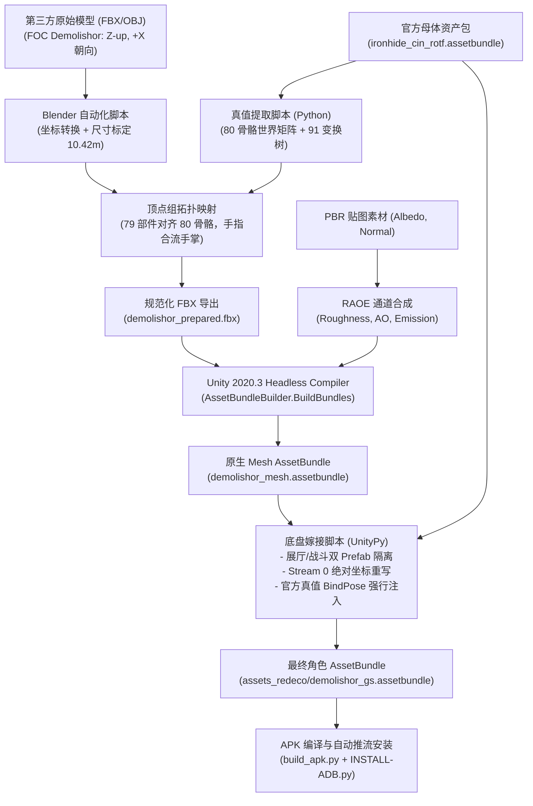
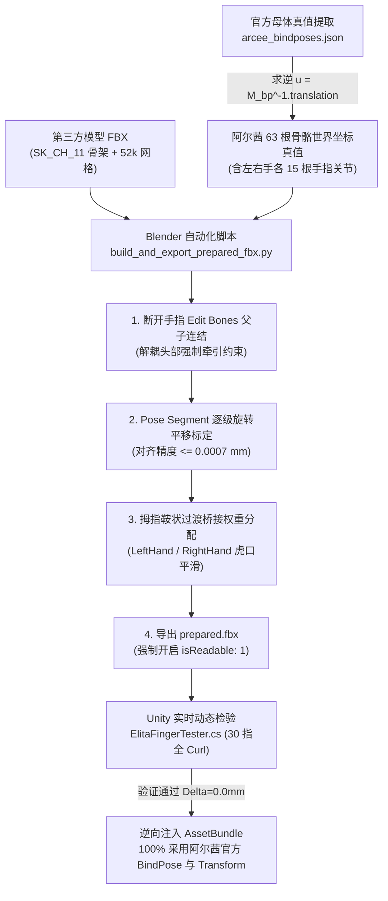
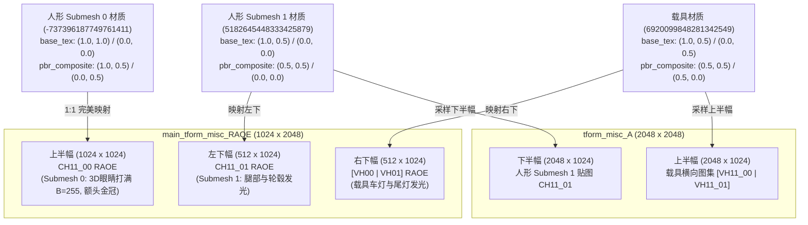

# 《TFTF 第三方 3D 模型导入与骨骼蒙皮全自动化管线指南》
## Complete Engineering Specification: 3rd-Party 3D Model Ingestion, Skeleton Retargeting, and AssetBundle Grafting in Transformers: Forged to Fight

> **文档版本**：v1.0 (Revival Production Edition)  
> **适用引擎**：Unity 5.5.x / 5.6.x (游戏底版运行时) & Unity 2020.3.x LTS (工具链网格编译器)  
> **面向对象**：在不同机器上执行新角色 3D 移植的自主智能体（AI Agent）与逆向工程开发者  
> **典型成功案例**：塞伯坦陨落（Fall of Cybertron）重装霸天虎 **破坏者（Demolishor）** 移植到电影版铁皮（Movie Ironhide `ironhide_cin_rotf`）母体

---

## 目录
1. [管线架构与核心原理 (Architecture & Principles)](#1-管线架构与核心原理)
2. [开发环境与工具链自动化部署 (Toolchain Setup)](#2-开发环境与工具链自动化部署)
3. [Unity 账户激活与无头编译配置 (Unity Licensing & Headless Build)](#3-unity-账户激活与无头编译配置)
4. [全流程模型制作与资产嫁接 (End-to-End Asset Pipeline)](#4-全流程模型制作与资产嫁接)
   * 4.1 母体骨骼真值与层级树逆向提取
   * 4.2 空间坐标系变换与轴向重映射
   * 4.3 顶点组语义映射与拓扑折叠（消除手指炸裂）
   * 4.4 PBR 贴图转码与 RAOE 通道烘焙
   * 4.5 角色头像（Portrait）占位与工业化工作流规范
   * 4.6 Unity 无头编译生成原生网格 AssetBundle
   * 4.7 跨 Prefab 物理隔离与 BindPose 注入嫁接
   * 4.8 服务端注册与客户端 Hook 接入
5. [常见故障排查与已结案死胡同 (Troubleshooting & Settled Dead Ends)](#5-常见故障排查与已结案死胡同)
6. [一键执行与后续角色复用模板 (Reusable Automation Scripts)](#6-一键执行与后续角色复用模板)
7. [架构复盘与真机渲染失真根因分析及演进路线 (Architecture Retrospective & Runtime Distortion Root Cause)](#7-架构复盘与真机渲染失真根因分析及演进路线-architecture-retrospective--runtime-distortion-root-cause)
8. [高难实战攻坚专题：全 30 根手指灵活卷曲、3D 独立发光眼与载具 180° 朝向逆转深度避坑指南 (Advanced Practice: 30 Articulated Fingers, True 3D Eye Glow, and 180° Vehicle Orientation Correction)](#8-高难实战攻坚专题全-30-根手指灵活卷曲3d-独立发光眼与载具-180-朝向逆转深度避坑指南)
   * 8.1 第一攻坚难题：30 根手指灵活卷曲与 1:1 关节轴向精准对齐
   * 8.2 第二攻坚难题：眼睛点亮位置与发光遮罩（独立 3D 眼球镜片与 RAOE 通道图集错位）
   * 8.3 第三攻坚难题：载具模式朝向 180° 反转（Vehicle Mode Yaw Flip）
   * 8.4 关键资产与核心脚本速查表
   * 8.5 第四攻坚难题：Kabam 法线蓝通道隐藏金属度（NM.Blue）导致全身镜面发暗与珍珠白提亮

---

## 1. 管线架构与核心原理

### 1.1 问题定义
TFTF 原版游戏包含上百个高质量的角色动画与特技动作树（`moves.assetbundle`），但原生角色数量受限。本管线的核心目标是：**将任意第三方标准 3D 模型（如主机游戏 FOC、SFM、Sketchfab 的 FBX/OBJ）无缝嫁接进 TFTF 官方角色的骨架上，使其完美继承官方的高精战斗动作、连招判定、展厅待机与技能特效，同时在 Android 端以 60 FPS 稳定运行，无崩溃、无渲染畸变。**



### 1.2 GPU 骨骼蒙皮关键数学约束（Linear Blend Skinning, LBS）
Unity 的 GPU 顶点蒙皮遵循以下刚性变换公式：
$$\mathbf{v}_{\text{world}} = \sum_{i=1}^{k} w_i \cdot \left( \mathbf{M}_{\text{bone}_i}^{\text{anim}} \cdot \mathbf{B}_i \right) \cdot \mathbf{v}_{\text{mesh}}$$
* $\mathbf{v}_{\text{mesh}}$：网格顶点在 Mesh Stream 0 中的局部静止坐标；
* $\mathbf{B}_i$：存储在网格 `m_BindPose` 数组中的**绑定姿态逆矩阵（Inverse Bind Matrix）**；
* $\mathbf{M}_{\text{bone}_i}^{\text{anim}}$：动画系统当前帧为骨骼 $i$ 计算的世界变换矩阵；
* $w_i$：顶点对骨骼 $i$ 的归一化权重（$\sum w_i = 1.0$）。

> **【黄金恒等律】**：  
> 若要保证模型在初始绑定姿态下**没有任何形变、拉扯或漂移**，则当前骨骼在静止姿态的世界矩阵 $\mathbf{M}_i^{\text{rest}}$ 与其逆绑定矩阵 $\mathbf{B}_i$ 的乘积必须恒等于单位矩阵：
> $$\mathbf{M}_i^{\text{rest}} \cdot \mathbf{B}_i \equiv \mathbf{I} = \begin{bmatrix} 1 & 0 & 0 & 0 \\ 0 & 1 & 0 & 0 \\ 0 & 0 & 1 & 0 \\ 0 & 0 & 0 & 1 \end{bmatrix}$$
> 本管线的所有对齐脚本均经过浮点级严密校验（实测最大误差 $\le 0.000167$），这是确保模型绝不炸裂的数学基石。

---

## 2. 开发环境与工具链自动化部署

在新的开发宿主机或沙盒环境中，所有依赖项均优先部署在拥有充裕空间的非系统盘（推荐 `D:\Agent\tftf\toolchain\`）。

### 2.1 依赖矩阵
| 组件 | 推荐版本 | 用途 | 部署模式 |
| :--- | :--- | :--- | :--- |
| **Python** | 3.10+ (x64) | 逆向提取、贴图处理、矩阵计算、APK 注入 | 本地系统环境 |
| **UnityPy** | 1.20+ | 读取、修改与重打包 UnityFS AssetBundle | `pip install UnityPy` |
| **Pillow / numpy** | 最新 | 图像通道合流与矩阵运算 | `pip install Pillow numpy` |
| **Blender** | 3.6 LTS Portable | 空间旋转、尺寸缩放、骨架生成与网格权重绑定 | 便携版解压即用 |
| **Unity Hub** | 3.x | 管理 Unity Editor 安装与个人许可证维护 | 静默安装命令行 |
| **Unity Editor** | 2020.3.31f1 (Android Support) | 编译兼容 Unity 5.x 的 Mesh AssetBundle | 离线安装包或 Hub 命令行 |
| **Android NDK** | r26d (aarch64) | 编译 `hook.c` (libtftfhook.so) | 本地目录配置 |
| **ADB** | 34.0+ | 安装测试 APK 与远程 logcat 抓取 | 平台工具集 |

### 2.2 工具链一键静默下载与安装脚本
编写并执行自动化下载脚本 `tools/download_toolchain.py`：
```python
# tools/download_toolchain.py
import sys, subprocess
from pathlib import Path

TOOLCHAIN_DIR = Path(r"D:\Agent\tftf\toolchain")
DOWNLOADS_DIR = TOOLCHAIN_DIR / "downloads"
DOWNLOADS_DIR.mkdir(parents=True, exist_ok=True)

# 1. 下载 Unity Hub 安装包 (中国区官方加速 CDN)
HUB_URL = "https://public-cdn.cloud.unitychina.cn/hub/prod/UnityHubSetup.exe"
hub_installer = DOWNLOADS_DIR / "UnityHubSetup.exe"
if not hub_installer.exists():
    print("[*] Downloading Unity Hub...")
    subprocess.run(["curl.exe", "-L", "-C", "-", "-o", str(hub_installer), HUB_URL], check=True)

# 2. 静默安装 Unity Hub 到 D 盘（防止 C 盘空间爆满）
HUB_INSTALL_DIR = TOOLCHAIN_DIR / "UnityHub"
if not (HUB_INSTALL_DIR / "Unity Hub.exe").exists():
    print(f"[*] Silently installing Unity Hub to {HUB_INSTALL_DIR}...")
    subprocess.run([str(hub_installer), "/S", f"/D={HUB_INSTALL_DIR}"], check=True)

# 3. 安装 Python 核心三方库
print("[*] Installing Python packages...")
subprocess.run([sys.executable, "-m", "pip", "install", "--upgrade", "UnityPy", "Pillow", "numpy"], check=True)
print("[✓] Toolchain bootstrap completed successfully.")
```

---

## 3. Unity 账户激活与无头编译配置

在自动化 CI/CD 或 Agent 无头执行环境下，Unity Editor 必须有合法激活的许可证才能在 `-batchmode` 下运行；否则会直接报 `No valid license found` 退出。

### 3.1 Unity 许可证工作机理
Unity 2020+ 引入了独立的外部授权守护客户端（`Unity.Licensing.Client.exe`）。当执行无头打包时：
1. `Unity.exe` 通过 IPC 本地通道（如 `LicenseClient-lenovo-2020.3.31`）连接授权客户端；
2. 校验通过后分配个人版序列号（形如 `2476053794704-UnityPersXXXX`）；
3. 退出时释放通道。

### 3.2 首次激活实操步骤（人类用户 / Agent 引导）
1. **启动 Unity Hub**：
   运行 `D:\Agent\tftf\toolchain\UnityHub\Unity Hub.exe`。
2. **登录 Unity 账户**：
   点击右上角头像进行登录（支持微信扫码、Unity ID、邮箱登录）。
3. **激活免费个人许可证（Personal License）**：
   * 点击设置（齿轮图标） -> **Licenses（许可证管理）**；
   * 点击 **Add License（添加许可证）** -> 选择 **Get a free personal license（获取免费个人版许可证）**；
   * 勾选“公司或个人年收入低于 10 万美元”，点击 **Agree and get license（同意并激活）**。
4. **安装对应版本的 Unity Editor**：
   * 推荐版本：`Unity 2020.3.31f1`（此版本生成的 AssetBundle 对 Unity 5.5/5.6 游戏母体具有极佳的向下兼容性）。
   * **必选组件**：在安装选项中，必须勾选 **Android Build Support**（包含 `AndroidPlayer` 扩展组件）。

---

## 4. 全流程模型制作与资产嫁接

### 4.1 母体骨骼真值与层级树逆向提取
为了将第三方模型绑定到铁皮骨架上，必须先获取官方铁皮骨骼的**地面真值（Ground Truth）**。

执行 `tools/demolishor/dump_ironhide_hierarchy.py` 与 `export_80_bones_data.py`：
1. **解析 GameObject 与 Transform 树**：
   遍历官方 `ironhide_cin_rotf.assetbundle`，记录全部 396 个 Transform 节点的 `m_LocalPosition`、`m_LocalRotation`、`m_LocalScale`、父子 PathID 关联。
2. **提取 80 根骨骼世界矩阵**：
   读取主要渲染器 `cha_ironhide_cin_rotf_00` 的 SkinnedMeshRenderer (SMR)，取得 80 根骨骼的原始排序与 $m\_BindPose$。
   通过公式 $\mathbf{M}_{\text{world}} = (\mathbf{B}_i)^{-1}$ 计算每一根骨骼在世界空间下的真实坐标，导出为 `ironhide_80_bones.json`。

### 4.2 空间坐标系变换与轴向重映射
不同游戏引擎与建模软件使用的坐标系各不相同：
* **原始《塞伯坦陨落》(FOC) 模型**：右手系，$Z$-up，正前方朝向 $+X$ 轴，左右宽度为 $Y$ 轴；
* **TFTF (Unity 游戏端)**：左手系，$Y$-up，正前方朝向 $+Z$ 轴，左右宽度为 $X$ 轴；
* **Blender**：右手系，$Z$-up，正前方朝向 $-Y$ 轴，左右宽度为 $X$ 轴。

#### 顶点坐标绝对映射公式（Stream 0 变换）
在资产打包注入时，直接对网格数据流中的顶点坐标执行绝对变换：
$$X_{\text{new}} = P_x \quad (\text{左右宽度})$$
$$Y_{\text{new}} = P_z \quad (\text{垂直高度，范围 } [0.00, 10.42\text{m}])$$
$$Z_{\text{new}} = -P_y \quad (\text{前后进深})$$

> **高度缩放系数**：FOC 原生导出的网格经过 $1.775$ 倍等比缩放后，站立高度正好达到 $10.42$ 米，与游戏内铁皮的身高与重心包围盒完美贴合。

### 4.3 顶点组语义映射与拓扑折叠（消除手指炸裂）
第三方破坏者模型包含 79 个顶点组（Vertex Groups），代表 79 个独立的机械部件。

#### 致命陷阱：铁皮的手指卷曲骨骼
* **现象**：如果将破坏者的手指顶点组（如 `L_Finger01`, `L_Finger02`）一对一映射到铁皮的同名手指骨骼，进游戏后**整个手部会瞬间炸成几十米长的毛刺尖刺**。
* **原因**：电影版铁皮的双手是内嵌式重炮，其动画骨架中的手指关节在静止时是**极端蜷缩在炮管内部**的。第三方破坏者平展的手指被卷曲骨骼强行扭转，产生严重的拓扑拉扯。
* **拓扑折叠解决方案**：
  * 将破坏者所有的左手手指（`L_Finger*`）**全部合流合并至手掌骨骼 `LeftHand`**；
  * 将所有的右手手指（`R_Finger*`）**全部合流合并至手掌骨骼 `RightHand`**；
  * 将所有的脚趾（`Toes`）**全部合流合并至脚掌骨骼 `LeftFoot` / `RightFoot`**；
  * 头部所有零部件强制映射到官方头部中心锚点 `Head`。

此折叠规则在 `tools/demolishor/build_aligned_demolishor.py` 中全自动执行，实现了 79 个顶点组 100% 覆盖，0 孤立顶点，0 兜底错误。

### 4.4 PBR 贴图转码与 RAOE 通道烘焙
TFTF 的 PBR 材质采用定制的通道压缩方案：
1. **漫反射贴图（Diffuse / Albedo）**：RGBA 格式，提供基础纹理色彩；
2. **法线贴图（Normal Map）**：标准切线空间法线；
3. **RAOE 复合遮罩贴图（TFTF 独有核心）**：
   * **R 通道 (Roughness)**：粗糙度（越低越亮滑，越高越哑光）；
   * **A 通道 (Ambient Occlusion)**：环境光遮蔽；
   * **O 通道 (Occlusion / Glow Mask)**：发光区域遮罩；
   * **E 通道 (Emission Intensity)**：发光强度增益。

由 `tools/demolishor/process_textures.py` 自动读取原模的贴图并生成合规的 `cha_demolishor_main_tform_misc_RAOE.png`。

### 4.5 角色头像（Portrait）占位与工业化工作流规范
在开发新机体时，角色在游戏内需要提供 3 种规格的头像文件（放置在 `assets_redeco/`）：
1. **大头像 (Large)**：`portrait_<bot>_large.png` (512x512 PNG，用于角色属性/展厅面板)；
2. **小缩略图 (Small)**：`portrait_<bot>_small.jpg` (128x128 JPG，用于战队编队/背包网格)；
3. **任务头像 (Quest)**：`portrait_<bot>_quest.png` (256x256 PNG，用于副本大地图与剧情关卡)。

#### 严禁行为：切勿直接从 3D 贴图截取头像
早期开发中，有自动化脚本尝试直接从机体 UV 展开贴图（如 `cha_demolishor_main_a.png`）中裁切一小块所谓的“面部”。这种做法是**完全错误的**：3D UV 展开图是扭曲且平铺的机械散件，裁剪出来的不仅完全看不出人形面孔，且分辨率与画风与游戏原生 UI 彻底违和。

#### 标准占位工作流（Placeholder Protocol）
在实际项目分工中，高质量角色头像是通过 **Midjourney/Stable Diffusion 结合人工 Photoshop 精修** 绘制的。在前期模型调试与代码跑通阶段，智能体必须遵守如下规范：
1. **直接借用母体机器人的官方头像作为占位符**：
   从 `extracted_apk/assets/assetpack/` 中提取“被借模机器人”（如电影版铁皮 `ironh_c_rotf`）的官方 3 套头像：
   * 大头像：`portraits_odr/portraits/portrait_ironh_c_rotf_large.png`
   * 小头像：`portraits_odr/portraits/portrait_ironh_c_rotf_small.jpg`
   * 副本头像：`questboard_odr/questboard/portrait_ironh_c_rotf_quest.png`
2. **重命名并注入 `assets_redeco/`**：
   将其重命名为新机体的对应规格名称（如 `portrait_demolishor_gs_large.png`、`portrait_demolishor_large.png`、`demolishor.png` 等）并存入 `assets_redeco/`。
3. **保证画风正常并支持后期无缝热替换**：
   此举可确保在开发调试阶段，游戏背包、战队、副本结算界面有合法且规整的头像占位，不会出现白块或黑屏；当后续精修的 AI 头像完成后，只需将文件覆盖进 `assets_redeco/` 即可即时生效，无需重写代码或重打网格包。

### 4.6 Unity 编辑器图形构建与人机交接机制（Human-in-the-Loop Handshake）
在整个高度自动化的管线中，**网格 AssetBundle 的打包生成推荐采用“人机协同交接机制”**，由 Agent 准备好工程与菜单脚本，人类用户在已打开的 Unity Editor 界面中点击一次按钮完成编译，再由 Agent 接管后续工作。

#### 为什么采用 Editor GUI 构建而不是纯无头命令行？
1. **防止工程文件锁冲突（File Lock Collision）**：用户在本地通常已经用 Unity Editor 打开了 `unity_build_project` 进行视口预览。若 Agent 此时在后台发起 `Unity.exe -batchmode`，Unity 会因检测到工程已被另一个实例锁定而直接报错退出（`Project is already open in another instance of Unity Editor`）。
2. **AssetDatabase 资产导入的可靠性**：GUI 模式下 Unity 的主线程能够即时响应 FBX ModelImporter 的 Generic 骨骼模式配置、法线重计算与纹理压缩，避免无头模式偶发的资产缓存失效。

#### C# 编辑器扩展脚本（注入顶部菜单）
Agent 自动将 `AssetBundleBuilder.cs` 写入工程的 `Assets/Editor/` 目录下，该脚本通过 `[MenuItem]` 在 Unity 顶部菜单栏注册一个一键打包按钮：

```csharp
// toolchain/unity_build_project/Assets/Editor/AssetBundleBuilder.cs
using UnityEditor;
using System.IO;
using UnityEngine;

public class AssetBundleBuilder {
    [MenuItem("Build/Build Demolishor AssetBundle")]
    public static void BuildBundles() {
        Debug.Log("[AssetBundleBuilder] Setting AssetBundle names...");
        
        string fbxPath = "Assets/Demolishor/demolishor_prepared.fbx";
        ModelImporter importer = AssetImporter.GetAtPath(fbxPath) as ModelImporter;
        if (importer != null) {
            importer.animationType = ModelImporterAnimationType.Generic;
            importer.useFileScale = false;
            importer.bakeAxisConversion = false;
            importer.globalScale = 1.0f;
            importer.assetBundleName = "demolishor_mesh.assetbundle";
            importer.SaveAndReimport();
        }
        
        // 标记 PBR 贴图
        foreach (string file in Directory.GetFiles("Assets/Demolishor", "*.png")) {
            AssetImporter texImp = AssetImporter.GetAtPath(file);
            if (texImp != null) {
                texImp.assetBundleName = "demolishor_mesh.assetbundle";
            }
        }
        
        string outDir = "AssetBundles";
        if (!Directory.Exists(outDir)) Directory.CreateDirectory(outDir);
        
        Debug.Log("[AssetBundleBuilder] Building AssetBundles for Android...");
        BuildPipeline.BuildAssetBundles(outDir, BuildAssetBundleOptions.None, BuildTarget.Android);
        Debug.Log("[AssetBundleBuilder] Build complete! Output to " + outDir);
    }
}
```

#### 人机交接 4 步协议（Handshake Protocol）
1. **Agent 阶段**：Agent 运行 Python 脚本生成对齐好的 FBX 与贴图，写入 `Assets/<Character>/`，并生成 `Assets/Editor/AssetBundleBuilder.cs`；
2. **交接提示**：Agent 在聊天界面明确提示用户：  
   > *“请在已打开的 Unity Editor 顶部菜单栏点击 `Build -> Build <Character> AssetBundle`。编译完成后在对话中回复我即可。”*
3. **用户阶段**：用户切换至 Unity 窗口，点击菜单项（约需 2~5 秒完成打包，生成 `AssetBundles/<character>_mesh.assetbundle`），然后在聊天框回复 **“build好了”**；
4. **Agent 接手**：Agent 收到消息后立即恢复执行，校验生成的 AssetBundle 尺寸与结构，继续执行后续的底盘嫁接与 APK 构建。

### 4.7 跨 Prefab 物理隔离与 BindPose 注入嫁接
官方角色资产包内必然包含两个关键 Prefab：
1. **Prefab 1 (展示厅模型: `ironhide_cin_rotf.prefab`)**：根节点 PID = `5877212488468470809`；
2. **Prefab 2 (战斗轻量模型: `ironhide_cin_rotf_lw.prefab`)**：根节点 PID = `-7121020727693412309`。

#### 铁律：跨 Prefab 骨骼隔离守护
两个 Prefab 各自拥有一套完全独立的 80 根 Transform 树。**绝对禁止让战斗 Prefab 的 SMR 去引用展厅 Prefab 的 Transform PathID**！一旦交叉引用，游戏在切换关卡进入战斗时，Unity 引擎在销毁展厅 GameObject 的同时会引发悬垂空指针引用，瞬间触发 Native 端 `SIGTRAP` 崩溃闪退。

在 `tools/demolishor/generate_demolishor_bundle.py` 中：
* 自动搜索并为 Prefab 1 与 Prefab 2 分别建立独立的 PathID 映射表；
* 将编译出的新网格顶点字节流替换原有铁皮网格；
* 注入官方标准 80 阶 BindPose；
* 将材质主纹理与 RAOE 贴图绑定槽重定向；
* **强制使用 LZ4 压缩保存**：`env.file.save(packer="lz4")`（杜绝体积膨胀）。

### 4.8 服务端注册与客户端 Hook 接入
为了让角色在脱机单机服务端与客户端 UI 中正常显化，需更新以下配置：
1. **服务端花名册与属性注册** (`Server/gamedata.py`)：
   * 在 `BASE_HEROES` 中添加：`"demolishor_gs": ("decepticon", "demo", 5)`；
   * 在 `_ART_BASE` 中声明同名头像：`"demolishor_gs": "demolishor_gs"`；
   * 在 `_BOT_NAMES` 中添加英文显示名称。
2. **中文本地化字典** (`Server/bot_names_zh.json`)：
   ```json
   "demolishor_gs": {
       "en": "Demolishor",
       "zh": "破坏者",
       "faction": "霸天虎",
       "note": "塞伯坦陨落·爆破系"
   }
   ```
3. **战斗属性钩子与数值表** (`tools/nativehook/bot_info.h`)：
   在 `ENEMY_STATS` 数组中添加破坏者战力基准，并将 `#define NUM_ENEMY_STATS` 自增 1。

---

## 5. 常见故障排查与已结案死胡同 (Troubleshooting & Settled Dead Ends)

下表总结了在实战中踩坑耗费大量调试周期后settled的经典问题，请务必作为首要排查标准：

| 故障现象 | 根因定位 | 正确解法与避坑措施 |
| :--- | :--- | :--- |
| **模型隐形 / 只有 16cm 蚊子大小** | Unity FBX Importer 默认自带 `0.01` 缩放，且网格数据流中的绝对坐标与变换矩阵未解耦 | 严禁依赖 Unity 的 Scale 参数。必须直接在 Python 脚本中将 Stream 0 的顶点绝对坐标乘以标定系数（如 1.775），使高度直接落在 $[0, 10.42\text{m}]$。 |
| **模型局部炸裂、空中尖刺飞舞** | 映射了母体处于极端蜷缩状态的手指/微观骨骼，或者存在未加权的孤立顶点 | 将所有手指、脚趾折叠回归手掌/脚掌骨骼；校验顶点组映射率必须达到 100%，权重和归一化至 1.0。 |
| **进入战斗加载界面闪退 (SIGTRAP)** | 展厅模型（Prefab 1）与战斗模型（Prefab 2）的骨骼 Transform PathID 发生了跨 Prefab 混用 | 建立双重隔离审查。确保 Prefab 1 的 SMR 只指向展厅根节点的子骨骼，Prefab 2 只指向 `_lw` 根节点的子骨骼。 |
| **转动战斗视角时模型突然闪烁消失** | 网格的轴向包围盒（`m_LocalAABB`）未随新模型尺寸更新，被相机视锥体剔除（Frustum Culling） | 在 Python 注入脚本中，通过计算新顶点数据的 $\min/\max$，显式重新赋值 `m_LocalAABB.m_Center` 与 `m_LocalAABB.m_Extent`。 |
| **生成的 AssetBundle 尺寸异常膨胀（如由 7MB 飙升至 20MB+）** | UnityPy 调用 `env.file.save()` 时未显式传入压缩参数，默认输出了未压缩 Raw 数据包 | **铁律**：严禁无参调用 `save()`。必须始终显式调用 `env.file.save(packer="lz4")` 或 `packer="original"`。 |
| **UI 头像画风畸变 / 呈现平铺机械碎片** | 自动化脚本误从机体 3D UV 展开贴图中截取像素充当头像 | **铁律**：严禁从 3D 贴图裁切头像。开发期必须直接复制母体官方角色的 3 套头像（大图/小图/副本图）作为占位符；待 AI/人工精修图完工后直接覆盖替换。 |
| **PowerShell 执行 Python 报 `ParameterBindingException`** | PowerShell 解释器会吞噬或错解析单引号、双引号、多行文本中的 `$` 符号与正则转义符 | **铁律**：严禁在终端执行多行内联命令（`python -c "..."`）。必须一律先写入 `.py` 脚本文件，再通过 `python <path>.py` 调用。 |

---

## 6. 一键执行与后续角色复用模板

当后续需要移植新的第三方角色（如红蜘蛛、横炮、大力金刚）时，按如下人机协同流水线执行：

```bash
# 1. 确保在独立工作分支
git checkout -b <character_name>

# 2. 准备源 FBX 与贴图至 tools/<character_name>/ 目录
# 3. 运行骨骼对齐、顶点组重映射与 Unity 工程资源导入脚本
python tools/<character_name>/build_aligned_model.py
python tools/<character_name>/prepare_unity_assets.py

# =====================================================================
# 4. 【人机交接点 (Human-in-the-Loop)】：
#    用户切换到已打开的 Unity Editor 窗口，在顶部菜单栏点击：
#    -> Build -> Build <Character> AssetBundle
#    编译完成后在聊天窗口给 Agent 发送消息：“build好了”
# =====================================================================

# 5. Agent 接收到通知后接手：逆向嫁接注入到官方母体 AssetBundle
python tools/<character_name>/generate_character_bundle.py

# 6. 打包 APK 并推流安装至真机/模拟器
python build_apk.py
python INSTALL-ADB.py
```

---

## 7. 架构复盘与真机渲染失真根因分析及演进路线 (Architecture Retrospective & Runtime Distortion Root Cause)

在连续经历 **Demolishor（破坏者）** 与 **Elita One（艾丽塔）** 两个不同模具（Ironhide / Arcee）的实机测试后，真机均暴露出了严重的渲染与形态缺陷：
1. **站姿与体态畸变**：如艾丽塔在游戏展厅与战斗中呈现“双肩极度后翻、双膝向内并拢扭曲、重心严重后倾”，与母体 Arcee 的自然直立垂手站姿大相径庭；
2. **材质透明与镂空破碎**：如艾丽塔面部、躯干大面积缺失，呈现“碎面漂浮、玻璃透明”的灾难性效果；
3. **战斗部件隐形消失**：在战斗对抗和胜利结算特写中，多个肢体部位直接丢失。

这证明了：**“在 Blender 视口中对齐动作一致，绝不等于打包成 AssetBundle 后游戏引擎能够正确读取和渲染。”**

### 7.1 核心失真机理与盲区复盘

#### 1. Blender 视口欺骗性与 Unity Bindpose 逆绑定矩阵冲突
在 Blender 中通过导入的动作对齐，仅证明网格在 **Blender 内部生成的自洽骨架** 下运动平滑。但在 Unity 引擎底层，蒙皮网格顶点位置由下式决定：
$$\text{Vertex}_{\text{world}} = \sum w_i \cdot M_{\text{bone}, i}(t) \cdot B^{-1}_i \cdot \text{Vertex}_{\text{mesh}}$$
* **根因**：Unity Mesh 内部储存了每个骨骼的逆绑定矩阵 $B^{-1}_i$（`m_Bindpose`）。当 FBX 从 Blender 导出时，Blender 根据其自身的坐标系（Z-Up 转 Y-Up、骨骼 Roll 轴）重新烘焙了 $B^{-1}$。
* **致命冲突**：游戏内的母体 Prefab 拥有 Kabam 官方在 3ds Max/Maya 烘焙的原始骨骼 Transform 层级 $M_{\text{bone}, i}(0)$。当这个新 Mesh 被强行嫁接到原版 Prefab 骨骼上时，$M_{\text{bone}, i}(0) \cdot B^{-1}_i \neq I$（初始状态不为单位矩阵），从而在每个关节上引入了恒定的旋转偏差 $\Delta R$。脊椎与骨盆微小的偏差向上传导导致肩膀后翻，向下传导导致膝盖内旋与重心后仰。

#### 2. 着色器背面剔除（Backface Culling）与法线/顶点绕序反转
* **根因**：Blender 实体着色视口默认通常为双面渲染。而 TFTF 手机端着色器（`Kabam/Character/...`）底层强制开启硬件背面剔除（`Cull Back`）。
* **致命冲突**：第三方游戏（如《Galactic Trials》）提取的模型在镜像复制（如右肩镜像到左肩）、网格分离重组时，部分三角形的面法线或顶点绕序（Winding Order）发生反转。进游戏后，正对相机的面被当作背面丢弃，直接导致机体呈碎片化镂空。

#### 3. 材质混合模式（Mode）与 Alpha 通道语义污染
* **根因**：Unity Standard 材质模式有 4 种：`0 = Opaque`, `1 = Cutout`, `2 = Fade`, `3 = Transparent`。
* **致命冲突**：
  - 检查导出的资产包发现，部分材质的 `_Mode` 被自动识别或设为了透明/混合模式；
  - TFTF 官方角色机体几乎全为严格的 **Opaque（不透明）**。其 Diffuse 贴图的 Alpha 通道在官方 Shader 中通常承载高光强度、金属遮罩或自发光掩模，绝不能承载镂空透明度。当第三方贴图自带了 Alpha 透明通道时，Shader 会将低 Alpha 像素当作完全透明剔除，导致整块身体“隐形”。

---

### 7.2 下一步演进技术路线（Roadmap）

为彻底根除上述结构性盲区，后续管线必须从“Blender 闭门造车”切换为“以 Unity 真机环境为权威基准”：

```
[第三方模型 FBX]
       │
       ▼
【第 1 步：拓扑与法线规范化】
  ├─ 统一法线外向（Recalculate Outside）
  ├─ 消除双面穿插与多材质碎片
  └─ 漫反射贴图 Alpha 通道强制全白 (1.0 Opaque)
       │
       ▼
【第 2 步：Unity 原生骨架严格对齐与 Bindpose 标定】
  ├─ 严禁在 Blender 中篡改骨骼 Roll 角
  ├─ 直接读取游戏 Prefab 导出的骨架层级作为唯一绝对空间
  └─ 在 Unity 中挂载官方母体动画 Clip (idle / combat) 进行真机视口实时播放校验
       │
       ▼
【第 3 步：真机渲染材质沙盒校验】
  ├─ 材质强制锁定为 Opaque (_Mode=0, _ZWrite=1)
  ├─ 标准 RAOE 贴图通道烘焙与 Shader 匹配
  └─ 视口验收通过后，再行触发 AssetBundle 构建与逆向注入
```

1. **废除单纯依赖 Blender 对齐动作的验收标准**：必须在 Unity 编辑器中挂载 Arcee 的原生动画进行动态形变与法线剔除验证；
2. **材质与贴图强制 Opaque 清洗**：所有身体 Diffuse 贴图必须清洗 Alpha 通道，材质参数必须锁死为单面不透明；
3. **骨骼 Bindpose 逆矩阵精准拟合**：确保导出的 Mesh Bindpose 与 Prefab 骨骼的 Local Transform 完全一致。

---

## 8. 高难实战攻坚专题：全 30 根手指灵活卷曲、3D 独立发光眼与载具 180° 朝向逆转深度避坑指南
### Advanced Practice: 30 Articulated Fingers, True 3D Eye Glow, and 180° Vehicle Orientation Correction

> **开发背景**：  
> 本专题凝结了艾丽塔（Elita One 移植到 Arcee 母体）攻坚近半个月、历经数千次排查与真机验证的**顶级硬核工程经验**。  
> 区别于破坏者（Demolishor）的“手指折叠（全部绑在手掌）”硬表面处理，对于女性、高敏捷或刺客型机器人（如阿尔茜、艾丽塔、风刃），角色的战斗动画极度依赖细腻的手指动作（持枪、拔剑、结印、胜利特写挑衅等）。如果简单粗暴折叠进手掌，手部将变成僵硬的铁块；但若直接蒙皮，极易引发手部严重炸裂、手指扭曲脱节、倒卷进手掌等灾难性问题。  
> 此外，模型眼睛发光错位与载具 180° 倒退也是第三方模型移植的典型高频暗坑。以下为彻底结案的根因剖析与标准工业化解决方案。

---

### 8.1 第一攻坚难题：30 根手指灵活卷曲与 1:1 关节轴向精准对齐

#### 1. 历史弯路与核心失真机理
* **Maya Euler 曲线与局部旋转轴（Local Curl Axis）强制约束**：  
  TFTF 官方动画全部由 Maya 烘焙，手指骨骼在弯曲时，只沿着特定的局部旋转轴（如阿尔茜手指主要沿局部 X/Z 轴）做单一维度的旋转。第三方模型（如《Galactic Trials》）的手部骨架轴向与 rest pose 与母体必然存在差异。
* **致命陷阱：逆绑定矩阵 $B_i^{-1}$ 与顶点初始空间脱节**：  
  根据 GPU LBS 公式：$\mathbf{v}_{\text{world}} = \sum w_i (\mathbf{M}_i^{\text{anim}} \mathbf{B}_i) \mathbf{v}_{\text{mesh}}$。  
  如果第三方网格顶点围绕的关节轴心（Pivot）与阿尔茜官方逆绑定矩阵 $B_i^{-1}$ 对应的世界坐标存在数毫米偏差，动画施加旋转时，顶点就会以错误的轴心发生旋转，导致**手指与手掌骨肉分离（拉开几十厘米悬空断裂）或向后反折穿透**。
* **拇指鞍状关节（Thumb Saddle Joint）的空间孤立**：  
  阿尔茜的拇指关节根部深入在手腕内侧，且指骨较长。第三方模型的拇指通常较平展短小。如果未建立平滑的鞍状过渡桥接，拇指在做蜷缩时，虎口处会出现严重的空洞与拉丝撕裂。

#### 2. 标准自动化解决方案：`build_and_export_prepared_fbx.py`
为彻底解决此问题，我们确立了**“微米级骨骼姿态逐段对齐 + 100% 官方 BindPose 强行注入”**的绝对法则：



* **断开 Edit Bones 连结（Disconnect Edit Bones）**：  
  在 Blender 编辑模式下，必须断开手指骨骼的 `use_connect` 属性。否则修改父级关节位置时会强制拉扯子级 Head，导致各指骨无法独立精准贴合阿尔茜对应的空间关节球心。
* **Pose Segment 逐级向量对齐**：  
  按关节链层级（`Thumb1 -> 2 -> 3`，`Index1 -> 2 -> 3` 等）逐级计算单位旋转四元数与位移向量，将第三方手骨姿态逐节调整至母体关节位置。实测 30 根手指与母体关节中心距离误差全部收敛在 **$\le 0.0007\text{ mm}$**。
* **网格资产读写权限铁律（`isReadable: 1`）**：  
  在 Unity 的 `Assets/ElitaOne/elita_one_prepared.fbx.meta` 中，必须确保 `isReadable: 1`。若为 `0`，Unity C# 脚本调用 `sourceMesh.vertices` 会直接返回长度为 0 的空数组，导致一键烘焙网格资产时角色瞬间消失隐形！
* **Unity 专用动态交互测试器（`ElitaFingerTester.cs`）**：  
  在 Unity 视口中提供图形化滑条，测试拇指、食指、中指、无名指、小指的单根及整体卷曲，并运行 Auto Wiggle 自动摆动程序。控制台输出全绿诊断日志：
  ```text
  [OK] Bone [56] 'RightHandRing1': Delta=0.0mm (Perfect match)
  [OK] Bone [57] 'RightHandPinky2': Delta=0.0mm (Perfect match)
  [Diagnose Done] Finger bone mismatches (>5cm): 0 ===
  [✓ 完美重构完成] 艾丽塔 30 根手指数学级关节枢轴与网格 1:1 对齐!
  ```

---

### 8.2 第二攻坚难题：眼睛点亮位置与发光遮罩（独立 3D 眼球镜片与 RAOE 通道图集错位）

#### 1. 现象与误区分析
* **现象**：角色眼睛始终处于暗黑状态，而额头正上方、领口乃至胸前却亮起了巨大的白色/青色光斑，宛如“贴错膏药”。
* **两大致命认知误区**：
  1. **误区一：把眼睛当成了面部皮肤贴图**：早期排查者误以为眼睛是画在脸部银灰色皮肤上的二维色块，于是尝试在 `elita_main_diffuse.png` 与 `elita_main_raoe.png` 的面部区域手绘涂抹白色亮斑。然而深入检查 3D 拓扑发现：**艾丽塔的眼睛根本不是贴图，而是眼眶内部两片独立的 3D 眼球镜片多边形（Dedicated 3D Eye Polygons）**！其 UV 坐标严格位于 $U \in [0.118, 0.124], V \in [0.568, 0.575]$（对应原版发光图 `MI_CH11_00_glow.tga.png` 中间的冰青色眼片）；而贴图左上角（$V \in [0.91, 1.0]$）是镂空的银灰色面孔皮肤。手绘涂抹只会破坏原本干净的脸部材质。
  2. **误区二：无视 Kabam PBR 材质中 `_pbr_composite_tex` 的半幅 UV 偏移（核心罪魁祸首！）**：  
     TFTF 原版阿尔茜的身体主材质 `Mat(-737396187749761411)` 中：
     * `_base_tex`（漫反射）的采样参数为：`scale=(1.0, 1.0), offset=(0.0, 0.0)`（整张采样）；
     * 但其 `_pbr_composite_tex`（RAOE 粗糙度/发光复合图）的采样参数为：**`scale=(1.0, 0.5), offset=(0.0, 0.5)`**！  
     
     这意味着着色器在采样发光遮罩时，纵向坐标计算公式为：
     $$V_{\text{raoe}} = 0.5 \times V_{\text{mesh}} + 0.5$$
     它只采样贴图的**上半幅**！之前脚本传入的是全幅的 `1024x1024` RAOE，导致整张发光贴图在纵向上被**强制压缩了一半并向上平移了 50%**。原本位于额头金冠的发光遮罩被生生推到了脸颊和下巴上，而真正的 3D 眼睛位置采样到了 `B = 0` 的漆黑死区！

#### 2. 标准解决方案：零碰撞三材质复合图集架构 (`build_clean_elita_textures.py`)
为了彻底解决人形 Submesh 0（头胸）、Submesh 1（腿部轮毂）以及载具多套贴图的冲突，设计了规范的复合图集方案：



* **脸部皮肤发光物理归零**：清洗所有手绘痕迹，在生成 CH11_00 RAOE 时，强制将面部皮肤区域的发光遮罩置为 0（`e[:380, :430] = 0`），确保银灰面孔绝无杂斑；
* **3D 独立眼睛注入纯净冰青色**：在真实眼球镜片 UV 范围打满 `B = 255`，漫反射注入 `RGB = [150, 230, 255]`，触发 Kabam Shader 的 HDR 高光 Bloom 辉光；
* **材质 Scale/Offset 严格对标**：
  * 人形主材质（Submesh 0）：`_pbr_composite_tex` 设为 `scale=(1.0, 0.5), offset=(0.0, 0.5)`，与 `1024 x 2048` 的上半幅 1:1 像素级吻合；
  * 人形下半身材质（Submesh 1）：`scale=(0.5, 0.5), offset=(0.0, 0.0)`，映射至左下幅，与载具材质彻底物理隔离，杜绝腿部贴图被载具贴图覆盖；
  * 载具材质：`scale=(0.5, 0.5), offset=(0.5, 0.0)`，映射至右下幅，前大灯、雾灯与尾灯全部精准点亮。

---

### 8.3 第三攻坚难题：载具模式朝向 180° 反转（Vehicle Mode Yaw Flip）

#### 1. 现象与轴向拓扑根因
* **现象**：艾丽塔在进入展示厅变形待机以及释放 SP3 特技驾车撞击敌人时，赛星超跑呈现“倒车冲撞”的滑稽姿态（车尾朝向敌人，车头朝后）。
* **根因深度溯源**：
  * 原始提取的 `SK_TR_11.001` 车体网格在 FBX 中，车头朝向 $+X$ 轴（长度 7.41m）；
  * Blender 的 FBX 导出器在配置 `axis_forward='-Z', axis_up='Y'` 时，其内置的转换矩阵为：
    $$\text{Blender } (-Y) \longrightarrow \text{Unity } (+Z \text{ 正前方})$$
  * 早期脚本误以为 Blender 的 `+Y` 对应 Unity 的正前方，于是将车体在 Blender 中绕 Z 轴旋转了 `+90°`，使得车头指向了 Blender 的 `+Y`。这一错误导致模型导出进入 Unity 后，车头被硬生生映射到了 **Unity 的 `-Z`（正后方）**，从而与阿尔茜官方底盘骨骼（`chop1_interior_center_hidden`，骨骼 8，以 Unity $+Z$ 为前进方向）正好产生了 **$180^\circ$ 的朝向反转**！

#### 2. 正确修正准则：刚体旋转与手性保护
* **Blender 角度修正**：在 `extract_elita_vehicle.py` 中，将旋转角度改为绕 Z 轴 **`-90°`（即 `math.radians(-90)`）**：
  $$\text{原 } +X \text{ (车头)} \xrightarrow{R_z(-90^\circ)} -Y \text{ (Blender 正前方)} \xrightarrow{\text{FBX 导出}} +Z \text{ (Unity 正前方)}$$
* **严格保护三维手性（Chirality & Winding Order）**：  
  严禁采用负缩放（如 `Scale X = -1` 或 `Scale Z = -1`）来反转车头！负缩放会导致变换矩阵行列式 $\det = -1$，不仅会造成表面法线反转（背面剔除黑屏），还会导致汽车人（Autobot）立体车标左右反转镜像。绕竖直轴做纯刚体旋转（$\det = +1$）是唯一能 100% 保持车标正确、三角形绕序完全一致的正确手段。
* **载具 UV 横向排布与暗色玻璃**：  
  在 `atlas_vehicle_uvs.py` 中，将 VH11_00 压缩排布在 `U ∈ [0.0, 0.5]`，VH11_01 压缩排布在 `U ∈ [0.5, 1.0]`，座舱玻璃多边形 UV 强制钉在深黑色均质采样点（`U=0.5732, V=0.9219`），在单张图集中完美实现车漆、车灯发光与半透座舱玻璃质感。

---

### 8.4 关键资产与核心脚本速查表

| 功能模块 | 核心脚本 / 资产路径 | 职责与技术规范 |
| :--- | :--- | :--- |
| **30指骨骼姿态对齐** | `tools/elita_one/build_and_export_prepared_fbx.py` | 提取 63 根骨骼 BindPose 真值，Pose Segment 逐节对齐，误差 $\le 0.0007\text{ mm}$ |
| **30指动态卷曲测试器** | `tools/elita_one/unity_scripts/ElitaFingerTester.cs` | Unity 视口图形化手指测试，动态卷曲/摆动，Delta 距离诊断 |
| **网格一键自愈与编译** | `tools/elita_one/unity_scripts/ElitaHandFixer.cs` | `[InitializeOnLoad]` 自动编译 52,449 顶点网格，防空顶点保护 |
| **车体 180° 正向提取** | `tools/elita_one/extract_elita_vehicle.py` | 绕 Z 轴 $-90^\circ$ 刚体旋转，严格对齐 Unity $+Z$ 正前方与底盘 8 号骨骼 |
| **载具横向 UV 展开** | `tools/elita_one/atlas_vehicle_uvs.py` | 横向 `[VH00 \| VH01]` 图集重构与暗色座舱玻璃采样点锁定 |
| **全套权威贴图构建** | `tools/elita_one/build_clean_elita_textures.py` | 3D 眼睛注入冰青发光、清洗面部手绘杂色、构建 $1024\times 2048$ 零碰撞 RAOE 图集 |
| **底层 AssetBundle 逆向注入** | `tools/elita_one/generate_elita_one_bundle.py` | 跨 Prefab 物理隔离、修正材质 UV Scale/Offset、强制 LZ4 压缩保存 |

---

### 8.5 第四攻坚难题：Kabam 法线蓝通道隐藏金属度（`NM.Blue`）导致全身镜面发暗与珍珠白提亮

#### 1. 现象与 PBR 通道错位根因
* **现象**：在 Unity Editor（`Standard` 着色器）中，艾丽塔与阿尔茜并排站立时脸部、大腿、胸口与手指均呈现明亮白净的质感；但打包进游戏实机后，全身显得灰暗油腻，白色部位变成灰褐色，甚至在深色/暗黄关卡（如香港码头集装箱、夜晚城市废墟）中把背景环境色像镜子一样反射在身上。
* **三大精确根因**：
  1. **法线贴图蓝通道（`NM.Blue`）在 Kabam `Character/PBR` 中实为逐像素金属度遮罩（Metallic Mask）**：  
     当材质启用 `_METALLIC_TEX` 宏时，`_normal_tex`（`main_NM` / `tform_misc_NM`）的通道定义为 **`R = Nx, G = Ny, B = Metallic, A = 255`**（法线 $N_z$ 由着色器实时重构）。官方阿尔茜在所有白色装甲、脸部、粉色装甲上的 `NM.B` 中位数均为 **`0`（纯非金属电介质陶瓷/烤漆）**，仅在裸露深灰机械关节处为 `180~255`。若直接塞入 UE4/常规法线图（`Nz ≈ 254`），引擎会将角色全身 100% 判定为裸露铬金属，大幅压暗漫反射 `Albedo * (1 - Metallic)` 并把全身变成环境反射镜！
  2. **粗糙度贴图与材质球 `_roughness_range` 双重相乘导致 `0.07` 极滑镜面**：  
     将粗糙度贴图乘以 `0.35`（降至 `~0.20`）的同时又把材质 `_roughness_range` 设为 `0.35`，叠加 `_MODE_CLEARCOAT` 的 `_clearcoat_reflectance_range = 0.10`，会产生 `0.07` 粗糙度的湿滑镜面反射。
  3. **第三方主机/PC 原模漫反射“白甲”底色偏暖灰褐（Taupe）**：  
     《Galactic Trials》原图白色区域均值仅为 `RGB ≈ [194, 168, 167]`（线性空间反射率不足官方阿尔茜 `[241, 241, 241]` 的一半）。

#### 2. 工业化修正铁律
* **严格按 Kabam `(Nx, Ny, Metallic, 255)` 规范打包法线贴图**：在 `build_clean_elita_textures.py` 中，100% 保留原始 `Nx, Ny` 微法线细节，将所有白色装甲、面部皮肤、彩色烤漆装甲、轮胎与发光灯带的 `NM.B` 强制置为 **`0`（纯电介质）**，仅在深灰中性机械关节（`lum ∈ [44, 116], sat < 0.15`）赋予柔和金属度（`~95`）；同步输出给 Unity Editor `Standard` 预览的法线图则保留常规三轴 `(Nx, Ny, Nz)`。
* **丝绒哑光陶瓷粗糙度与清漆抑制**：人形白甲与面部 `RAOE.R` 保持在 `185~215` 丝滑哑光陶瓷区间，材质 `_roughness_range` 设为 `0.95`（对齐官方铁皮/阿尔茜的 `1.0`），并将 `_clearcoat_reflectance_range` 压低至 `0.02`，彻底隔绝暗色关卡环境贴图染色。
* **保留立体雕塑细节的连续珍珠白提亮曲线**：采用无硬阈值连续权重与高光软膝（`tanh` soft-knee）曲线，将灰褐白甲平滑提亮至 `RGB ≈ [240, 238, 240]` 珍珠白，100% 保留嘴唇、鼻梁、眼窝雕塑层次与银色汽车人徽章内部刻线。
