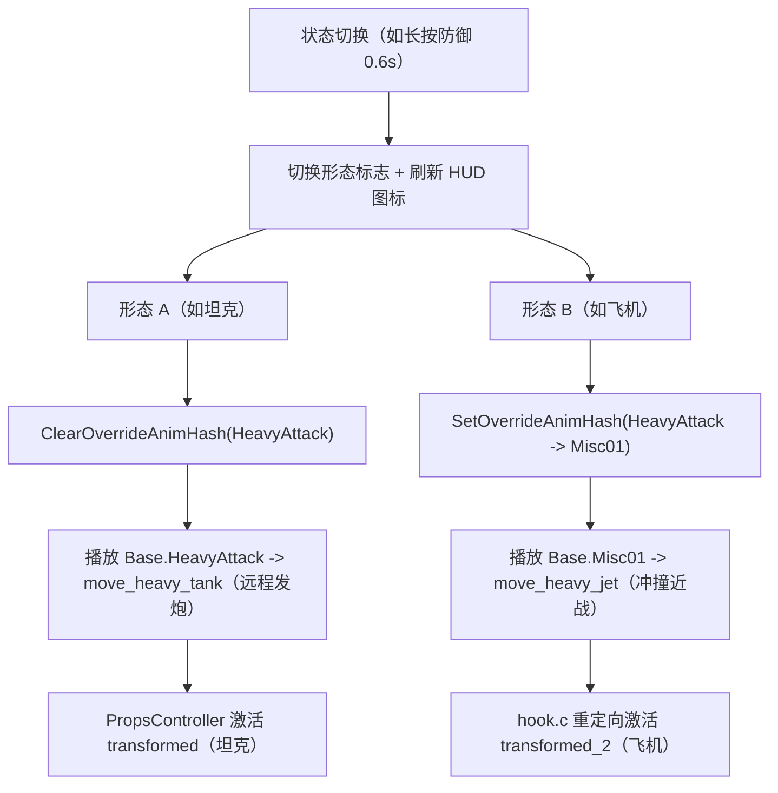
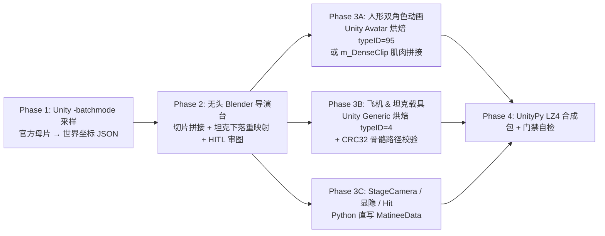

# 《百炼为战》（TFTF）三变金刚（Triple Changer）技术路线指南

> **适用原型**：闪电（Blitzwing：人形 / 喷气机 / 坦克）、弹簧（Springer：人形 / 直升机 / 装甲车）、沙暴（Sandstorm：人形 / 垂直起降机 / 越野车）等拥有**两种载具形态**的变形金刚。  
> **文档定位**：技术可行性论证与工程实施路线图（当前为设计方案沉淀，尚未实装进代码）。

---

## 一、 核心思路概览

在原版《百炼为战》中，每名角色通常只有一种载具形态（在重击 `HeavyAttack` 与 `SP3` 中使用）。若要实现“三变金刚”，核心机制可以拆解为三层协同：

1. **状态切换层（类探长机制）**：借用类似探长（Hound）“按住防御切换弹药”的交互思路，在战斗中维护一个形态标志（如 `AltMode A` ↔ `AltMode B`），并通过 HUD 被动图标向玩家明示当前待命的载具形态。
2. **动作与招式分流层（原生备用槽 + 哈希覆写）**：利用游戏底层已有的动画哈希覆写机制（`SetOverrideAnimHash`）与通用状态机预留的 `Base.Misc01` 槽位，让角色在不同状态下触发重击时，自动分流到两套完全不同的 `Move` 数据（例如：**形态 A 变坦克远程炮击** vs **形态 B 变飞机近战冲撞**）。
3. **资产层（单 AssetBundle 内置双载具）**：利用角色预制体自带的 `PropsController` 道具字典机制，在同一个角色 `.assetbundle` 中同时编译并预热两套载具骨架、网格与动作控制器，战斗中按状态定向显隐。

---

## 二、 AssetBundle 层：单包内置双载具的可行性与结构

### 1. 引擎底层原理：载具本质上是受控“道具（Prop）”

通过分析反编译源码 [`PropsController.cs`](file:///d:/Agent/tftf/decomp_310_source/PropsController.cs) 与 [`PropData.cs`](file:///d:/Agent/tftf/decomp_310_source/PropData.cs) 可知，TFTF 的变形并非将人形网格直接变形扭曲，而是将载具作为独立子节点挂载在骨骼树（通常为 `character_model/Reference/Hips`）下，并以字符串键名登记在 `PropsController._props` 字典中：

- `"character_model"`：人形主网格；
- `"transformed"`：载具形态预制体实例，拥有自己独立的 `GameObject`、骨骼、`SkinnedMeshRenderer`、`Animator` 以及基于 `animator_prop_gameplay` 的 `AnimatorOverrideController`；
- 各类武器（如 `"Sword"`、`"axe"`、`"gun"`）也同样作为 `PropData` 存放在同一个字典里。

进战斗加载阶段，[`BattleArbiterInitState.cs`](file:///d:/Agent/tftf/decomp_310_source/BattleArbiterInitState.cs#L496-L515) 会遍历 `PropsController._props` 中的**全部条目**执行 `PreWarm`（预实例化、预热材质 Shader、并按 `PropInitFlags` 复位隐藏）。

### 2. 双载具 AssetBundle 打包结构

基于这一机制，**完全可以在同一个角色 `.assetbundle` 中直接编译进两套互不干扰的载具形态**：

| `PropsController._props` 键名 | 挂载内容 | `InitFlags` 建议 | 说明 |
|---|---|---|---|
| `"character_model"` | 人形主网格与骨架 | `-9`（原版常规值） | 常驻人形外观 |
| `"transformed"` | **载具形态 A**（如坦克骨架/网格 + `override_blitzwing_tank`） | `8`（`FrontendTransformed`，即 Gameplay 默认隐藏但参与 `PreWarm`） | 沿用原生默认键名 |
| `"transformed_2"`（或 `"transformed_jet"`） | **载具形态 B**（如飞机骨架/网格 + `override_blitzwing_jet`） | `8`（同样默认隐藏且参与 `PreWarm`） | 第二载具独立子层级 |

**工程优势**：
- **战斗中零加载卡顿**：两套载具都在开战 Loading 阶段由官方流程自动 `PreWarm` 完毕，切换时仅开关 `Renderer.enabled`，无动态实例化掉帧风险；
- **骨骼与控制器完全隔离**：坦克炮塔/履带骨骼与飞机机翼/尾焰骨骼各自独立挂在自己的子层级和 `AnimatorOverrideController` 下，互不穿模污染，可各自直接复用成熟模具（如坦克借用 `megatron_gs_leader2015`、飞机借用 `windblade_gs` 或 Seekers 系列）。

> [!NOTE]
> 打包双载具时仍需严格遵守 [`ORIGINAL_CHARACTER_CREATION_GUIDE.md`](file:///d:/Agent/tftf/re_notes/ORIGINAL_CHARACTER_CREATION_GUIDE.md) 中的命名空间隔离铁律：确保角色 `ModelID`、AssetBundle 文件名及内部 `CAB` 哈希全局唯一，并使用 `packer="lz4"` 保存。

---

## 三、 动作与招式分流：利用原生 `Misc` 备用槽与动画覆写

### 1. 为什么不需要魔改 Unity 状态机？

查阅 [`PlayerController.cs`](file:///d:/Agent/tftf/decomp_310_source/PlayerController.cs) 与 [`MoveSequencer.cs`](file:///d:/Agent/tftf/decomp_310_source/EB.MoveEditor/MoveSequencer.cs) 可以确认，游戏原生框架已为“同一操作触发不同招式”留好了完整通道：

1. **状态机自带备用槽位**：通用战斗控制器 `animator_char_fight` 中，除 `Base.HeavyAttack` 外还内置了 `Base.Misc01` ~ `Base.Misc04`（对应 `PlayerController.AnimStates.Misc[0..3]`），且 **`Base.Misc01` 原生存在向 `Base.Idle` 的自动过渡连线**。官方角色如探长（`hound_cin_tlk.assetbundle`）自身就在 `MoveSet` 中绑定了 `Base.Misc01` 与 `Base.Misc02`。
2. **播放前自动查覆写表**：[`PlayerController.PlayAnimatorState`](file:///d:/Agent/tftf/decomp_310_source/PlayerController.cs#L1970-L1990) 每次播动画前都会调用 `TryGetOverrideAnimHash(hash)` 查表 `_overrideAnimHashes`。只要通过 [`SetOverrideAnimHash`](file:///d:/Agent/tftf/decomp_310_source/PlayerController.cs#L1965-L1968) 把 `HeavyAttack` 的短哈希重定向到 `Misc01`，[`PlayerNewHeavyAttackState.OnEnter`](file:///d:/Agent/tftf/decomp_310_source/PlayerNewHeavyAttackState.cs#L15-L27) 在调用 `PlayAnimatorState(AnimStates.HeavyAttack, 0f)` 时就会无缝播放 `Base.Misc01` 动画。
3. **招式逻辑按动画状态哈希自动匹配**：[`MoveSequencer.EnterAnimatorState`](file:///d:/Agent/tftf/decomp_310_source/EB.MoveEditor/MoveSequencer.cs#L758-L786) 直接拿实际进入的 `stateInfo.fullPathHash` 去角色 `MoveSet` 检索对应的 `MoveInfo`（包括其中的 `ProjectileMoveEvent`、`HitMoveEvent`、`SlideMoveEvent`、粒子、音效与 `TransformMoveEvent`）。
4. **自然收尾回待机**：当 `Base.Misc01` 播完自动过渡回 `Base.Idle` 时，[`PlayerController.OnAnimatorMove`](file:///d:/Agent/tftf/decomp_310_source/PlayerController.cs#L2543-L2559) 检测到目标动画变为 `Idle`，就会自动切回 `Idle` 状态并触发 [`PlayerNewHeavyAttackState.OnExit`](file:///d:/Agent/tftf/decomp_310_source/PlayerNewHeavyAttackState.cs#L29-L36) 清理标志并退出变形。

### 2. 双重击资产映射方案（以闪电为例）

| 形态状态 | 覆写映射 | 人形 `AOC` 对应剪辑 | 角色 `MoveSet` 绑定 | 招式事件特征（`moves.assetbundle`） |
|---|---|---|---|---|
| **形态 A：坦克态**（默认） | 无覆写（`HeavyAttack` 原值） | `HeavyAttack` → 坦克架炮/后坐力动画 | `'Base.HeavyAttack'` → `move_heavy_blitzwing_tank` | 参考 `move_heavy_megatron_gs_shoot`：带 `ProjectileMoveEvent` 远程发射坦克炮弹 |
| **形态 B：喷气机态** | `HeavyAttack` → `Misc01` | `Misc01` → 战机起飞/落地动画 | `'Base.Misc01'` → `move_heavy_blitzwing_jet` | 参考 `move_heavy_plane_donut`：带位移推进、`HitMoveEvent` 近战冲撞与机翼拖尾特效 |

### 3. 两种驱动动画覆写的方式对比

- **方式 A（推荐，Native Hook 直控）**：在 `hook.c` 切换形态时直接调用 `PlayerController.SetOverrideAnimHash` / `ClearOverrideAnimHash`，状态完全可控，与自定义技能/冷却和被动图标强同步。
- **方式 B（原生 Buff 机制驱动）**：游戏原生已经内置了 [`OverrideAnimation_BuffEffect`](file:///d:/Agent/tftf/decomp_310_source/OverrideAnimation_BuffEffect.cs)（`t: "override_anim"`, 参数 `anim: "HeavyAttack", slot: 1`）与 [`ClearOverrideAnimation_BuffEffect`](file:///d:/Agent/tftf/decomp_310_source/ClearOverrideAnimation_BuffEffect.cs)（`t: "clear_override_anim"`），理论上也可通过服务端 `statMods` 驱动。但仍需配合下节所述的 Hook 层来完成双载具 Prop 重定向。

---

## 四、 必须由 `hook.c` 补齐的 4 处原版硬编码关卡

虽然 AssetBundle 和 `MoveSet` 可以直接容纳两套形态，但原版 C# 层把 `"transformed"` 写死了，仅靠改包无法绕过，需在 [`tools/nativehook/hook.c`](file:///d:/Agent/tftf/tools/nativehook/hook.c) 与 `tools/nativehook/skills/bots/` 中补齐以下 4 个环节（所有地址均已在 `dump.cs` 核对为函数入口 RVA）：

| 关卡 | 涉及类与方法（`dump.cs` RVA） | 原版局限性 | 工程处理思路 |
|---|---|---|---|
| **1. 载具显隐与动画重定向** | `PlayerController.Transform(bool)` (`0x117A67C`) `PlayerNewHeavyAttackState.OnEnter` (`0x1182764`) `PropsController.SetActive` (`0xEA0DB8`) `PropsController.PlayAnimatorState` (`0xEA1734`) | 原版硬编码只开关 `"transformed"`、只在进入重击时对 `"transformed"` 播放 `"HeavyAttack"` 状态 | 当角色处于形态 B 时，在 Hook 中将原本发往 `"transformed"` 的 `SetActive` 与 `PlayAnimatorState` 目标名重定向为 `"transformed_2"`；同时保证退出变形时两套载具均可靠关闭，杜绝双载具残影重叠 |
| **2. 受击打断与载具缩放同步** | `PlayerHitReactState.OnEnter` (`0x117FEC4`) `PropsController.SetScale` (`0xEA1090`) | 重击期间被打断时，[`PlayerHitReactState.cs`](file:///d:/Agent/tftf/decomp_310_source/PlayerHitReactState.cs#L70-L79) 会硬编码调用 `PlayPropAnimatorState("transformed", "HitReaction")`；`TransformedStateScaleEvent` 也默认只缩放 `"transformed"` | 对处于形态 B 的目标同步重定向 `PlayPropAnimatorState` 与 `SetScale` 的 `propName` 至 `"transformed_2"` |
| **3. 形态切换交互与状态提示** | `PlayerBlockState` / 战斗定时循环 自定义技能模块 `skills/bots/` | 原版探长通过持防 0.6s 触发弹药切换，其它角色无内置按键切换机制 | 在对应角色技能脚本中记录 `s_alt_mode[player]`；检测持续防御（或特定动作如后撤闪避）达到阈值后翻转形态，同步刷新 `SetOverrideAnimHash`，并向 HUD 施加/替换对应形态的被动图标 Buff |
| **4. AI 距离探测修正** | `GameplayUtils.HasRangedHeavy` (`0xB6D404`) | 该函数固定只查 `Base.HeavyAttack` 是否含 `ProjectileMoveEvent` 来判定 `heavyType`（`"ranged"` / `"melee"`） | 若三变角色要作为 AI 对手或开启自动战斗，需按当前形态覆盖 `HasRangedHeavy` 返回值，防止 AI 在近战载具形态下于版边空放重击 |

---

## 五、 上线前验证检查清单

1. **PreWarm 与显隐自检**：进入战斗 Intro 及开战第 1 帧时，`"transformed"` 与 `"transformed_2"` 均必须处于隐藏状态，仅 `"character_model"` 可见。
2. **连续切换防串台**：快速连续切换形态并释放重击时，不能出现人形与载具同时可见、或坦克与飞机重叠渲染的问题；受击打断（`HitReact`）后必须干净恢复人形。
3. **重击判定与弹道完整性**：形态 A 的 `ProjectileMoveEvent` 与形态 B 的近战 `HitMoveEvent`、粒子拖尾、音效事件均需在 [`assets_redeco/moves.assetbundle`](file:///d:/Agent/tftf/assets_redeco/moves.assetbundle) 中完整注册，且保存前必须通过 `moves >= 945` 质量门禁。
4. **AI / 自动战斗表现**：分别在坦克态与飞机态开启自动战斗或作为敌方测试，确认 AI 不会在错误距离反复空放重击。

---

## 六、 连环三变 SP3 技术可行性评估与死胡同排除

既然两套载具模型（如 `"transformed"` 与 `"transformed_2"`）已在开战 Loading 阶段作为独立 `PropData` 预热并驻留在 `PropsController` 中，三变金刚的 **SP3 终结技**在渲染机制上天然支持**“单场演出内先后切换两套载具”**——因为 `Matinee` 舞台仅通过部件 `SkinnedMeshRenderer.m_Enabled` 曲线与独立 `Animator` 控制显隐与动作，SP3 总时长也无需全角色统一（实测官方 SP3 在 `150 ~ 350` 帧 / `5.0s ~ 11.7s` 之间不等）。

以**闪电（Blitzwing）：前半段借风刃（喷气机绕飞扫射） + 后半段借汽车大师（高空变坦克砸向对手）**为例，必须先明确为何**“纯改 JSON 硬拼（不经重新烘焙）”必然失败**：

1. **事件播放器无中段切片偏移**：[`PlayMecanimAnimationEvent`](file:///d:/Agent/tftf310revival/decomp_firstpass/Assembly-CSharp-firstpass/EB/Animation/Matinee/PlayMecanimAnimationEvent.cs) 与 [`PlayHumanoidAnimationEvent`](file:///d:/Agent/tftf310revival/decomp_firstpass/Assembly-CSharp-firstpass/EB/Animation/Matinee/PlayHumanoidAnimationEvent.cs) 的动画采样公式均为 `(t - triggerTime) / duration`，数据结构（`MecanimAnimationData`）中**不存在 `clipStartOffset`**。所有绑定剪辑必然从第 `0.0s` 起播，无法直接“截取风刃前 3.5 秒 + 跳播汽车大师第 4.4 秒起”。
2. **卡车与坦克骨骼完全不兼容**：汽车大师 `transformed` 载具为 **41 节点半挂卡车骨架**（`PropsController.RotationOffset = (0, 0, 90)`），而威震天坦克（`26` 节点）与雾隐暗杀星坦克（`40` 节点）均使用 `RotationOffset = (0, -90, 90)` 且子骨命名各异，骨骼路径 CRC32 哈希（见 [`check_clip_bone_hashes.py`](file:///d:/Agent/tftf/tools/check_clip_bone_hashes.py)）根本无法通用。
3. **舞台尺度与相机基准差异巨大**：风刃与汽车大师舞台中 `Actor0_locator` / `Actor1_locator` 间距相差 3.3 倍，人形 `Avatar.m_Scale` 亦不相同（`5.801` vs `7.052`），相机在切口处存在几十米高度跳变，必须通过连续动画重采样与运镜重接解决。

> **工程结论**：不能纯改 JSON 拼装，必须走 **“官方母片采样导入 Blender 二次剪辑桥接 + 坦克包络重映射 + Unity/Python 分轨烘焙回包”** 路线。由于拳脚打斗与受击由两段官方母片兜底，AI（无头 Blender）+ 用户（HITL 审图微调）仅需聚焦载具下落曲线、10~18 帧动作过渡与连续镜头，整体工程复杂度可从“从零制作”降至 **3/10 ~ 4/10**。

---

## 七、 实测母片分析：风刃 SP3（前半）× 汽车大师 SP3（后半）数据手册

以下全部数据均直接提取自游戏原生资产包，供后续有 Blender 环境的开发机免解包查表使用。

### 1. 关键 `AnimationClip` 与载具/人形 `Avatar` 参数

| 素材来源 | 对象 / 用途 | 剪辑名（`m_Name`） | 所在 AssetBundle | 时长 / 采样率 | 绑定类型与结构规模 | `Avatar.m_Scale` / 载具偏置 |
|---|---|---|---|---|---|---|
| **风刃** | `Actor0` 攻击方 | `windblade_normal_attackSpecial_03` | `windblade_gs.assetbundle` | `7.000s` (210f) / `30Hz` | `types=[95]` (Humanoid), 130 绑定 (`S=12, D=109×212, C=9`) | `cha_windblade_gs_deluxe2014_00Avatar`: **`5.8013`** |
| **风刃** | `Actor1` 受击方 | `windblade_normal_attackSpecial_03_hitReaction` | `windblade_gs.assetbundle` | `7.000s` (210f) / `30Hz` | `types=[95]`, 130 绑定 (`S=0, D=121×212, C=9`) | 运行时按实际对手 `Avatar` 重定向 |
| **风刃** | `transformed` 飞机 | `windblade_normal_attackSpecial_03_transformed` | **`assets_netflix/character_anim_procedural.assetbundle`**（PID `-5736628052197875752`） | `7.000s` (210f) / `30Hz` | `types=[4]` (Generic), 84 绑定（**注意不在角色本包内**） | `31` 骨骼节点；`RotationOffset=(0, -90, 90)` |
| **汽车大师** | `Actor0` 攻击方 | `motormaster_gs_attackSpecial_03` | `motormaster_gs_voyager2015.assetbundle` | `7.667s` (230f) / `30Hz` | `types=[95]`, 130 绑定 (`S=0, D=121×232, C=9`) | `cha_motormaster_gs_voyager2015_00Avatar`: **`7.0522`** |
| **汽车大师** | `Actor1` 受击方 | `motormaster_gs_attackSpecial_03_hitReaction` | `motormaster_gs_voyager2015.assetbundle` | `7.667s` (230f) / `30Hz` | `types=[4, 95]`, 144 绑定 (`S=38, D=77×232, C=64`) | 同上 |
| **汽车大师** | `transformed` 卡车 | `motormaster_gs_attackSpecial_03_transformed` | `motormaster_gs_voyager2015.assetbundle` | `7.667s` (230f) / `30Hz` | `types=[4]`, 117 绑定 (`S=241, D=3×232, C=146`) | `41` 骨骼节点（含 `BodyBase` 与 6 组车轮转向/旋转骨）；`RotationOffset=(0, 0, 90)` |
| **坦克模具 A** | 威震天坦克骨架参考 | `megatron_gs_attackSpecial_03_transformed` | `megatron_gs_leader2015.assetbundle` | `8.667s` / `30Hz` | `types=[4]`, 72 绑定 | `26` 骨骼节点；`RotationOffset=(0, -90, 90)` |
| **坦克模具 B** | 雾隐暗杀星坦克参考 | `bludgeon_gs_attackSpecial_03_transformed` | `bludgeon_gs_rd20.assetbundle` | `6.633s` / `30Hz` | `types=[4]`, 111 绑定 | `40` 骨骼节点；`RotationOffset=(0, -90, 90)` |

> [!IMPORTANT] 坐标系与 `humanScale` 缩放铁律
> 在 Unity `m_MuscleClip` 中，控制人体重心的 `RootT (attr 7, 8, 9)` 存储的是**归一化肌肉空间单位**，而非真实世界米数；引擎在运行时会自动乘以角色自身的 `Avatar.m_Scale`（如风刃 `× 5.801`、汽车大师 `× 7.052`）。  
> **实务推论**：导出资产到 Blender 前，**切勿手算反推原版 `m_DenseClip` 的绝对空间坐标**，务必在 Unity `-batchmode` 下用官方 `Avatar` 调用 `AnimationClip.SampleAnimation()` 采集真实世界矩阵。

### 2. 舞台 Locator 基准对照（直接影响跨包衔接原点）

| 舞台 Prefab | `Actor0_locator` 坐标 | `Actor1_locator` 坐标 | 初始战位间距 | 相机 FOV | 初始 `StageCamera` / `Interest` |
|---|---|---|---|---|---|
| `TFormStage_windblade_gs_special03` | `(-28.700, 0.000, 0.928)` | `(-9.793, 0.000, 0.503)` | **`18.91 m`** | `40.0` | Cam `(-22.002, 2.140, -12.356)` Interest `(-25.748, 3.272, -3.918)` |
| `TFormStage_Motormaster_GS_Special03` | `(-30.723, -0.104, 0.325)` | `(31.163, -0.104, -1.708)` | **`61.92 m`** | `50.0` | Cam `(-37.689, 7.839, -3.375)` Interest `(-22.254, 8.501, 1.196)` |

*(注：两个舞台的 Locator 旋转均为 `(0, 0.707, 0, 0.707)`，即局部沿 `+X` 朝向敌方。)*

### 3. 逐秒分镜时间轴与 `MatineeHitEvent` 伤害分布

#### A. 风刃原版 SP3（`Matinee_windblade_gs_special03`，共 `210` 帧 / `7.00s`）
- **`0.00s ~ 1.17s`（0 ~ 35 帧）｜拔剑上挑升空**：
  - `wpns_sword.m_Enabled`：`0.033s = 1.0` → `1.067s = 0.0`；`ground_crack_quad_01..03` 于 `0.967s` 开启。
  - `Actor0.RootT.Y` 从 `0.632` 爬升至 `2.205+`；命中 2 次地上斩击（`0.494s dp=0.10`、`0.908s dp=0.10`）。
- **`1.17s ~ 3.57s`（35 ~ 107 帧）｜变身喷气机绕飞扫射（拟截取目标段）**：
  - 显隐切换：`cha_windblade_gs_deluxe2014_00` 于 `1.167s = 0.0`、`3.567s = 1.0`；飞机 `cha_windblade_gs_deluxe2014_01` 于 `1.167s = 1.0`、`3.600s = 0.0`。
  - 空间轨迹：`RootT.Y` 于 `1.70s` 达峰 `4.712`（折合世界高度 **`≈ 27.3m`**），`Z` 在 `-6.16 ~ +2.82` 之间绕敌盘旋；`StageCamera.Y` 于 `1.5s ~ 2.0s` 拉升至 `31.0m ~ 47.86m` 俯拍。
  - 伤害密点：**`1.871s ~ 3.410s`** 连续触发 **17 次机枪扫射 `MatineeHitEvent`**（间隔约 `0.095s`，每次 `dp=0.03`，累计 `0.51`）；此时 `Actor1` 基本留在地面原地受击（`RootT.Y ≈ 0.68 ~ 0.87`）。
- **`3.57s ~ 7.00s`（107 ~ 210 帧）｜变人盘旋斩击终结（混搭时舍弃或替换为下落衔接）**：
  - `4.198s ~ 5.577s` 10 段连斩（`dp=0.02×10 = 0.20`），`5.729s` 终结击倒（`dp=0.09, db=True`），`Impact_crack` 于 `6.467s` 开启。

#### B. 汽车大师原版 SP3（`Matinee_Motormaster_GS_Special03`，共 `230` 帧 / `7.667s`）
- **`0.00s ~ 4.43s`（0 ~ 133 帧）｜近战＋龙卷风抛空（混搭时整段剪除）**：
  - `0.600s`（`dp=0.20`）砍击；`0.867s` 步枪隐藏；`1.333s ~ 3.867s` 龙卷风卷起车辆碎片；`3.998s`（`dp=0.30`）龙卷风抛射最高点打击。
  - **关键时序特征**：`Actor0` 与 `Actor1` 在 `3.90s` 同时达到滞空峰值（`Actor0.RootT.Y = 4.552 ≈ 32.1m`；`Actor1.RootT.Y = 4.682`），但 **`Actor1`（受击方）率先在 `4.00s → 4.47s` 提前摔趴地面（`4.47s` 时 `RootT.Y = 0.119`）**，等待攻击方砸落！这一特性对混搭极为有利：风刃阶段 `Actor1` 本就在地面，只需 12~15 帧“被炸倒趴地”过渡即可无缝接入！
- **`4.47s ~ 6.20s`（134 ~ 186 帧）｜高空变形从天而降砸地（拟迁移核心段）**：
  - 显隐切换：`cha_motormaster_gs_voyager2015_00` 于 `4.467s = 0.0`、`6.233s = 1.0`；载具 `_01` 于 `4.467s = 1.0`、`6.200s = 0.0`。
  - 下砸物理包络：`4.47s` 攻击方仍悬停在 `RootT.Y = 3.511`（`≈ 24.8m`），`5.00s` 微蓄力抬升至 `3.724`（`≈ 26.3m`），随后 **`5.00s → 5.37s ~ 6.00s`** 高速砸地（`5.30s` 降至 `1.174`、`6.00s` 触底 `0.035`）；同步镜头 `StageCamera.Y` 从 `4.5s` 的 `31.21m` 急速俯冲至 `5.0s` 的 `2.43m` → `5.5s` 的 `1.44m`；大范围爆炸特效 `fx_p_hit_large_matinee_01` 跟随下坠轨迹（`Y: 21.84m @ 5.20s → 1.44m @ 5.37s`），**`5.526s`** 触发终结重击 `MatineeHitEvent`（`dp=0.50, db=True`），`5.467s` 开启地面裂纹 `Impact_crack_02`。
- **`6.23s ~ 7.67s`（187 ~ 230 帧）｜变回人形压制收尾**：
  - 载具弹起切回人形起身（`RootT.Y: 0.337 → 0.812`），`6.47s ~ 6.77s` 触发地面刮擦火星 `fx_p_scrape_sparks_01`，`Actor1` 于地面定格（`RootT.Y = 0.250`）。

> [!WARNING] 伤害比例总和校验铁律
> `MatineeHitEvent` 的全流程 `dp`（`damagePercent`）之和在原生 SP3 中严格等于 **`1.00`**（风刃：`0.1+0.1+0.51+0.20+0.09 = 1.0`；汽车大师：`0.2+0.3+0.5 = 1.0`）。混搭剪辑重排命中事件后，务必将最后一次重砸的 `dp` 调平至使全局 `sum(dp) == 1.00`（如前半段保留 `0.20 + 0.51 = 0.71`，则后半段坦克落地终结 `dp` 设为 `0.29` 并标 `db = True`），否则 SP3 结算总伤害会异常放大或偏低。

---

## 八、 Antigravity 智能体工作方案：无头 Blender + Unity 混合剪辑烘焙 SOP

> **给后续接手此任务的 Antigravity 智能体的执行手册**：当开发机已安装 Blender 3.6 LTS / 4.x 后，可严格按以下 4 个阶段推进。注意遵循仓库 `AGENTS.md` 规范：禁止多行内联 `python -c`，Windows 脚本必须配置 UTF-8 输出，所有 AssetBundle 必须用 `packer="lz4"` 保存，且不越界写入外部兄弟仓库。

### 前置环境与历史代码可复用清单
- **Unity 编译器（已就位）**：[`D:\Agent\tftf\toolchain\Unity_2020.3.31f1\Editor\Unity.exe`](file:///d:/Agent/tftf/toolchain/Unity_2020.3.31f1/Editor/Unity.exe)，本地已有工程 [`unity_lifeline`](file:///d:/Agent/tftf/unity_lifeline/Assets)。
- **Blender 环境（需待目标机就位）**：需安装 Blender 3.6+ 并确认 `blender --version` 可运行。
- **Git 历史可参考原型**（位于本仓库 `origin/blender` 分支，需用 `git show origin/blender:<path>` 只读查看，严禁直接切分支覆盖当前代码）：
  - `tools/elita_one/sample_arcee_animations.py`：Unity `-batchmode` 下用 `AnimationClip.SampleAnimation` 导出逐帧骨骼世界矩阵 JSON；
  - `tools/elita_one/setup_sbs_animation.py`：Unity（Y-up 左手）与 Blender（Z-up 右手）矩阵互转矩阵 `C`、四元数动作帧烘焙脚本；
  - `tools/elita_one/export_clean_unity_fbx.py`：Blender → Unity 规范 FBX 导出参数（`bake_space_transform=True`, `axis_forward='Z'`, `axis_up='Y'`, `use_armature_deform_only=True`）；
  - `tools/strongarm/render_vh_check_blender.py`：Blender EEVEE 多视角无头诊断图渲染脚本。

---

### Phase 1：Unity 官方动作无损采样 → 导入统一 Blender 舞台

**目标**：避开直接解码 `m_MuscleClip` 时手算 `Avatar.m_Scale` 与 `PropsController.RotationOffset` 的偏差，直接由游戏同版引擎 `Unity 2020.3.31f1` 算好真实世界坐标再送入 Blender。

1. **编写采样器（参考 `origin/blender` 的 `SampleArceeAnimations.cs`）**：
   - 在临时 Unity Editor 脚本中分别加载风刃舞台与汽车大师舞台角色实例（包括 `character_model`、`transformed` 飞机/卡车实例以及靶标 `Actor1`）；
   - 按 `30fps` 步进（`t = 0, 1/30, ...`）调用 `clip.SampleAnimation(go, t)`，输出两部分 JSON：
     - ① 攻击方/受击方所有人形核心骨（`Reference/Hips/...`）世界 4×4 矩阵与相对对应 `Actor*_locator` 的平移；
     - ② 载具根节点 `transformed/Reference/COG` 的世界位置、朝向四元数、以及原版 `StageCamera` / `StageCameraInterest` 的世界轨迹（用于与舞台中点归零对齐）。
2. **在 Blender 建立“统一原点对齐舞台（Calibrated Stage）”**：
   - 选定三变角色自身战斗舞台原点为坐标基准（建议统一以闪电/风刃间距 **`Actor0 = (0,0,0)`，`Actor1 = (+18.9m, 0, 0)`** 归一化坐标，消除风刃 `18.9m` 与汽车大师 `61.9m` 跨度冲突）；
   - 对汽车大师后半段数据，按“以落地瞬间 `Actor1` 位置重叠为锚点”平移对齐至闪电舞台的 `Actor1` 坐标；
   - 使用手性转换矩阵 `C = ((1,0,0,0),(0,0,1,0),(0,1,0,0),(0,0,0,1))` 把两段角色骨架、目标坦克模型（如威震天/雾隐坦克网格）、以及相机导进同一个 `.blend` 工作文件，先渲染 1 张同框基准图由用户确认比例与初始站位。

---

### Phase 2：Blender 剪辑拼接、坦克包络重映射与 HITL 导演循环

**目标**：只编辑差异区，不重做官方高质量武打。推荐时间轴蓝图如下（总时长约 **`220 帧 ≈ 7.33s` @ 30fps**，可按 HITL 反馈微调）：

1. **动作拼接与 12~18 帧桥接区**：
   - **区间 I（`0 ~ 107f`，`0.00s ~ 3.57s`）**：完全继承风刃 `0 ~ 107` 帧的 `Actor0`、`Actor1` 与 `transformed`（飞机）动作；
   - **区间 II（`108 ~ 125f`，自定义 `~15~18 帧` 过渡桥）**：
     - **`Actor0` 过渡**：在 Blender 里将风刃 `107f` 飞机悬空拉升点（或变人瞬间姿态）用四元数 Slerp + 抛物线插值衔接到汽车大师 `134f`（`4.47s`）的高空蓄力起始点；
     - **`Actor1` 过渡**：从风刃 `107f` 的原地被射僵直姿，插值为 **15 帧“被最后一轮火力炸飞倒地趴伏”动作**，精确对齐汽车大师 `134f`（`RootT.Y ≈ 0.119`）的地面挨砸等待姿态；
   - **区间 III（`126 ~ 222f`，`4.20s ~ 7.40s`）**：继承汽车大师 `134 ~ 230` 帧的后半段动作与收招；
   - **武器与特效清理**：关闭本角色不适用的汽车大师小汽车龙卷风道具（或风刃阶段未用到的残留特效轨迹）。
2. **坦克载具 `transformed_2` 下砸动画合成（关键简化）**：
   - **不复用汽车大师 41 根卡车骨骼动画**，改为读取汽车大师卡车 `transformed/Reference/COG` 在区间 III 的**世界位移曲线（抛物线下落+落地触底 `5.3s~6.0s`+弹起）与俯仰角包络**；
   - 在 Blender 中让已预摆好变形收拢姿态（或带炮塔略微后仰蓄力→砸地压低动画）的坦克模型 **`transformed_2` 整体挂接该 `COG` 运动包络**，再补上变回人形前约 `6~10 帧`的收缩隐身缓冲。
3. **连续摄影机与双载具显隐导出**：
   - 用三次样条（Cubic Spline）将风刃前半段相机轨迹平稳过渡至汽车大师俯冲机位，重算 `StageCamera.localPosition` 与 `StageCameraInterest.localPosition`；
   - **EEVEE 拼图预览与 HITL 微调**：编写 headless Blender 渲染脚本，对关键衔接帧（如切口 `95..140f`、砸地 `155..185f` 每隔 5 帧）同时输出 **主视角（StageCamera）+ 侧面正交视角** 的 Contact Sheet 拼图，通过 `read_file` 审图并与用户多轮 HITL 对齐，直到无穿模、视角顺畅、砸中 `Actor1` 中心。

---

### Phase 3：分轨烘焙回游戏 AssetBundle（严格遵守引擎协议）

禁止整套流程用同一种 FBX 导入器一锅端，必须按**轨道物理类型**分流导出并重装进目标角色包（参考 [`ORIGINAL_CHARACTER_CREATION_GUIDE.md`](file:///d:/Agent/tftf/re_notes/ORIGINAL_CHARACTER_CREATION_GUIDE.md)）：

| 轨道 | 目标格式 | 推荐烘焙做法与校验工具 | 严厉禁忌 |
|---|---|---|---|
| **A. `Actor0`（攻击方）** **B. `Actor1`（`_hitReaction`）** | **Humanoid `AnimationClip`** （`typeID = 95`, `m_MuscleClip`） | **首选精简法（零漂移）**：FBX 导出后进 Unity `2020.3.31f1 -batchmode`，确保 ModelImporter 设 **`AnimationType.Human` 并绑定游戏同款 `Avatar`**（或使用 `HumanPoseHandler.GetHumanPose` 在场景中逐帧读出 `95 肌肉 + RootT/RootQ` 写入 `m_DenseClip`），导出为 Android Bundle 后用 `UnityPy` 仅抽取曲线；若纯拼接，官方 I/III 段肌肉值可直接原样保留，仅用 Unity 烘焙第 II 段过渡桥缝合进 `m_DenseClip`（`attr 7..136` 见 [`custom_idle_animation_guide.md`](file:///d:/Agent/tftf/re_notes/custom_idle_animation_guide.md)）。 | **绝对禁止** `avatar = null` 烘焙出 `typeID = 4`（否则游戏 Humanoid `Animator` 忽略四肢动画退回 T-Pose）。 |
| **C1. `transformed`（飞机）** **C2. `transformed_2`（坦克）** | **Generic `AnimationClip`** （`typeID = 4`） | 从 Blender 分别按 `export_clean_unity_fbx.py` 参数导出飞机/坦克动画 FBX，进 Unity `2020.3.31f1 -batchmode` 以 `AnimationType.Generic` 导入（保持骨骼层级名与角色预制体内 `"transformed"` / `"transformed_2"` 100% 同名），调用 `BuildPipeline.BuildAssetBundles(..., BuildTarget.Android)` 编译成临时包再用 `UnityPy` 迁移到目标角色包；使用 [`check_clip_bone_hashes.py`](file:///d:/Agent/tftf/tools/check_clip_bone_hashes.py) 核验绑定数量与骨骼路径 CRC32 100% 匹配。 | 导出前务必检查并抵消 `PropsController` 中的 `RotationOffset`（例如坦克若挂 `(0,-90,90)` 需在 Root/COG 层预补偿，否则车头侧飞或倒插）。 |
| **D. 舞台演出与判定** （相机、显隐、伤害、音效） | **`MatineeData` + `TFormMatineeStage`** | 用 Python 直接转换 Blender 曲线为 Unity 坐标后写回 `MatineeData.trackList[i].propertyList`（`StageCamera.localPosition` / `field of view`、`StageCameraInterest.localPosition`）及三个网格的 `SkinnedMeshRenderer.m_Enabled` 开关： • 人形 `_00`：`0..35f = 1` → `35..125f = 0` → `126..185f = 0`（或桥接短现身）→ 终结变回 `= 1`； • 飞机 `_01`：仅在前半飞行段 `= 1`； • 坦克 `_01`（`transformed_2`）：仅在下砸段 `= 1`。 同时在 `jSONData` 中为 `transformed_2` 补齐 `PlayMecanimAnimationEvent` 轨道（或绑定专有 `MatineeAOC` / 剪辑状态），并校验全流程 `MatineeHitEvent` `sum(dp) == 1.00`。 | 切勿遗漏 `m_PreloadTable` 与 `Container` / `Stage` 中 `Animator` 对两套载具剪辑的引用，且所有剪辑 `duration` 与 `Matinee.MC.fc / 30` 必须一致。 |

---

### Phase 4：实装前后质量门禁

1. **双载具显隐互斥核验**：第 `0` 帧仅 `"character_model"` 可见；飞机展示期间坦克网格 `m_Enabled == 0`；坦克下砸期间飞机与人形网格 `m_Enabled == 0`；大招结束或中途退出 Stage 时两套载具同时强制归零隐藏。
2. **音频与特效绑定核验**：SP3 原生音效由 `MatineePlayFabricLvl3Event` 触发角色专属音库（参考 [`ORIGINAL_CHARACTER_CREATION_GUIDE.md`](file:///d:/Agent/tftf/re_notes/ORIGINAL_CHARACTER_CREATION_GUIDE.md) 第 8.6 节关于四端强耦合与 `.resource` 音频的规范），如更换音轨或调整爆炸声节点需同步对照重排事件帧号。
3. **打包压缩门禁**：任何重写的 `.assetbundle` 必须使用 `packer="lz4"` 输出，并在真机运行确认无 `NullReferenceException` / 无姿态回退 / 总伤害结算精确符合技能数值设定。
