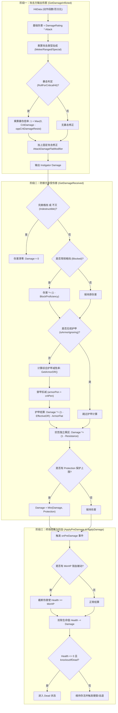

# TFTF 完整战斗伤害计算模型与抗性/破甲机制技术规范
# Combat Damage Calculation Pipeline, Armor Break & Resistance Mechanics

> **真理源参考 (Truth Source)**：
> - 客户端源码 (Decomp 3.1.0 C#):
>   - [`PlayerAttributes.cs`](file:///e:/Agent/TFTF310Revival/decomp_310_source/PlayerAttributes.cs) (核心属性、伤害结算与公式)
>   - [`DamageResistances.cs`](file:///e:/Agent/TFTF310Revival/decomp_310_source/DamageResistances.cs) (抗性字典与独立乘区)
>   - [`PlayerController.cs`](file:///e:/Agent/TFTF310Revival/decomp_310_source/PlayerController.cs) (战斗主流程、格挡、受击硬直与扣血)
>   - [`TuningGameplay.cs`](file:///e:/Agent/TFTF310Revival/decomp_310_source/TuningGameplay.cs) (全局战斗与数值平衡常数)
>   - [`ResistDamage_BuffEffect.cs`](file:///e:/Agent/TFTF310Revival/decomp_310_source/ResistDamage_BuffEffect.cs) (抗性 Buff/Debuff 实现)
>   - [`DamageType.cs`](file:///e:/Agent/TFTF310Revival/decomp_310_source/DamageType.cs) & [`DamageTypeTable.cs`](file:///e:/Agent/TFTF310Revival/decomp_310_source/DamageTypeTable.cs) (伤害属性标签)

---

## 目录
1. [核心结论与快速查阅](#1-核心结论与快速查阅)
2. [伤害计算完整管线架构 (Pipeline)](#2-伤害计算完整管线架构-pipeline)
3. [阶段一：攻击方输出伤害计算 (GetDamageInflicted)](#3-阶段一攻击方输出伤害计算-getdamageinflicted)
4. [阶段二：防御方承受伤害结算 (GetDamageReceived)](#4-阶段二防御方承受伤害结算-getdamagereceived)
   - 4.1 [格挡与完美格挡](#41-格挡与完美格挡)
   - 4.2 [护甲、破甲与穿甲计算 (GetArmorDR)](#42-护甲破甲与穿甲计算-getarmordr)
   - 4.3 [抗性系统与独立乘区 (DamageResistances)](#43-抗性系统与独立乘区-damageresistances)
   - 4.4 [伤害保护上限 (Protection)](#44-伤害保护上限-protection)
5. [阶段三：终局结算与生命扣除 (ApplyPreDamage & ApplyDamage)](#5-阶段三终局结算与生命扣除-applypredamage--applydamage)
6. [深度对比：破甲 (Armor Break) vs 抗性减益 (Resistance Debuff)](#6-深度对比破甲-armor-break-vs-抗性减益-resistance-debuff)
7. [实战数值演算与复合增伤推导](#7-实战数值演算与复合增伤推导)

---

## 1. 核心结论与快速查阅

1. **30% 抗性减益（Resistance Debuff）的本质**：
   - 在底层代码中，抗性乘数为 `num *= Mathf.Max(0f, 1f - Resistance)`。
   - 30% 抗性减益会将对应抗性设定/累加为 `-0.30`。
   - 代入公式得：`1f - (-0.30) = 1.30`。
   - **结论：30% 抗性减益 = 对应伤害类型的独立乘区直接放大 30%（即 1.3 倍伤害）。**

2. **破甲（Armor Break）与抗性减益（Resistance Debuff）的核心差异**：
   - **破甲是加算线性减免率**（`ArmorDR = BaseDR + ArmorUp - ArmorBreak`）：它直接削减敌人的护甲百分比。打高甲敌人时收益极大（相对增伤可达 60%~100%+）；打 0 甲敌人时会触发**负甲增伤**。
   - **抗性减益是独立乘算**（`Damage *= (1 - Resistance)`）：无论敌人原本有多少护甲，只要伤害类型匹配，都是恒定将最终伤害放大指定倍率。
   - **伤害属性依赖不同**：破甲对所有未免疫护甲的常规伤害生效；抗性减益严格按照伤害类型标签（如 `physical` 物理、`magic`/`energy` 能量）匹配，不符合属性的攻击完全不享受加成。

---

## 2. 伤害计算完整管线架构 (Pipeline)

每一次攻击命中在 `PlayerController.cs` 中经历的三大阶段：



---

## 3. 阶段一：攻击方输出伤害计算 (GetDamageInflicted)

源码位置：[`PlayerAttributes.cs#L530-L548`](file:///e:/Agent/TFTF310Revival/decomp_310_source/PlayerAttributes.cs#L530-L548)

```csharp
public float GetDamageInflicted(HitData hitData, bool criticalHit, DamageType damageType, float oppCritDamageResist, out float damageRating)
{
    float num = 0f;
    if (!hitData.FlatDamage)
    {
        float num2 = Mathf.Clamp01(hitData.Damage);
        damageRating = num2 * GetAttackPercent(hitData.AttackLevel);
        num = damageRating * GetAttackBonusMultiplier(hitData.AttackLevel, damageType) * Attack;
        if (criticalHit)
        {
            float critDamageMultiplier = GetCritDamageMultiplier(oppCritDamageResist);
            num *= critDamageMultiplier;
        }
        num += AttackDamageFlatModifier;
        return Mathf.Max(0f, num);
    }
    damageRating = 1f;
    return Mathf.Max(hitData.Damage, 0f);
}
```

### 3.1 招式百分比 (`GetAttackPercent`)
- **普通轻击、中击、重击**：从 `BCGAttackValue` 查找招式配置百分比；
- **特殊技 Special 1 / 2 / 3**：从蓝图读取 `Special1Damage`、`Special2Damage`、`Special3Damage`。

### 3.2 攻击类型加成倍率 (`GetAttackBonusMultiplier`)
源码位置：[`PlayerAttributes.cs#L698`](file:///e:/Agent/TFTF310Revival/decomp_310_source/PlayerAttributes.cs#L698)
```csharp
private float GetAttackBonusMultiplier(AttackLevel attackLevel, DamageType damageType)
{
    float num = 0f;
    if ((attackLevel & AttackLevel.Special) != 0)
    {
        num = _specialBonus.Get();
    }
    if (damageType.Contains("melee"))
    {
        num += _meleeBonus.Get();
    }
    if (damageType.Contains("ranged"))
    {
        num += _projectileBonus.Get();
    }
    return Mathf.Max(0f, 1f + num);
}
```
公式：
$$\text{AttackBonusMultiplier} = \max\left(0,\, 1 + \sum \text{Bonus}\right)$$

### 3.3 暴击率与暴击伤害
源码位置：[`PlayerAttributes.cs#L624-L638`](file:///e:/Agent/TFTF310Revival/decomp_310_source/PlayerAttributes.cs#L624-L638)
- **暴击率判定**：
  $$\text{CritChance} = \frac{\text{CritRating} - \text{OppCritRateResist}}{\text{CritRatingConstant\_A}} + \text{CritChanceModifier}$$
  *(全局常数 `CritRatingConstant_A` 默认值为 `111.0f`)*
- **暴击伤害倍率**：
  $$\text{CritDamageMultiplier} = 1 + \max\left(0,\, \text{CritDamage} - \text{OppCritDamageResist}\right)$$

---

## 4. 阶段二：防御方承受伤害结算 (GetDamageReceived)

源码位置：[`PlayerAttributes.cs#L550-L585`](file:///e:/Agent/TFTF310Revival/decomp_310_source/PlayerAttributes.cs#L550-L585)

### 4.1 格挡与完美格挡
1. **完美格挡 (Perfect Block)** 与 **不灭 (Indestructible)**：
   - 触发完美格挡（`Random.value < PerfectBlockChance` 且正处于格挡态）或角色处于 `Indestructible` 状态时，**伤害直接置 0**。
2. **普通格挡**：
   $$\text{Damage} = \text{Damage} \times (1 - \text{BlockProficiency})$$

---

### 4.2 护甲、破甲与穿甲计算 (GetArmorDR)

源码位置：[`PlayerAttributes.cs#L587-L594`](file:///e:/Agent/TFTF310Revival/decomp_310_source/PlayerAttributes.cs#L587-L594)

```csharp
public float GetArmorDR()
{
    float num = 0f;
    float num2 = _armorRating.Get();
    float num3 = TuningGameplay.Instance.ArmorRatingConstant; // 默认 200f
    num = ((!(num2 >= 0f)) ? (num2 / (0f - num2 + num3)) : (num2 / (num2 + num3)));
    return num + (ArmorUpModifier - ArmorBreakModifier);
}
```

#### 4.2.1 护甲减免率公式
- 当基础护甲评级 $\text{ArmorRating} \ge 0$ 时：
  $$\text{BaseArmorDR} = \frac{\text{ArmorRating}}{\text{ArmorRating} + 200}$$
- 当基础护甲评级 $\text{ArmorRating} < 0$ 时：
  $$\text{BaseArmorDR} = \frac{\text{ArmorRating}}{-\text{ArmorRating} + 200} = \frac{\text{ArmorRating}}{|\text{ArmorRating}| + 200}$$
- 最终护甲减免率：
  $$\text{TotalArmorDR} = \text{BaseArmorDR} + \text{ArmorUpModifier} - \text{ArmorBreakModifier}$$

> **重要特性**：
> `ArmorUpModifier`（护甲强化 Buff）与 `ArmorBreakModifier`（破甲 Debuff）是**直接线性加减减伤率**。
> 例如一个 30% 破甲 Debuff，会将 `ArmorBreakModifier` 增加 `0.30`，直接使最终护甲减免率减少 `0.30`（即 30% 的绝对免伤点数）。

#### 4.2.2 穿甲与暴击穿甲
源码逻辑：
```csharp
float value = ((!isCrit) ? armorPenetration : (armorPenetration + critPenetration));
value = Mathf.Clamp01(value);
if (num2 > 0f)
{
    num2 *= 1f - value;
}
damage *= 1f - num2;
damage = Mathf.Max(damage - ArmorFlat, 0f);
```
- **正护甲状态 ($\text{TotalArmorDR} > 0$)**：
  $$\text{EffectiveArmorDR} = \text{TotalArmorDR} \times \left(1 - \text{Clamp01}(\text{armorPen} + (\text{isCrit} ? \text{critPen} : 0))\right)$$
  穿甲按比例削弱敌人的正护甲。
- **负护甲状态 ($\text{TotalArmorDR} < 0$)**：
  `if (num2 > 0f)` 条件不成立，穿甲**不会**削弱负护甲！负护甲带来的伤害放大直接完整生效：
  $$\text{Damage} \times= (1 - \text{TotalArmorDR}) = (1 - (-|\text{TotalArmorDR}|)) = 1 + |\text{TotalArmorDR}|$$
- **固定减伤**：最后减去固定护甲减免 `ArmorFlat`：
  $$\text{Damage} = \max(0,\, \text{Damage} - \text{ArmorFlat})$$

---

### 4.3 抗性系统与独立乘区 (DamageResistances)

源码位置：[`DamageResistances.cs`](file:///e:/Agent/TFTF310Revival/decomp_310_source/DamageResistances.cs)

```csharp
public float GetResistanceMultiplier(DamageType damageType)
{
    float num = 1f;
    if (damageType != null)
    {
        HashSet<string>.Enumerator enumerator = damageType.GetEnumerator();
        while (enumerator.MoveNext())
        {
            string current = enumerator.Current;
            float num2 = Get(current);
            num *= Mathf.Max(0f, 1f - num2);
        }
    }
    return num;
}
```

#### 4.3.1 结算顺序
抗性乘区在护甲之后独立乘算：
```csharp
num = _damageResistances.GetResistanceMultiplier(damageType);
damage = num * damage;
```

#### 4.3.2 伤害类型标签机制
每个攻击都带有一组 `DamageType` 标签（例如 `["melee", "physical"]` 或 `["ranged", "energy"]`）：
- 目标身上的抗性表映射 `_resistanceMap` 会记录各种类型标签的抗性数值。
- 只有攻击的 `DamageType` 中包含了对应的标签，该抗性才会生效。
- 若命中攻击不包含该类型标签，乘数为 `1.0`，完全不产生作用。

#### 4.3.3 正抗性 vs 抗性减益
- **正抗性（Buff，如 +30% 物理抗性）**：
  `_resistanceMap.Add("physical", 0.3f)`（代码限制上限最多 `1.0`，即 100% 免疫）。
  乘数 = `1f - 0.30f = 0.70f`（受损减少 30%）。
- **抗性减益（Debuff，如 -30% 物理抗性）**：
  `_resistanceMap.Add("physical", -0.3f)`。
  乘数 = `1f - (-0.30f) = 1.30f`（**伤害直接放大 30%**）。

---

### 4.4 伤害保护上限 (Protection)
```csharp
if (Protection >= 0f)
{
    damage = Mathf.Min(damage, Protection);
}
```
用于威震天保留遗物等特殊机制：限制单次打击所能承受的最高伤害（如单次最多损失生命值上限的 10%）。

---

## 5. 阶段三：终局结算与生命扣除 (ApplyPreDamage & ApplyDamage)

源码位置：[`PlayerController.cs#L2164-L2185`](file:///e:/Agent/TFTF310Revival/decomp_310_source/PlayerController.cs#L2164-L2185)

```csharp
public float ApplyPreDamage(HitResultData result)
{
    StatModifierController.ApplyStatModifiers("onPreDamage", new BuffTriggerParams(result));
    float num = result.Damage;
    float minHP = Attributes.MinHP;
    if (minHP > 0f)
    {
        num = Mathf.Clamp(num, 0f, Attributes.Health - minHP);
    }
    return num;
}
```

1. **`onPreDamage` 事件触发**：允许触发诸如受击反伤、受击护盾等前置被动。
2. **`MinHP` 锁血截断**：若角色有保命被动（`MinHP > 0`），最终伤害被截断，确保生命值绝不会跌落到 `MinHP` 之下。
3. **`ApplyDamage` 扣减生命值**：
   - 扣除生命值并更新归一化血量（`NormalizedHealth`）。
   - 若血量归零且 `knockoutIfDead=true`，切换状态至 `Dead`。

---

## 6. 深度对比：破甲 (Armor Break) vs 抗性减益 (Resistance Debuff)

| 对比维度 | 破甲（Armor Break） | 抗性减益（Resistance Debuff） |
| :--- | :--- | :--- |
| **底层实现字段** | `PlayerAttributes._armorBreakModifier` | `DamageResistances._resistanceMap[type]` |
| **数学运算性质** | **加减算（线性增减减免率）**<br>`ArmorDR = BaseDR + ArmorUp - ArmorBreak` | **独立乘算（乘区倍率放大）**<br>`Damage *= (1 - Resistance)` |
| **伤害类型限定** | **通用**：对所有常规攻击均生效（只要未无视护甲） | **类型受限**：严格按照 `DamageType` 标签（如物理、能量、流血）匹配 |
| **打高护甲坦克收益** | **收益极大**：削减高免伤比例，相对增伤可达 60%~100%+ | **恒定收益**：在原有伤害基础上恒定放大 30% |
| **打零护甲脆皮收益** | **形成负甲**：`1 - (-0.30) = 1.30`，增伤 30% | **恒定收益**：直接放大 30% |
| **与“无视护甲”互动** | 攻击若具有 100% 穿甲或无视护甲，破甲效果被跳过 | 依然独立生效，稳稳放大 30% 伤害 |
| **与敌方抗性 Buff 互动**| 无法削减敌人的属性抗性 | 能直接抵消/穿透敌人的抗性 Buff |

---

## 7. 实战数值演算与复合增伤推导

假设某攻击命中后，阶段一算出的输出基础伤害为 **1000**：

### 演算 A：打高护甲重装战士（基础护甲免伤 50%，即 `ArmorDR = 0.50`）
1. **无任何 Debuff**：
   $$\text{Damage} = 1000 \times (1 - 0.50) = 500$$
2. **仅施加 30% 破甲 (Armor Break)**：
   $$\text{新 ArmorDR} = 0.50 - 0.30 = 0.20$$
   $$\text{Damage} = 1000 \times (1 - 0.20) = 800$$
   $$\text{相对原始伤害提升} = \frac{800 - 500}{500} = \mathbf{+60\%}$$
3. **仅施加 30% 抗性减益 (Resistance Debuff)**：
   $$\text{Damage} = 500 \times (1 - (-0.30)) = 500 \times 1.30 = 650$$
   $$\text{相对原始伤害提升} = \frac{650 - 500}{500} = \mathbf{+30\%}$$
4. **复合叠加（30% 破甲 + 30% 对应抗性减益）**：
   $$\text{Damage} = 1000 \times (1 - 0.20) \times 1.30 = 800 \times 1.30 = 1040$$
   $$\text{相对原始伤害提升} = \frac{1040 - 500}{500} = \mathbf{+108\%}\text{（伤害翻倍！）}$$

---

### 演算 B：打零护甲脆皮机器人（`ArmorDR = 0.00`）
1. **无任何 Debuff**：
   $$\text{Damage} = 1000 \times (1 - 0) = 1000$$
2. **仅施加 30% 破甲**：
   $$\text{新 ArmorDR} = 0 - 0.30 = -0.30\text{（打出负甲）}$$
   $$\text{Damage} = 1000 \times (1 - (-0.30)) = 1300\text{（提升 30%）}$$
3. **仅施加 30% 抗性减益**：
   $$\text{Damage} = 1000 \times (1 - (-0.30)) = 1300\text{（提升 30%）}$$

---

### 核心开发建议
- 开发角色技能或 Mod 时，如果希望该角色成为**重装克星/坦克杀手**，优先配置 **破甲（`armor_break`）**；
- 如果希望该角色获得**泛用、稳定、可穿透护盾/无视护甲的独立增伤**，优先配置 **对应攻击类型的抗性减益（`resist_<dmg_type>`）**；
- 若角色能同时施加破甲与抗性减益，二者将产生极具破坏力的**复合乘算增伤**。
